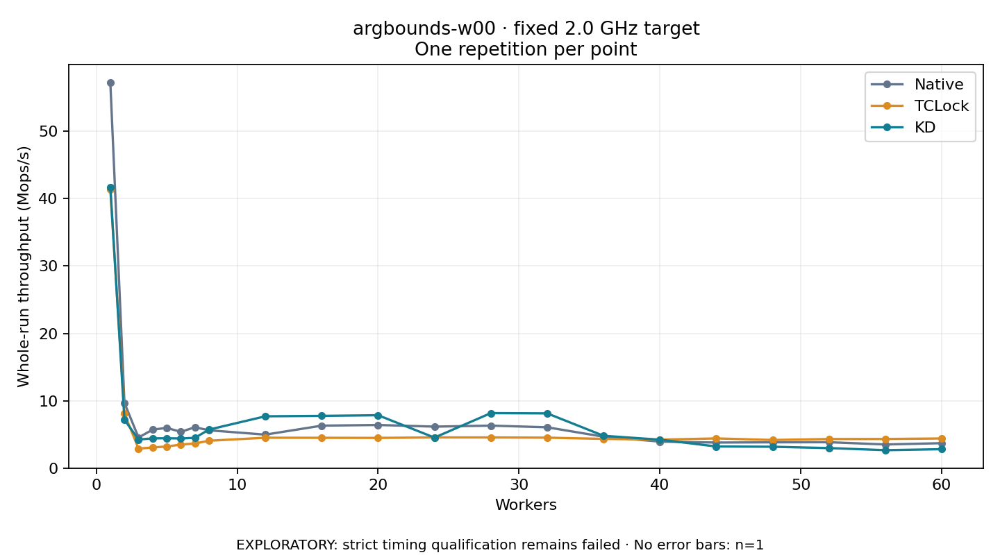

# argbounds-w00 · fixed 2.0 GHz target

One timed round per point. **EXPLORATORY: strict timing qualification remains failed.** Failed/unrun points have no rate; one round supplies no repeat-variability estimate.

| Workers | Native Mops/s | TCLock Mops/s | KD Mops/s | KD / Native | KD / TCLock | KD execution |
|---:|---:|---:|---:|---:|---:|:---|
| 1 | 57.169 | 41.314 | 41.682 | 0.729× | 1.009× | NO_JIT |
| 2 | 9.667 | 8.081 | 7.181 | 0.743× | 0.889× | NO_JIT |
| 3 | 4.544 | 2.888 | 4.241 | 0.933× | 1.468× | NO_JIT |
| 4 | 5.705 | 3.064 | 4.415 | 0.774× | 1.441× | NO_JIT |
| 5 | 5.975 | 3.207 | 4.432 | 0.742× | 1.382× | NO_JIT |
| 6 | 5.383 | 3.491 | 4.403 | 0.818× | 1.261× | NO_JIT |
| 7 | 6.064 | 3.657 | 4.491 | 0.741× | 1.228× | NO_JIT |
| 8 | 5.613 | 4.060 | 5.716 | 1.018× | 1.408× | RETURNED_JIT |
| 12 | 4.968 | 4.512 | 7.690 | 1.548× | 1.704× | RETURNED_JIT |
| 16 | 6.301 | 4.499 | 7.753 | 1.230× | 1.724× | RETURNED_JIT |
| 20 | 6.401 | 4.484 | 7.847 | 1.226× | 1.750× | RETURNED_JIT |
| 24 | 6.157 | 4.554 | 4.529 | 0.736× | 0.994× | NO_JIT |
| 28 | 6.306 | 4.551 | 8.159 | 1.294× | 1.793× | RETURNED_JIT |
| 32 | 6.058 | 4.519 | 8.123 | 1.341× | 1.798× | RETURNED_JIT |
| 36 | 4.661 | 4.340 | 4.799 | 1.030× | 1.106× | RETURNED_JIT |
| 40 | 3.932 | 4.222 | 4.222 | 1.074× | 1.000× | RETURNED_JIT |
| 44 | 3.794 | 4.408 | 3.212 | 0.847× | 0.729× | RETURNED_JIT |
| 48 | 3.830 | 4.175 | 3.171 | 0.828× | 0.760× | RETURNED_JIT |
| 52 | 3.845 | 4.319 | 2.974 | 0.774× | 0.689× | NO_JIT |
| 56 | 3.508 | 4.324 | 2.663 | 0.759× | 0.616× | RETURNED_JIT |
| 60 | 3.702 | 4.402 | 2.808 | 0.758× | 0.638× | RETURNED_JIT |

[Full-precision table](table.csv)

Frozen source: `a9aeb280a68242818aa469d8277e0c5a22fffee1`. [Archive hashes, frozen-validator replay and exact lifecycle checks](audit.json). Measured points: **63**; failed: **0**; unrun: **0**. Failed/unrun points have no throughput value. The full raw archive remains the primary receipt; compact JSON copies stay under the raw audit path.

Whole-run throughput is completed operations divided by the recorded wall interval; peak rates use the frozen full-cohort progress-window validator. Reciprocal throughput is an aggregate service interval, not operation latency. Returned completion share counts eligible writer operations (snapshot reads for the extracted snapshot cases). NO_JIT points are local execution evidence. One observation cannot establish statistical superiority.

Frequency readbacks are bound before/after this workload. Fixed frequency does not repair the separately failed strict host task-membership gate. Exact output checks and drain validate the retained execution; offline replay does not rerun kernel bodies or syscalls.

Frozen score-ineligible observations, if any, retain their separately labeled raw rate in the CSV and are excluded from the ordinary chart and ratios. Valid NO_JIT observations remain plotted.
