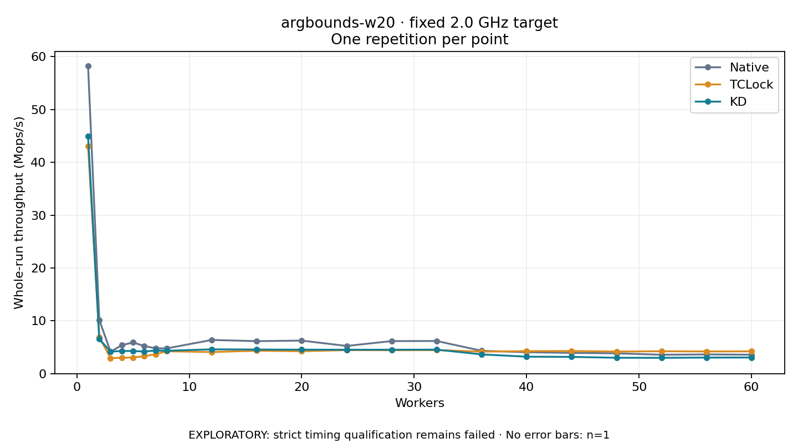

# argbounds-w20 · fixed 2.0 GHz target

One timed round per point. **EXPLORATORY: strict timing qualification remains failed.** Failed/unrun points have no rate; one round supplies no repeat-variability estimate.

| Workers | Native Mops/s | TCLock Mops/s | KD Mops/s | KD / Native | KD / TCLock | KD execution |
|---:|---:|---:|---:|---:|---:|:---|
| 1 | 58.217 | 43.045 | 44.907 | 0.771× | 1.043× | NO_JIT |
| 2 | 10.154 | 6.911 | 6.545 | 0.645× | 0.947× | NO_JIT |
| 3 | 4.148 | 2.940 | 4.174 | 1.006× | 1.419× | NO_JIT |
| 4 | 5.384 | 3.002 | 4.292 | 0.797× | 1.429× | NO_JIT |
| 5 | 5.900 | 3.064 | 4.283 | 0.726× | 1.398× | NO_JIT |
| 6 | 5.234 | 3.294 | 4.196 | 0.802× | 1.274× | NO_JIT |
| 7 | 4.791 | 3.685 | 4.370 | 0.912× | 1.186× | NO_JIT |
| 8 | 4.783 | 4.239 | 4.336 | 0.907× | 1.023× | RETURNED_JIT |
| 12 | 6.379 | 4.090 | 4.602 | 0.721× | 1.125× | RETURNED_JIT |
| 16 | 6.153 | 4.334 | 4.565 | 0.742× | 1.053× | RETURNED_JIT |
| 20 | 6.257 | 4.250 | 4.539 | 0.725× | 1.068× | RETURNED_JIT |
| 24 | 5.243 | 4.453 | 4.528 | 0.864× | 1.017× | NO_JIT |
| 28 | 6.162 | 4.432 | 4.531 | 0.735× | 1.022× | RETURNED_JIT |
| 32 | 6.181 | 4.453 | 4.546 | 0.735× | 1.021× | NO_JIT |
| 36 | 4.325 | 4.165 | 3.642 | 0.842× | 0.874× | NO_JIT |
| 40 | 4.058 | 4.263 | 3.212 | 0.791× | 0.754× | NO_JIT |
| 44 | 3.926 | 4.281 | 3.173 | 0.808× | 0.741× | RETURNED_JIT |
| 48 | 3.847 | 4.185 | 3.007 | 0.782× | 0.718× | RETURNED_JIT |
| 52 | 3.579 | 4.236 | 2.997 | 0.837× | 0.708× | NO_JIT |
| 56 | 3.637 | 4.202 | 3.042 | 0.836× | 0.724× | RETURNED_JIT |
| 60 | 3.588 | 4.222 | 3.058 | 0.852× | 0.724× | NO_JIT |

[Full-precision table](table.csv)

Frozen source: `a9aeb280a68242818aa469d8277e0c5a22fffee1`. [Archive hashes, frozen-validator replay and exact lifecycle checks](audit.json). Measured points: **63**; failed: **0**; unrun: **0**. Failed/unrun points have no throughput value. The full raw archive remains the primary receipt; compact JSON copies stay under the raw audit path.

Whole-run throughput is completed operations divided by the recorded wall interval; peak rates use the frozen full-cohort progress-window validator. Reciprocal throughput is an aggregate service interval, not operation latency. Returned completion share counts eligible writer operations (snapshot reads for the extracted snapshot cases). NO_JIT points are local execution evidence. One observation cannot establish statistical superiority.

Frequency readbacks are bound before/after this workload. Fixed frequency does not repair the separately failed strict host task-membership gate. Exact output checks and drain validate the retained execution; offline replay does not rerun kernel bodies or syscalls.

Frozen score-ineligible observations, if any, retain their separately labeled raw rate in the CSV and are excluded from the ordinary chart and ratios. Valid NO_JIT observations remain plotted.
