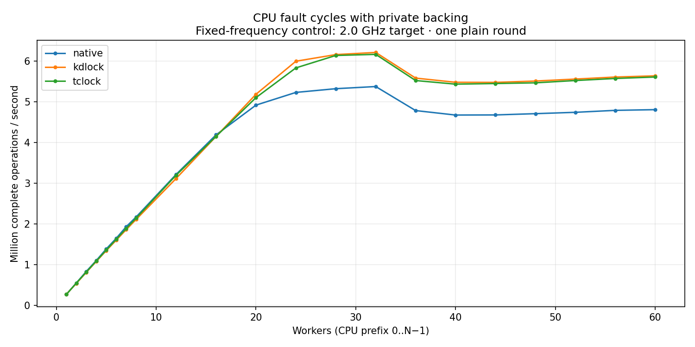

# CPU fault cycles with private backing — fixed 2.0 GHz target

MADV_DONTNEED plus checked CPU read, including PTE reset. Native, KD and TCLock backing readers execute locally on the original task; this is not shared-mm writer delegation. Kernel `6.1.159-kdclobber2` (Build ID `5ca28058e156f34a2c7fe91e8e0fbf92f4e51960`); source `a9aeb280a68242818aa469d8277e0c5a22fffee1`.

Exactly one plain round per point. All 64 host policies request performance with min=max=2.0 GHz and turbo disabled, verified at captured endpoints. This is a separate campaign; endpoint settings do not prove instantaneous frequency for every operation. Strict host timing qualification is failed; auxiliary QEMU workers use CPU 63. No variance estimate or latency samples. Rates use complete operations divided by whole wall time. Missing optional positive-cohort peak windows do not invalidate exact aggregate accounting or drain.

[CSV](table.csv) · [SVG](throughput.svg)

| Workers | native Mops/s | kdlock Mops/s | tclock Mops/s |
| --- | ---: | ---: | ---: |
| 1 | 0.276570 | 0.276654 | 0.272037 |
| 2 | 0.554552 | 0.543714 | 0.552130 |
| 3 | 0.838588 | 0.815291 | 0.822865 |
| 4 | 1.105758 | 1.082368 | 1.092858 |
| 5 | 1.389829 | 1.348905 | 1.362293 |
| 6 | 1.650972 | 1.605127 | 1.625854 |
| 7 | 1.936014 | 1.864040 | 1.890994 |
| 8 | 2.175957 | 2.115592 | 2.146973 |
| 12 | 3.218312 | 3.118301 | 3.199053 |
| 16 | 4.188841 | 4.148941 | 4.151329 |
| 20 | 4.918153 | 5.184700 | 5.102352 |
| 24 | 5.230011 | 5.995192 | 5.831776 |
| 28 | 5.321395 | 6.158193 | 6.136786 |
| 32 | 5.373991 | 6.210669 | 6.163577 |
| 36 | 4.784187 | 5.581176 | 5.521214 |
| 40 | 4.674331 | 5.478450 | 5.432753 |
| 44 | 4.677496 | 5.475930 | 5.448195 |
| 48 | 4.708427 | 5.509039 | 5.465386 |
| 52 | 4.741465 | 5.557229 | 5.521418 |
| 56 | 4.789577 | 5.606960 | 5.572332 |
| 60 | 4.806777 | 5.636317 | 5.607596 |
