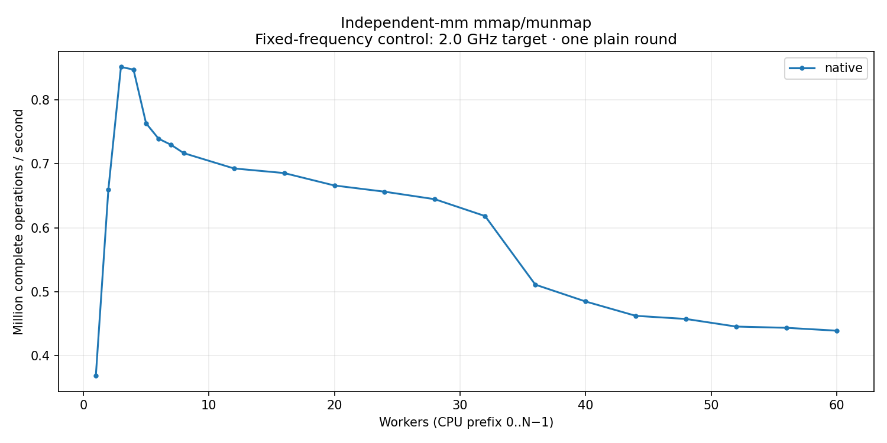

# Independent-mm mmap/munmap — fixed 2.0 GHz target

Native mmap/munmap without page access; independent address spaces. No backing-lock operation. Kernel `6.1.159-kdclobber2` (Build ID `5ca28058e156f34a2c7fe91e8e0fbf92f4e51960`); source `a9aeb280a68242818aa469d8277e0c5a22fffee1`.

Exactly one plain round per point. All 64 host policies request performance with min=max=2.0 GHz and turbo disabled, verified at captured endpoints. This is a separate campaign; endpoint settings do not prove instantaneous frequency for every operation. Strict host timing qualification is failed; auxiliary QEMU workers use CPU 63. No variance estimate or latency samples. Rates use complete operations divided by whole wall time. Missing optional positive-cohort peak windows do not invalidate exact aggregate accounting or drain.

[CSV](table.csv) · [SVG](throughput.svg)

| Workers | native Mops/s |
| --- | ---: |
| 1 | 0.368511 |
| 2 | 0.660018 |
| 3 | 0.851442 |
| 4 | 0.847358 |
| 5 | 0.763431 |
| 6 | 0.739259 |
| 7 | 0.729666 |
| 8 | 0.716752 |
| 12 | 0.692815 |
| 16 | 0.685594 |
| 20 | 0.666176 |
| 24 | 0.656467 |
| 28 | 0.644696 |
| 32 | 0.618380 |
| 36 | 0.511191 |
| 40 | 0.484886 |
| 44 | 0.462434 |
| 48 | 0.457546 |
| 52 | 0.445630 |
| 56 | 0.443716 |
| 60 | 0.439226 |
