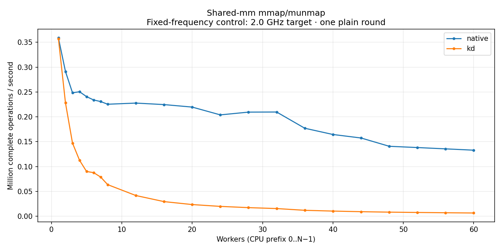

# Shared-mm mmap/munmap — fixed 2.0 GHz target

Actual mmap/munmap in one shared address space on installed `6.1.159-kdmm31` (Build ID `ef5179e8def44f0255adcd62585f62f118fee30f`). Native uses `kd_mmap=off`; KD uses `kd_mmap=on`. Native MM bodies run on their original task; the installed kernel retains its own historical source identity, separately from the current controller. Each point keeps the 90-second post-setup interval. These are exploratory aggregate controls, not an accepted paired campaign. Controller source `a9aeb280a68242818aa469d8277e0c5a22fffee1`; unchanged timed client SHA-256 `5962210671ac238ae4df8dcca442b3cb7407efb2b5b2edb42ae637ac4902083f`. The explicit frequency comparison changes only cpufreq; original receipts remain unchanged.

Exactly one plain round per point. All 64 host policies request performance with min=max=2.0 GHz and turbo disabled, verified at captured endpoints. This is a separate campaign; endpoint settings do not prove instantaneous frequency for every operation. Strict host timing qualification is failed; auxiliary QEMU workers use CPU 63. No variance estimate or latency samples. Rates use complete operations divided by whole wall time. Missing optional positive-cohort peak windows do not invalidate exact aggregate accounting or drain.

[CSV](table.csv) · [SVG](throughput.svg)

| Workers | native Mops/s | kd Mops/s |
| --- | ---: | ---: |
| 1 | 0.358803 | 0.357066 |
| 2 | 0.291214 | 0.228142 |
| 3 | 0.248414 | 0.147107 |
| 4 | 0.250515 | 0.112509 |
| 5 | 0.240618 | 0.089953 |
| 6 | 0.233958 | 0.087705 |
| 7 | 0.230745 | 0.078764 |
| 8 | 0.225347 | 0.063507 |
| 12 | 0.227676 | 0.041597 |
| 16 | 0.224643 | 0.029356 |
| 20 | 0.219632 | 0.023421 |
| 24 | 0.203919 | 0.019724 |
| 28 | 0.209485 | 0.017235 |
| 32 | 0.209686 | 0.015371 |
| 36 | 0.177032 | 0.011859 |
| 40 | 0.164459 | 0.010290 |
| 44 | 0.157392 | 0.009067 |
| 48 | 0.140717 | 0.008151 |
| 52 | 0.138169 | 0.007512 |
| 56 | 0.135530 | 0.006935 |
| 60 | 0.132874 | 0.006442 |
