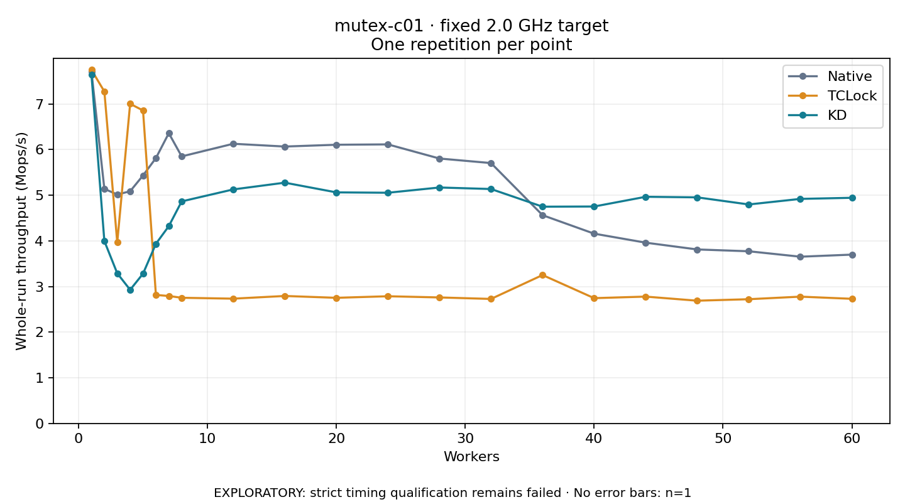

# mutex-c01 · fixed 2.0 GHz target

One timed round per point. **EXPLORATORY: strict timing qualification remains failed.** Failed/unrun points have no rate; one round supplies no repeat-variability estimate.

| Workers | Native Mops/s | TCLock Mops/s | KD Mops/s | KD / Native | KD / TCLock | KD execution |
|---:|---:|---:|---:|---:|---:|:---|
| 1 | 7.704 | 7.745 | 7.637 | 0.991× | 0.986× | NO_JIT |
| 2 | 5.140 | 7.272 | 3.996 | 0.777× | 0.549× | NO_JIT |
| 3 | 5.015 | 3.966 | 3.289 | 0.656× | 0.829× | RETURNED_JIT |
| 4 | 5.086 | 7.003 | 2.927 | 0.576× | 0.418× | RETURNED_JIT |
| 5 | 5.432 | 6.856 | 3.280 | 0.604× | 0.478× | RETURNED_JIT |
| 6 | 5.813 | 2.815 | 3.935 | 0.677× | 1.398× | RETURNED_JIT |
| 7 | 6.358 | 2.792 | 4.322 | 0.680× | 1.548× | RETURNED_JIT |
| 8 | 5.850 | 2.753 | 4.865 | 0.832× | 1.767× | RETURNED_JIT |
| 12 | 6.127 | 2.733 | 5.127 | 0.837× | 1.876× | RETURNED_JIT |
| 16 | 6.066 | 2.792 | 5.275 | 0.870× | 1.889× | RETURNED_JIT |
| 20 | 6.106 | 2.752 | 5.062 | 0.829× | 1.840× | RETURNED_JIT |
| 24 | 6.113 | 2.786 | 5.054 | 0.827× | 1.814× | RETURNED_JIT |
| 28 | 5.804 | 2.760 | 5.169 | 0.891× | 1.873× | RETURNED_JIT |
| 32 | 5.704 | 2.727 | 5.136 | 0.900× | 1.883× | RETURNED_JIT |
| 36 | 4.562 | 3.251 | 4.749 | 1.041× | 1.461× | RETURNED_JIT |
| 40 | 4.157 | 2.744 | 4.752 | 1.143× | 1.732× | RETURNED_JIT |
| 44 | 3.960 | 2.778 | 4.965 | 1.254× | 1.787× | RETURNED_JIT |
| 48 | 3.811 | 2.689 | 4.953 | 1.300× | 1.842× | RETURNED_JIT |
| 52 | 3.772 | 2.721 | 4.797 | 1.272× | 1.763× | RETURNED_JIT |
| 56 | 3.653 | 2.777 | 4.919 | 1.347× | 1.771× | RETURNED_JIT |
| 60 | 3.698 | 2.730 | 4.943 | 1.337× | 1.811× | RETURNED_JIT |

[Full-precision table](table.csv)

Frozen source: `a9aeb280a68242818aa469d8277e0c5a22fffee1`. [Archive hashes, frozen-validator replay and exact lifecycle checks](audit.json). Measured points: **63**; failed: **0**; unrun: **0**. Failed/unrun points have no throughput value. The full raw archive remains the primary receipt; compact JSON copies stay under the raw audit path.

Whole-run throughput is completed operations divided by the recorded wall interval; peak rates use the frozen full-cohort progress-window validator. Reciprocal throughput is an aggregate service interval, not operation latency. Returned completion share counts eligible writer operations (snapshot reads for the extracted snapshot cases). NO_JIT points are local execution evidence. One observation cannot establish statistical superiority.

Frequency readbacks are bound before/after this workload. Fixed frequency does not repair the separately failed strict host task-membership gate. Exact output checks and drain validate the retained execution; offline replay does not rerun kernel bodies or syscalls.

Frozen score-ineligible observations, if any, retain their separately labeled raw rate in the CSV and are excluded from the ordinary chart and ratios. Valid NO_JIT observations remain plotted.
