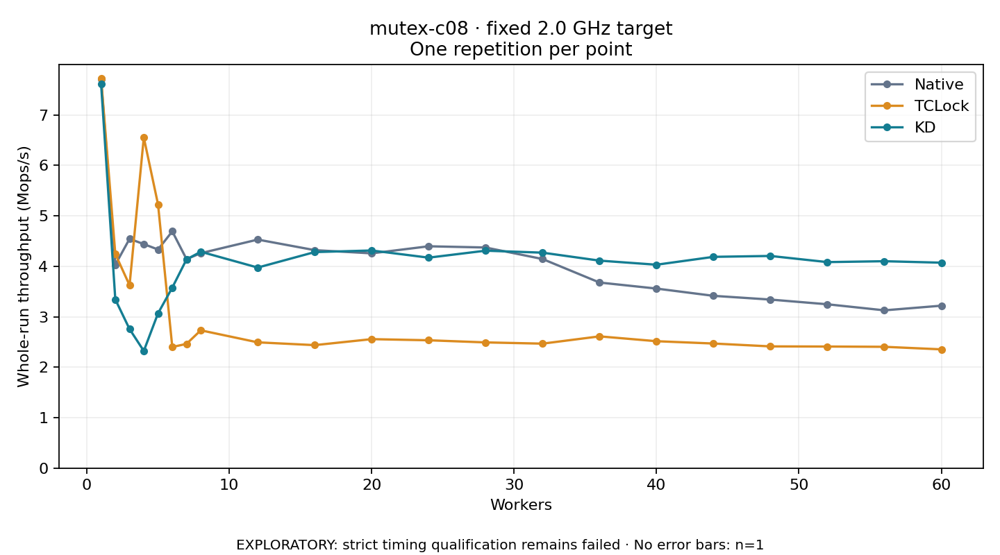

# mutex-c08 · fixed 2.0 GHz target

One timed round per point. **EXPLORATORY: strict timing qualification remains failed.** Failed/unrun points have no rate; one round supplies no repeat-variability estimate.

| Workers | Native Mops/s | TCLock Mops/s | KD Mops/s | KD / Native | KD / TCLock | KD execution |
|---:|---:|---:|---:|---:|---:|:---|
| 1 | 7.707 | 7.726 | 7.619 | 0.989× | 0.986× | NO_JIT |
| 2 | 4.030 | 4.243 | 3.342 | 0.829× | 0.788× | NO_JIT |
| 3 | 4.543 | 3.624 | 2.755 | 0.606× | 0.760× | RETURNED_JIT |
| 4 | 4.439 | 6.552 | 2.322 | 0.523× | 0.354× | RETURNED_JIT |
| 5 | 4.331 | 5.226 | 3.067 | 0.708× | 0.587× | RETURNED_JIT |
| 6 | 4.691 | 2.399 | 3.576 | 0.762× | 1.490× | RETURNED_JIT |
| 7 | 4.141 | 2.462 | 4.135 | 0.999× | 1.680× | RETURNED_JIT |
| 8 | 4.258 | 2.730 | 4.287 | 1.007× | 1.570× | RETURNED_JIT |
| 12 | 4.528 | 2.492 | 3.974 | 0.878× | 1.595× | RETURNED_JIT |
| 16 | 4.319 | 2.437 | 4.281 | 0.991× | 1.757× | RETURNED_JIT |
| 20 | 4.255 | 2.556 | 4.312 | 1.013× | 1.687× | RETURNED_JIT |
| 24 | 4.395 | 2.533 | 4.170 | 0.949× | 1.646× | RETURNED_JIT |
| 28 | 4.371 | 2.491 | 4.308 | 0.986× | 1.730× | RETURNED_JIT |
| 32 | 4.143 | 2.466 | 4.269 | 1.030× | 1.731× | RETURNED_JIT |
| 36 | 3.677 | 2.611 | 4.111 | 1.118× | 1.575× | RETURNED_JIT |
| 40 | 3.557 | 2.515 | 4.030 | 1.133× | 1.603× | RETURNED_JIT |
| 44 | 3.414 | 2.469 | 4.186 | 1.226× | 1.696× | RETURNED_JIT |
| 48 | 3.340 | 2.412 | 4.204 | 1.259× | 1.743× | RETURNED_JIT |
| 52 | 3.246 | 2.409 | 4.082 | 1.257× | 1.694× | RETURNED_JIT |
| 56 | 3.126 | 2.404 | 4.100 | 1.311× | 1.706× | RETURNED_JIT |
| 60 | 3.218 | 2.353 | 4.070 | 1.265× | 1.730× | RETURNED_JIT |

[Full-precision table](table.csv)

Frozen source: `a9aeb280a68242818aa469d8277e0c5a22fffee1`. [Archive hashes, frozen-validator replay and exact lifecycle checks](audit.json). Measured points: **63**; failed: **0**; unrun: **0**. Failed/unrun points have no throughput value. The full raw archive remains the primary receipt; compact JSON copies stay under the raw audit path.

Whole-run throughput is completed operations divided by the recorded wall interval; peak rates use the frozen full-cohort progress-window validator. Reciprocal throughput is an aggregate service interval, not operation latency. Returned completion share counts eligible writer operations (snapshot reads for the extracted snapshot cases). NO_JIT points are local execution evidence. One observation cannot establish statistical superiority.

Frequency readbacks are bound before/after this workload. Fixed frequency does not repair the separately failed strict host task-membership gate. Exact output checks and drain validate the retained execution; offline replay does not rerun kernel bodies or syscalls.

Frozen score-ineligible observations, if any, retain their separately labeled raw rate in the CSV and are excluded from the ordinary chart and ratios. Valid NO_JIT observations remain plotted.
