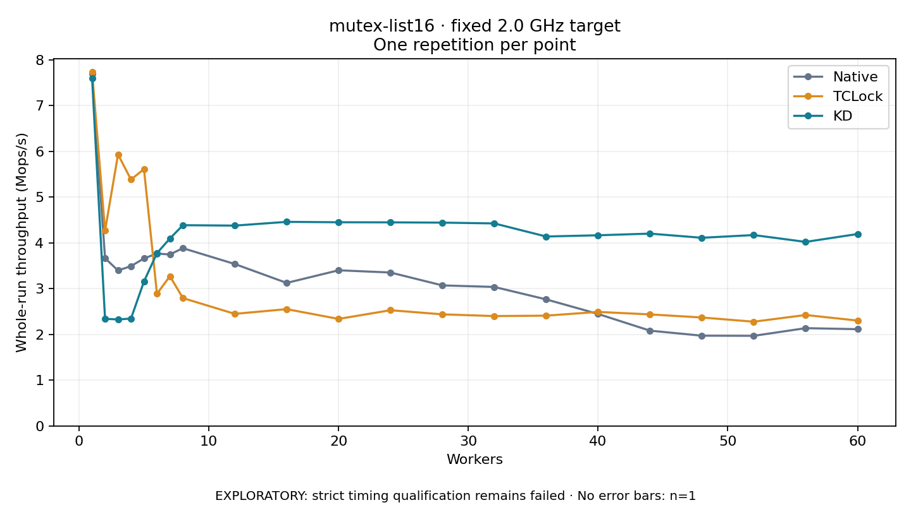

# mutex-list16 · fixed 2.0 GHz target

One timed round per point. **EXPLORATORY: strict timing qualification remains failed.** Failed/unrun points have no rate; one round supplies no repeat-variability estimate.

| Workers | Native Mops/s | TCLock Mops/s | KD Mops/s | KD / Native | KD / TCLock | KD execution |
|---:|---:|---:|---:|---:|---:|:---|
| 1 | 7.697 | 7.739 | 7.603 | 0.988× | 0.982× | NO_JIT |
| 2 | 3.666 | 4.268 | 2.342 | 0.639× | 0.549× | RETURNED_JIT |
| 3 | 3.399 | 5.935 | 2.328 | 0.685× | 0.392× | RETURNED_JIT |
| 4 | 3.494 | 5.386 | 2.348 | 0.672× | 0.436× | RETURNED_JIT |
| 5 | 3.662 | 5.615 | 3.158 | 0.862× | 0.562× | RETURNED_JIT |
| 6 | 3.768 | 2.888 | 3.777 | 1.002× | 1.308× | RETURNED_JIT |
| 7 | 3.749 | 3.274 | 4.097 | 1.093× | 1.251× | RETURNED_JIT |
| 8 | 3.886 | 2.795 | 4.389 | 1.129× | 1.570× | RETURNED_JIT |
| 12 | 3.540 | 2.450 | 4.380 | 1.237× | 1.787× | RETURNED_JIT |
| 16 | 3.127 | 2.553 | 4.461 | 1.427× | 1.747× | RETURNED_JIT |
| 20 | 3.403 | 2.340 | 4.453 | 1.309× | 1.903× | RETURNED_JIT |
| 24 | 3.354 | 2.530 | 4.451 | 1.327× | 1.759× | RETURNED_JIT |
| 28 | 3.072 | 2.440 | 4.445 | 1.447× | 1.822× | RETURNED_JIT |
| 32 | 3.039 | 2.402 | 4.427 | 1.457× | 1.843× | RETURNED_JIT |
| 36 | 2.767 | 2.411 | 4.141 | 1.497× | 1.718× | RETURNED_JIT |
| 40 | 2.448 | 2.493 | 4.168 | 1.702× | 1.672× | RETURNED_JIT |
| 44 | 2.083 | 2.438 | 4.204 | 2.018× | 1.724× | RETURNED_JIT |
| 48 | 1.973 | 2.371 | 4.113 | 2.085× | 1.735× | RETURNED_JIT |
| 52 | 1.970 | 2.279 | 4.173 | 2.118× | 1.831× | RETURNED_JIT |
| 56 | 2.137 | 2.425 | 4.023 | 1.882× | 1.659× | RETURNED_JIT |
| 60 | 2.115 | 2.303 | 4.196 | 1.983× | 1.822× | RETURNED_JIT |

[Full-precision table](table.csv)

Frozen source: `a9aeb280a68242818aa469d8277e0c5a22fffee1`. [Archive hashes, frozen-validator replay and exact lifecycle checks](audit.json). Measured points: **63**; failed: **0**; unrun: **0**. Failed/unrun points have no throughput value. The full raw archive remains the primary receipt; compact JSON copies stay under the raw audit path.

Whole-run throughput is completed operations divided by the recorded wall interval; peak rates use the frozen full-cohort progress-window validator. Reciprocal throughput is an aggregate service interval, not operation latency. Returned completion share counts eligible writer operations (snapshot reads for the extracted snapshot cases). NO_JIT points are local execution evidence. One observation cannot establish statistical superiority.

Frequency readbacks are bound before/after this workload. Fixed frequency does not repair the separately failed strict host task-membership gate. Exact output checks and drain validate the retained execution; offline replay does not rerun kernel bodies or syscalls.

Frozen score-ineligible observations, if any, retain their separately labeled raw rate in the CSV and are excluded from the ordinary chart and ratios. Valid NO_JIT observations remain plotted.
