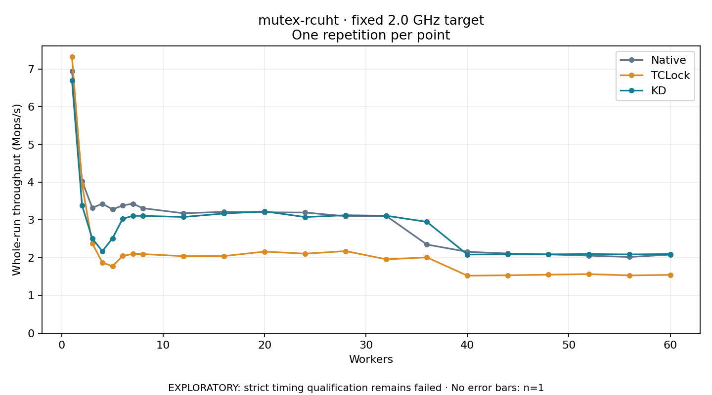

# mutex-rcuht · fixed 2.0 GHz target

One timed round per point. **EXPLORATORY: strict timing qualification remains failed.** Failed/unrun points have no rate; one round supplies no repeat-variability estimate.

| Workers | Native Mops/s | TCLock Mops/s | KD Mops/s | KD / Native | KD / TCLock | KD execution |
|---:|---:|---:|---:|---:|---:|:---|
| 1 | 6.944 | 7.320 | 6.693 | 0.964× | 0.914× | NO_JIT |
| 2 | 4.029 | 3.933 | 3.379 | 0.839× | 0.859× | NO_JIT |
| 3 | 3.322 | 2.381 | 2.509 | 0.755× | 1.054× | RETURNED_JIT |
| 4 | 3.429 | 1.871 | 2.171 | 0.633× | 1.160× | RETURNED_JIT |
| 5 | 3.281 | 1.772 | 2.515 | 0.767× | 1.419× | RETURNED_JIT |
| 6 | 3.383 | 2.047 | 3.030 | 0.896× | 1.480× | RETURNED_JIT |
| 7 | 3.431 | 2.098 | 3.109 | 0.906× | 1.482× | RETURNED_JIT |
| 8 | 3.310 | 2.095 | 3.108 | 0.939× | 1.483× | RETURNED_JIT |
| 12 | 3.177 | 2.040 | 3.079 | 0.969× | 1.509× | RETURNED_JIT |
| 16 | 3.214 | 2.043 | 3.169 | 0.986× | 1.551× | RETURNED_JIT |
| 20 | 3.202 | 2.161 | 3.226 | 1.007× | 1.493× | RETURNED_JIT |
| 24 | 3.196 | 2.106 | 3.076 | 0.963× | 1.461× | RETURNED_JIT |
| 28 | 3.099 | 2.174 | 3.124 | 1.008× | 1.437× | RETURNED_JIT |
| 32 | 3.105 | 1.957 | 3.111 | 1.002× | 1.590× | RETURNED_JIT |
| 36 | 2.348 | 2.008 | 2.950 | 1.256× | 1.469× | RETURNED_JIT |
| 40 | 2.155 | 1.523 | 2.082 | 0.966× | 1.367× | RETURNED_JIT |
| 44 | 2.110 | 1.533 | 2.093 | 0.992× | 1.365× | RETURNED_JIT |
| 48 | 2.086 | 1.550 | 2.088 | 1.001× | 1.348× | RETURNED_JIT |
| 52 | 2.053 | 1.564 | 2.096 | 1.021× | 1.339× | RETURNED_JIT |
| 56 | 2.018 | 1.530 | 2.087 | 1.034× | 1.364× | RETURNED_JIT |
| 60 | 2.080 | 1.544 | 2.095 | 1.007× | 1.357× | RETURNED_JIT |

[Full-precision table](table.csv)

Frozen source: `a9aeb280a68242818aa469d8277e0c5a22fffee1`. [Archive hashes, frozen-validator replay and exact lifecycle checks](audit.json). Measured points: **63**; failed: **0**; unrun: **0**. Failed/unrun points have no throughput value. The full raw archive remains the primary receipt; compact JSON copies stay under the raw audit path.

Whole-run throughput is completed operations divided by the recorded wall interval; peak rates use the frozen full-cohort progress-window validator. Reciprocal throughput is an aggregate service interval, not operation latency. Returned completion share counts eligible writer operations (snapshot reads for the extracted snapshot cases). NO_JIT points are local execution evidence. One observation cannot establish statistical superiority.

Frequency readbacks are bound before/after this workload. Fixed frequency does not repair the separately failed strict host task-membership gate. Exact output checks and drain validate the retained execution; offline replay does not rerun kernel bodies or syscalls.

Frozen score-ineligible observations, if any, retain their separately labeled raw rate in the CSV and are excluded from the ordinary chart and ratios. Valid NO_JIT observations remain plotted.
