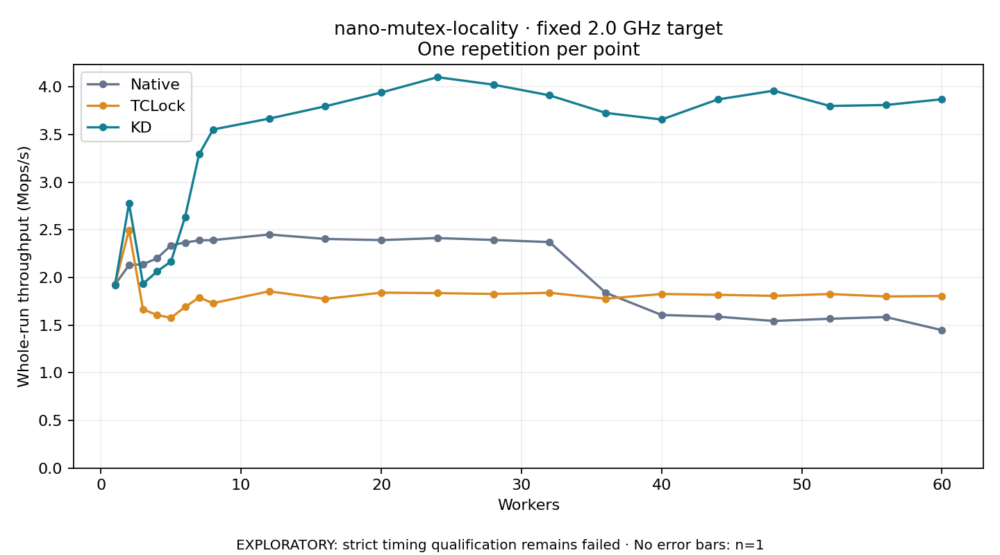

# nano-mutex-locality · fixed 2.0 GHz target

One timed round per point. **EXPLORATORY: strict timing qualification remains failed.** Failed/unrun points have no rate; one round supplies no repeat-variability estimate.

| Workers | Native Mops/s | TCLock Mops/s | KD Mops/s | KD / Native | KD / TCLock | KD execution |
|---:|---:|---:|---:|---:|---:|:---|
| 1 | 1.926 | 1.929 | 1.923 | 0.998× | 0.997× | NO_JIT |
| 2 | 2.130 | 2.499 | 2.778 | 1.304× | 1.112× | NO_JIT |
| 3 | 2.140 | 1.666 | 1.934 | 0.904× | 1.161× | RETURNED_JIT |
| 4 | 2.201 | 1.606 | 2.064 | 0.938× | 1.285× | RETURNED_JIT |
| 5 | 2.339 | 1.578 | 2.169 | 0.928× | 1.375× | RETURNED_JIT |
| 6 | 2.368 | 1.692 | 2.636 | 1.113× | 1.558× | RETURNED_JIT |
| 7 | 2.390 | 1.790 | 3.293 | 1.378× | 1.840× | RETURNED_JIT |
| 8 | 2.393 | 1.731 | 3.554 | 1.485× | 2.053× | RETURNED_JIT |
| 12 | 2.452 | 1.856 | 3.668 | 1.496× | 1.977× | RETURNED_JIT |
| 16 | 2.405 | 1.776 | 3.797 | 1.579× | 2.139× | RETURNED_JIT |
| 20 | 2.393 | 1.841 | 3.942 | 1.647× | 2.141× | RETURNED_JIT |
| 24 | 2.414 | 1.837 | 4.103 | 1.699× | 2.234× | RETURNED_JIT |
| 28 | 2.395 | 1.828 | 4.025 | 1.681× | 2.202× | RETURNED_JIT |
| 32 | 2.372 | 1.840 | 3.912 | 1.649× | 2.126× | RETURNED_JIT |
| 36 | 1.841 | 1.778 | 3.728 | 2.025× | 2.097× | RETURNED_JIT |
| 40 | 1.607 | 1.827 | 3.659 | 2.276× | 2.002× | RETURNED_JIT |
| 44 | 1.589 | 1.819 | 3.869 | 2.434× | 2.127× | RETURNED_JIT |
| 48 | 1.544 | 1.808 | 3.961 | 2.565× | 2.191× | RETURNED_JIT |
| 52 | 1.568 | 1.827 | 3.801 | 2.425× | 2.080× | RETURNED_JIT |
| 56 | 1.586 | 1.801 | 3.811 | 2.403× | 2.116× | RETURNED_JIT |
| 60 | 1.448 | 1.806 | 3.871 | 2.674× | 2.143× | RETURNED_JIT |

[Full-precision table](table.csv)

Frozen source: `a9aeb280a68242818aa469d8277e0c5a22fffee1`. [Archive hashes, frozen-validator replay and exact lifecycle checks](audit.json). Measured points: **63**; failed: **0**; unrun: **0**. Failed/unrun points have no throughput value. The full raw archive remains the primary receipt; compact JSON copies stay under the raw audit path.

Whole-run throughput is completed operations divided by the recorded wall interval; peak rates use the frozen full-cohort progress-window validator. Reciprocal throughput is an aggregate service interval, not operation latency. Returned completion share counts eligible writer operations (snapshot reads for the extracted snapshot cases). NO_JIT points are local execution evidence. One observation cannot establish statistical superiority.

Frequency readbacks are bound before/after this workload. Fixed frequency does not repair the separately failed strict host task-membership gate. Exact output checks and drain validate the retained execution; offline replay does not rerun kernel bodies or syscalls.

Frozen score-ineligible observations, if any, retain their separately labeled raw rate in the CSV and are excluded from the ordinary chart and ratios. Valid NO_JIT observations remain plotted.
