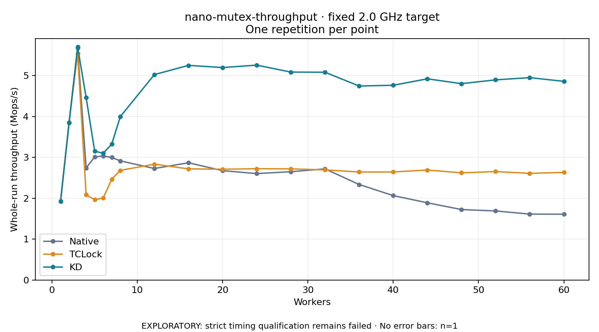

# nano-mutex-throughput · fixed 2.0 GHz target

One timed round per point. **EXPLORATORY: strict timing qualification remains failed.** Failed/unrun points have no rate; one round supplies no repeat-variability estimate.

| Workers | Native Mops/s | TCLock Mops/s | KD Mops/s | KD / Native | KD / TCLock | KD execution |
|---:|---:|---:|---:|---:|---:|:---|
| 1 | 1.927 | 1.929 | 1.924 | 0.999× | 0.997× | NO_JIT |
| 2 | 3.854 | 3.860 | 3.843 | 0.997× | 0.996× | NO_JIT |
| 3 | 5.672 | 5.540 | 5.704 | 1.006× | 1.030× | NO_JIT |
| 4 | 2.743 | 2.085 | 4.465 | 1.628× | 2.141× | RETURNED_JIT |
| 5 | 3.013 | 1.965 | 3.153 | 1.047× | 1.605× | RETURNED_JIT |
| 6 | 3.037 | 2.008 | 3.103 | 1.022× | 1.546× | RETURNED_JIT |
| 7 | 3.000 | 2.469 | 3.325 | 1.108× | 1.347× | RETURNED_JIT |
| 8 | 2.917 | 2.683 | 3.998 | 1.371× | 1.490× | RETURNED_JIT |
| 12 | 2.729 | 2.835 | 5.028 | 1.842× | 1.773× | RETURNED_JIT |
| 16 | 2.869 | 2.720 | 5.253 | 1.831× | 1.931× | RETURNED_JIT |
| 20 | 2.677 | 2.712 | 5.200 | 1.943× | 1.918× | RETURNED_JIT |
| 24 | 2.605 | 2.724 | 5.259 | 2.019× | 1.931× | RETURNED_JIT |
| 28 | 2.651 | 2.721 | 5.089 | 1.920× | 1.871× | RETURNED_JIT |
| 32 | 2.720 | 2.695 | 5.085 | 1.869× | 1.887× | RETURNED_JIT |
| 36 | 2.339 | 2.643 | 4.749 | 2.030× | 1.796× | RETURNED_JIT |
| 40 | 2.066 | 2.645 | 4.767 | 2.308× | 1.802× | RETURNED_JIT |
| 44 | 1.890 | 2.693 | 4.924 | 2.605× | 1.829× | RETURNED_JIT |
| 48 | 1.725 | 2.623 | 4.806 | 2.786× | 1.832× | RETURNED_JIT |
| 52 | 1.691 | 2.654 | 4.899 | 2.898× | 1.846× | RETURNED_JIT |
| 56 | 1.614 | 2.611 | 4.953 | 3.069× | 1.897× | RETURNED_JIT |
| 60 | 1.610 | 2.634 | 4.863 | 3.020× | 1.846× | RETURNED_JIT |

[Full-precision table](table.csv)

Frozen source: `a9aeb280a68242818aa469d8277e0c5a22fffee1`. [Archive hashes, frozen-validator replay and exact lifecycle checks](audit.json). Measured points: **63**; failed: **0**; unrun: **0**. Failed/unrun points have no throughput value. The full raw archive remains the primary receipt; compact JSON copies stay under the raw audit path.

Whole-run throughput is completed operations divided by the recorded wall interval; peak rates use the frozen full-cohort progress-window validator. Reciprocal throughput is an aggregate service interval, not operation latency. Returned completion share counts eligible writer operations (snapshot reads for the extracted snapshot cases). NO_JIT points are local execution evidence. One observation cannot establish statistical superiority.

Frequency readbacks are bound before/after this workload. Fixed frequency does not repair the separately failed strict host task-membership gate. Exact output checks and drain validate the retained execution; offline replay does not rerun kernel bodies or syscalls.
