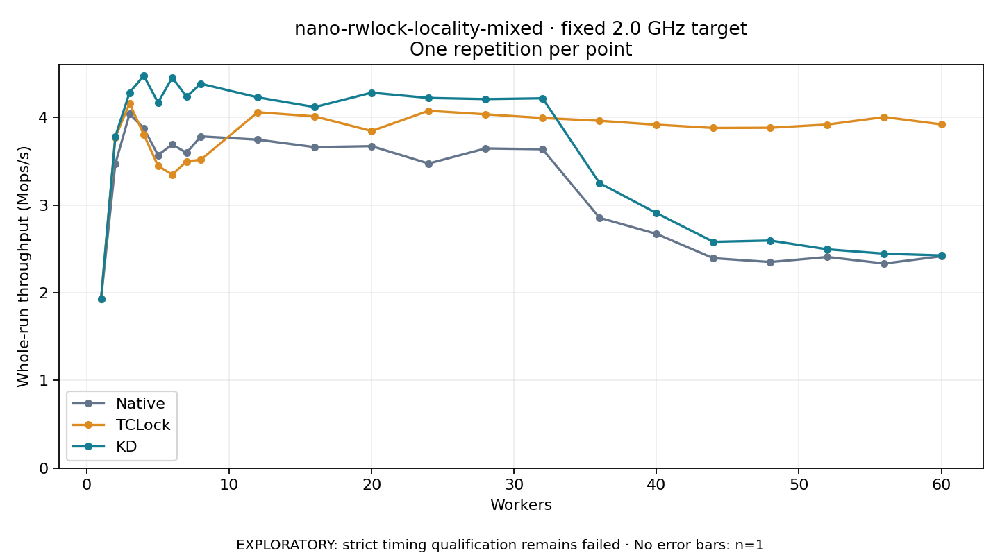

# nano-rwlock-locality-mixed · fixed 2.0 GHz target

One timed round per point. **EXPLORATORY: strict timing qualification remains failed.** Failed/unrun points have no rate; one round supplies no repeat-variability estimate.

| Workers | Native Mops/s | TCLock Mops/s | KD Mops/s | KD / Native | KD / TCLock | KD execution |
|---:|---:|---:|---:|---:|---:|:---|
| 1 | 1.928 | 1.927 | 1.929 | 1.001× | 1.001× | NO_JIT |
| 2 | 3.468 | 3.771 | 3.781 | 1.090× | 1.003× | NO_JIT |
| 3 | 4.038 | 4.159 | 4.282 | 1.060× | 1.029× | NO_JIT |
| 4 | 3.876 | 3.805 | 4.475 | 1.154× | 1.176× | NO_JIT |
| 5 | 3.569 | 3.446 | 4.168 | 1.168× | 1.210× | NO_JIT |
| 6 | 3.691 | 3.346 | 4.454 | 1.207× | 1.331× | NO_JIT |
| 7 | 3.595 | 3.498 | 4.235 | 1.178× | 1.211× | NO_JIT |
| 8 | 3.783 | 3.516 | 4.382 | 1.159× | 1.246× | NO_JIT |
| 12 | 3.745 | 4.058 | 4.228 | 1.129× | 1.042× | RETURNED_JIT |
| 16 | 3.660 | 4.010 | 4.117 | 1.125× | 1.027× | RETURNED_JIT |
| 20 | 3.671 | 3.844 | 4.281 | 1.166× | 1.114× | RETURNED_JIT |
| 24 | 3.473 | 4.074 | 4.221 | 1.215× | 1.036× | RETURNED_JIT |
| 28 | 3.645 | 4.034 | 4.208 | 1.154× | 1.043× | RETURNED_JIT |
| 32 | 3.636 | 3.992 | 4.217 | 1.160× | 1.056× | RETURNED_JIT |
| 36 | 2.855 | 3.960 | 3.250 | 1.139× | 0.821× | RETURNED_JIT |
| 40 | 2.671 | 3.916 | 2.908 | 1.089× | 0.743× | RETURNED_JIT |
| 44 | 2.393 | 3.878 | 2.580 | 1.078× | 0.665× | RETURNED_JIT |
| 48 | 2.349 | 3.881 | 2.595 | 1.104× | 0.669× | RETURNED_JIT |
| 52 | 2.407 | 3.918 | 2.495 | 1.036× | 0.637× | RETURNED_JIT |
| 56 | 2.333 | 4.003 | 2.445 | 1.048× | 0.611× | RETURNED_JIT |
| 60 | 2.415 | 3.920 | 2.425 | 1.004× | 0.619× | RETURNED_JIT |

[Full-precision table](table.csv)

Frozen source: `a9aeb280a68242818aa469d8277e0c5a22fffee1`. [Archive hashes, frozen-validator replay and exact lifecycle checks](audit.json). Measured points: **63**; failed: **0**; unrun: **0**. Failed/unrun points have no throughput value. The full raw archive remains the primary receipt; compact JSON copies stay under the raw audit path.

Whole-run throughput is completed operations divided by the recorded wall interval; peak rates use the frozen full-cohort progress-window validator. Reciprocal throughput is an aggregate service interval, not operation latency. Returned completion share counts eligible writer operations (snapshot reads for the extracted snapshot cases). NO_JIT points are local execution evidence. One observation cannot establish statistical superiority.

Frequency readbacks are bound before/after this workload. Fixed frequency does not repair the separately failed strict host task-membership gate. Exact output checks and drain validate the retained execution; offline replay does not rerun kernel bodies or syscalls.

Frozen score-ineligible observations, if any, retain their separately labeled raw rate in the CSV and are excluded from the ordinary chart and ratios. Valid NO_JIT observations remain plotted.
