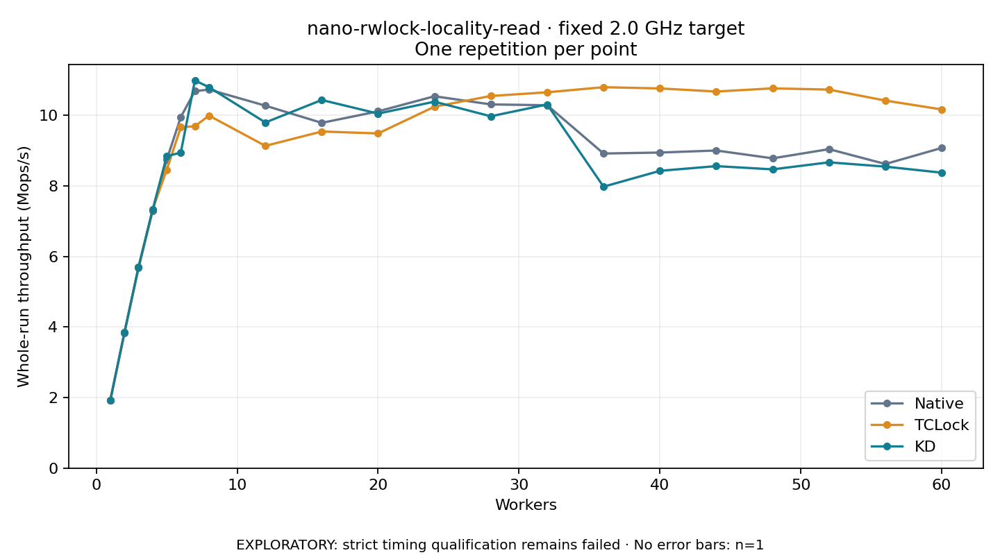

# nano-rwlock-locality-read · fixed 2.0 GHz target

One timed round per point. **EXPLORATORY: strict timing qualification remains failed.** Failed/unrun points have no rate; one round supplies no repeat-variability estimate.

| Workers | Native Mops/s | TCLock Mops/s | KD Mops/s | KD / Native | KD / TCLock | KD execution |
|---:|---:|---:|---:|---:|---:|:---|
| 1 | 1.927 | 1.928 | 1.929 | 1.001× | 1.001× | NO_JIT |
| 2 | 3.837 | 3.842 | 3.842 | 1.001× | 1.000× | NO_JIT |
| 3 | 5.669 | 5.700 | 5.701 | 1.006× | 1.000× | NO_JIT |
| 4 | 7.292 | 7.328 | 7.324 | 1.004× | 0.999× | NO_JIT |
| 5 | 8.738 | 8.458 | 8.839 | 1.012× | 1.045× | NO_JIT |
| 6 | 9.952 | 9.660 | 8.944 | 0.899× | 0.926× | NO_JIT |
| 7 | 10.685 | 9.689 | 10.986 | 1.028× | 1.134× | NO_JIT |
| 8 | 10.730 | 9.991 | 10.798 | 1.006× | 1.081× | NO_JIT |
| 12 | 10.273 | 9.133 | 9.796 | 0.954× | 1.073× | NO_JIT |
| 16 | 9.785 | 9.540 | 10.434 | 1.066× | 1.094× | NO_JIT |
| 20 | 10.112 | 9.486 | 10.048 | 0.994× | 1.059× | NO_JIT |
| 24 | 10.540 | 10.244 | 10.386 | 0.985× | 1.014× | RETURNED_JIT |
| 28 | 10.308 | 10.548 | 9.972 | 0.967× | 0.945× | RETURNED_JIT |
| 32 | 10.285 | 10.652 | 10.308 | 1.002× | 0.968× | RETURNED_JIT |
| 36 | 8.917 | 10.796 | 7.976 | 0.895× | 0.739× | RETURNED_JIT |
| 40 | 8.944 | 10.761 | 8.426 | 0.942× | 0.783× | RETURNED_JIT |
| 44 | 9.002 | 10.674 | 8.560 | 0.951× | 0.802× | RETURNED_JIT |
| 48 | 8.780 | 10.763 | 8.467 | 0.964× | 0.787× | RETURNED_JIT |
| 52 | 9.041 | 10.728 | 8.667 | 0.959× | 0.808× | RETURNED_JIT |
| 56 | 8.619 | 10.417 | 8.545 | 0.991× | 0.820× | RETURNED_JIT |
| 60 | 9.075 | 10.166 | 8.374 | 0.923× | 0.824× | RETURNED_JIT |

[Full-precision table](table.csv)

Frozen source: `a9aeb280a68242818aa469d8277e0c5a22fffee1`. [Archive hashes, frozen-validator replay and exact lifecycle checks](audit.json). Measured points: **63**; failed: **0**; unrun: **0**. Failed/unrun points have no throughput value. The full raw archive remains the primary receipt; compact JSON copies stay under the raw audit path.

Whole-run throughput is completed operations divided by the recorded wall interval; peak rates use the frozen full-cohort progress-window validator. Reciprocal throughput is an aggregate service interval, not operation latency. Returned completion share counts eligible writer operations (snapshot reads for the extracted snapshot cases). NO_JIT points are local execution evidence. One observation cannot establish statistical superiority.

Frequency readbacks are bound before/after this workload. Fixed frequency does not repair the separately failed strict host task-membership gate. Exact output checks and drain validate the retained execution; offline replay does not rerun kernel bodies or syscalls.

Frozen score-ineligible observations, if any, retain their separately labeled raw rate in the CSV and are excluded from the ordinary chart and ratios. Valid NO_JIT observations remain plotted.
