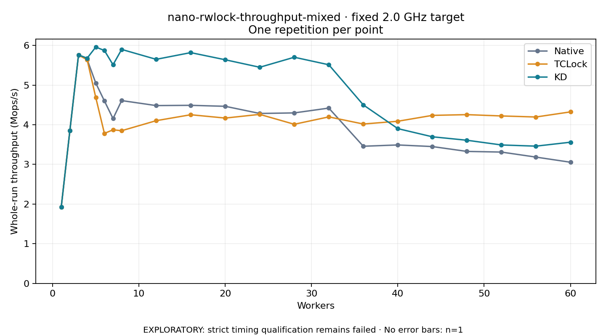

# nano-rwlock-throughput-mixed · fixed 2.0 GHz target

One timed round per point. **EXPLORATORY: strict timing qualification remains failed.** Failed/unrun points have no rate; one round supplies no repeat-variability estimate.

| Workers | Native Mops/s | TCLock Mops/s | KD Mops/s | KD / Native | KD / TCLock | KD execution |
|---:|---:|---:|---:|---:|---:|:---|
| 1 | 1.926 | 1.927 | 1.927 | 1.001× | 1.000× | NO_JIT |
| 2 | 3.856 | 3.853 | 3.855 | 1.000× | 1.001× | NO_JIT |
| 3 | 5.759 | 5.757 | 5.762 | 1.001× | 1.001× | NO_JIT |
| 4 | 5.646 | 5.640 | 5.679 | 1.006× | 1.007× | NO_JIT |
| 5 | 5.052 | 4.687 | 5.959 | 1.180× | 1.271× | NO_JIT |
| 6 | 4.601 | 3.783 | 5.873 | 1.276× | 1.553× | NO_JIT |
| 7 | 4.156 | 3.872 | 5.513 | 1.327× | 1.424× | NO_JIT |
| 8 | 4.610 | 3.850 | 5.900 | 1.280× | 1.532× | NO_JIT |
| 12 | 4.484 | 4.103 | 5.650 | 1.260× | 1.377× | RETURNED_JIT |
| 16 | 4.490 | 4.253 | 5.819 | 1.296× | 1.368× | RETURNED_JIT |
| 20 | 4.465 | 4.169 | 5.639 | 1.263× | 1.353× | RETURNED_JIT |
| 24 | 4.285 | 4.262 | 5.450 | 1.272× | 1.279× | RETURNED_JIT |
| 28 | 4.299 | 4.012 | 5.703 | 1.327× | 1.421× | RETURNED_JIT |
| 32 | 4.421 | 4.198 | 5.513 | 1.247× | 1.313× | RETURNED_JIT |
| 36 | 3.458 | 4.019 | 4.501 | 1.301× | 1.120× | RETURNED_JIT |
| 40 | 3.491 | 4.088 | 3.902 | 1.118× | 0.955× | RETURNED_JIT |
| 44 | 3.450 | 4.237 | 3.697 | 1.071× | 0.873× | RETURNED_JIT |
| 48 | 3.328 | 4.255 | 3.610 | 1.085× | 0.848× | RETURNED_JIT |
| 52 | 3.311 | 4.222 | 3.491 | 1.054× | 0.827× | RETURNED_JIT |
| 56 | 3.185 | 4.196 | 3.461 | 1.087× | 0.825× | RETURNED_JIT |
| 60 | 3.055 | 4.325 | 3.560 | 1.165× | 0.823× | RETURNED_JIT |

[Full-precision table](table.csv)

Frozen source: `a9aeb280a68242818aa469d8277e0c5a22fffee1`. [Archive hashes, frozen-validator replay and exact lifecycle checks](audit.json). Measured points: **63**; failed: **0**; unrun: **0**. Failed/unrun points have no throughput value. The full raw archive remains the primary receipt; compact JSON copies stay under the raw audit path.

Whole-run throughput is completed operations divided by the recorded wall interval; peak rates use the frozen full-cohort progress-window validator. Reciprocal throughput is an aggregate service interval, not operation latency. Returned completion share counts eligible writer operations (snapshot reads for the extracted snapshot cases). NO_JIT points are local execution evidence. One observation cannot establish statistical superiority.

Frequency readbacks are bound before/after this workload. Fixed frequency does not repair the separately failed strict host task-membership gate. Exact output checks and drain validate the retained execution; offline replay does not rerun kernel bodies or syscalls.

Frozen score-ineligible observations, if any, retain their separately labeled raw rate in the CSV and are excluded from the ordinary chart and ratios. Valid NO_JIT observations remain plotted.
