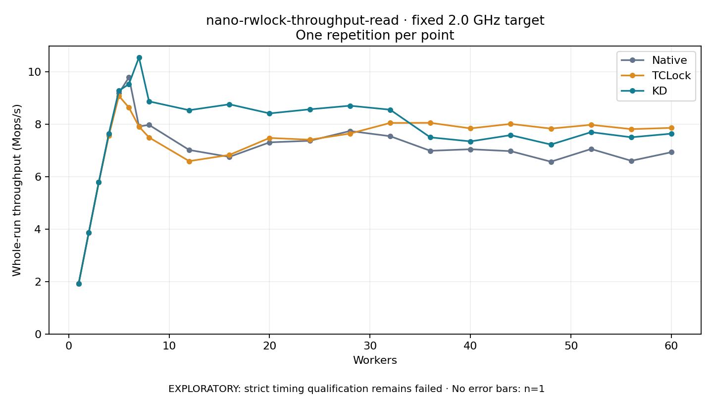

# nano-rwlock-throughput-read · fixed 2.0 GHz target

One timed round per point. **EXPLORATORY: strict timing qualification remains failed.** Failed/unrun points have no rate; one round supplies no repeat-variability estimate.

| Workers | Native Mops/s | TCLock Mops/s | KD Mops/s | KD / Native | KD / TCLock | KD execution |
|---:|---:|---:|---:|---:|---:|:---|
| 1 | 1.927 | 1.928 | 1.928 | 1.001× | 1.000× | NO_JIT |
| 2 | 3.857 | 3.856 | 3.859 | 1.001× | 1.001× | NO_JIT |
| 3 | 5.782 | 5.783 | 5.785 | 1.001× | 1.000× | NO_JIT |
| 4 | 7.603 | 7.562 | 7.639 | 1.005× | 1.010× | NO_JIT |
| 5 | 9.183 | 9.081 | 9.274 | 1.010× | 1.021× | NO_JIT |
| 6 | 9.787 | 8.634 | 9.529 | 0.974× | 1.104× | NO_JIT |
| 7 | 7.914 | 7.911 | 10.549 | 1.333× | 1.333× | NO_JIT |
| 8 | 7.974 | 7.496 | 8.871 | 1.112× | 1.183× | NO_JIT |
| 12 | 7.017 | 6.592 | 8.535 | 1.216× | 1.295× | NO_JIT |
| 16 | 6.753 | 6.828 | 8.759 | 1.297× | 1.283× | NO_JIT |
| 20 | 7.308 | 7.476 | 8.412 | 1.151× | 1.125× | RETURNED_JIT |
| 24 | 7.367 | 7.409 | 8.567 | 1.163× | 1.156× | RETURNED_JIT |
| 28 | 7.740 | 7.642 | 8.705 | 1.125× | 1.139× | RETURNED_JIT |
| 32 | 7.543 | 8.048 | 8.553 | 1.134× | 1.063× | RETURNED_JIT |
| 36 | 6.986 | 8.052 | 7.498 | 1.073× | 0.931× | RETURNED_JIT |
| 40 | 7.045 | 7.841 | 7.345 | 1.043× | 0.937× | RETURNED_JIT |
| 44 | 6.972 | 8.011 | 7.583 | 1.088× | 0.947× | RETURNED_JIT |
| 48 | 6.571 | 7.833 | 7.224 | 1.099× | 0.922× | RETURNED_JIT |
| 52 | 7.055 | 7.977 | 7.697 | 1.091× | 0.965× | RETURNED_JIT |
| 56 | 6.605 | 7.812 | 7.502 | 1.136× | 0.960× | RETURNED_JIT |
| 60 | 6.932 | 7.859 | 7.639 | 1.102× | 0.972× | RETURNED_JIT |

[Full-precision table](table.csv)

Frozen source: `a9aeb280a68242818aa469d8277e0c5a22fffee1`. [Archive hashes, frozen-validator replay and exact lifecycle checks](audit.json). Measured points: **63**; failed: **0**; unrun: **0**. Failed/unrun points have no throughput value. The full raw archive remains the primary receipt; compact JSON copies stay under the raw audit path.

Whole-run throughput is completed operations divided by the recorded wall interval; peak rates use the frozen full-cohort progress-window validator. Reciprocal throughput is an aggregate service interval, not operation latency. Returned completion share counts eligible writer operations (snapshot reads for the extracted snapshot cases). NO_JIT points are local execution evidence. One observation cannot establish statistical superiority.

Frequency readbacks are bound before/after this workload. Fixed frequency does not repair the separately failed strict host task-membership gate. Exact output checks and drain validate the retained execution; offline replay does not rerun kernel bodies or syscalls.

Frozen score-ineligible observations, if any, retain their separately labeled raw rate in the CSV and are excluded from the ordinary chart and ratios. Valid NO_JIT observations remain plotted.
