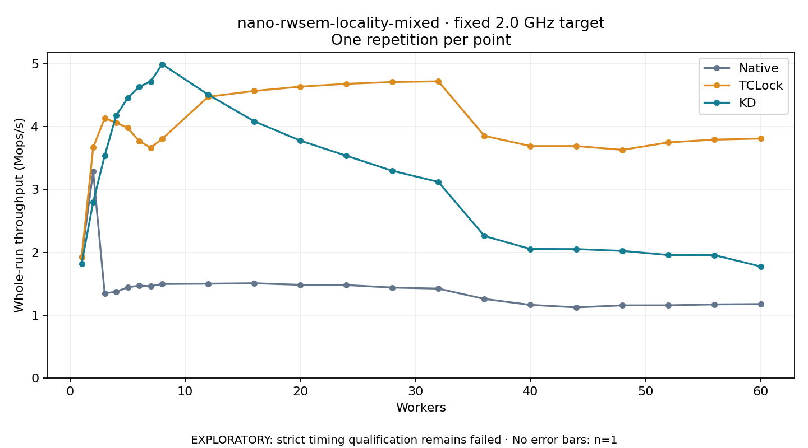

# nano-rwsem-locality-mixed · fixed 2.0 GHz target

One timed round per point. **EXPLORATORY: strict timing qualification remains failed.** Failed/unrun points have no rate; one round supplies no repeat-variability estimate.

| Workers | Native Mops/s | TCLock Mops/s | KD Mops/s | KD / Native | KD / TCLock | KD execution |
|---:|---:|---:|---:|---:|---:|:---|
| 1 | 1.926 | 1.927 | 1.822 | 0.946× | 0.945× | NO_JIT |
| 2 | 3.287 | 3.670 | 2.800 | 0.852× | 0.763× | NO_JIT |
| 3 | 1.347 | 4.134 | 3.539 | 2.628× | 0.856× | NO_JIT |
| 4 | 1.371 | 4.065 | 4.179 | 3.048× | 1.028× | RETURNED_JIT |
| 5 | 1.442 | 3.980 | 4.457 | 3.092× | 1.120× | RETURNED_JIT |
| 6 | 1.469 | 3.770 | 4.637 | 3.156× | 1.230× | RETURNED_JIT |
| 7 | 1.460 | 3.665 | 4.720 | 3.234× | 1.288× | RETURNED_JIT |
| 8 | 1.495 | 3.807 | 4.995 | 3.342× | 1.312× | RETURNED_JIT |
| 12 | 1.500 | 4.477 | 4.510 | 3.007× | 1.007× | RETURNED_JIT |
| 16 | 1.507 | 4.569 | 4.086 | 2.712× | 0.894× | RETURNED_JIT |
| 20 | 1.481 | 4.638 | 3.778 | 2.551× | 0.815× | RETURNED_JIT |
| 24 | 1.477 | 4.683 | 3.537 | 2.394× | 0.755× | RETURNED_JIT |
| 28 | 1.438 | 4.712 | 3.298 | 2.293× | 0.700× | RETURNED_JIT |
| 32 | 1.421 | 4.723 | 3.120 | 2.195× | 0.661× | RETURNED_JIT |
| 36 | 1.257 | 3.855 | 2.259 | 1.798× | 0.586× | RETURNED_JIT |
| 40 | 1.162 | 3.691 | 2.052 | 1.766× | 0.556× | RETURNED_JIT |
| 44 | 1.123 | 3.692 | 2.051 | 1.827× | 0.555× | RETURNED_JIT |
| 48 | 1.154 | 3.631 | 2.022 | 1.751× | 0.557× | RETURNED_JIT |
| 52 | 1.155 | 3.750 | 1.956 | 1.693× | 0.522× | RETURNED_JIT |
| 56 | 1.170 | 3.794 | 1.954 | 1.670× | 0.515× | RETURNED_JIT |
| 60 | 1.175 | 3.811 | 1.775 | 1.510× | 0.466× | RETURNED_JIT |

[Full-precision table](table.csv)

Frozen source: `a9aeb280a68242818aa469d8277e0c5a22fffee1`. [Archive hashes, frozen-validator replay and exact lifecycle checks](audit.json). Measured points: **63**; failed: **0**; unrun: **0**. Failed/unrun points have no throughput value. The full raw archive remains the primary receipt; compact JSON copies stay under the raw audit path.

Whole-run throughput is completed operations divided by the recorded wall interval; peak rates use the frozen full-cohort progress-window validator. Reciprocal throughput is an aggregate service interval, not operation latency. Returned completion share counts eligible writer operations (snapshot reads for the extracted snapshot cases). NO_JIT points are local execution evidence. One observation cannot establish statistical superiority.

Frequency readbacks are bound before/after this workload. Fixed frequency does not repair the separately failed strict host task-membership gate. Exact output checks and drain validate the retained execution; offline replay does not rerun kernel bodies or syscalls.

Frozen score-ineligible observations, if any, retain their separately labeled raw rate in the CSV and are excluded from the ordinary chart and ratios. Valid NO_JIT observations remain plotted.
