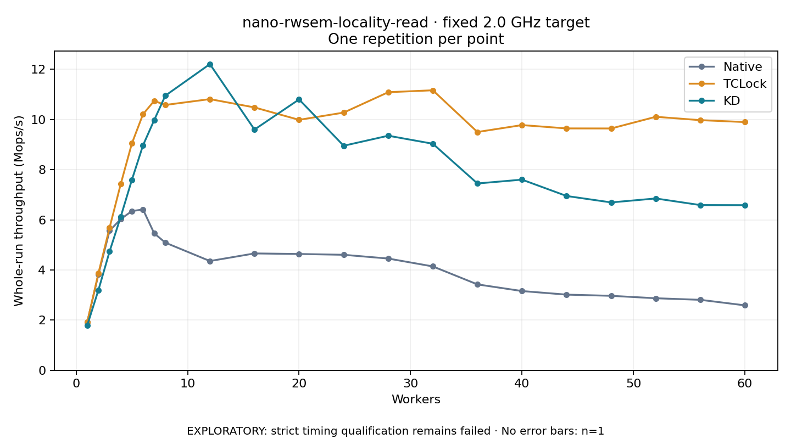

# nano-rwsem-locality-read · fixed 2.0 GHz target

One timed round per point. **EXPLORATORY: strict timing qualification remains failed.** Failed/unrun points have no rate; one round supplies no repeat-variability estimate.

| Workers | Native Mops/s | TCLock Mops/s | KD Mops/s | KD / Native | KD / TCLock | KD execution |
|---:|---:|---:|---:|---:|---:|:---|
| 1 | 1.926 | 1.928 | 1.798 | 0.933× | 0.932× | NO_JIT |
| 2 | 3.826 | 3.869 | 3.199 | 0.836× | 0.827× | NO_JIT |
| 3 | 5.563 | 5.685 | 4.736 | 0.851× | 0.833× | NO_JIT |
| 4 | 6.028 | 7.424 | 6.120 | 1.015× | 0.824× | NO_JIT |
| 5 | 6.346 | 9.042 | 7.590 | 1.196× | 0.839× | NO_JIT |
| 6 | 6.411 | 10.208 | 8.969 | 1.399× | 0.879× | NO_JIT |
| 7 | 5.461 | 10.740 | 9.971 | 1.826× | 0.928× | NO_JIT |
| 8 | 5.088 | 10.578 | 10.948 | 2.152× | 1.035× | NO_JIT |
| 12 | 4.355 | 10.810 | 12.207 | 2.803× | 1.129× | NO_JIT |
| 16 | 4.658 | 10.479 | 9.597 | 2.060× | 0.916× | NO_JIT |
| 20 | 4.636 | 9.984 | 10.798 | 2.329× | 1.082× | NO_JIT |
| 24 | 4.604 | 10.273 | 8.951 | 1.944× | 0.871× | NO_JIT |
| 28 | 4.454 | 11.086 | 9.351 | 2.099× | 0.844× | NO_JIT |
| 32 | 4.141 | 11.163 | 9.032 | 2.181× | 0.809× | NO_JIT |
| 36 | 3.424 | 9.500 | 7.447 | 2.175× | 0.784× | NO_JIT |
| 40 | 3.158 | 9.775 | 7.600 | 2.406× | 0.778× | NO_JIT |
| 44 | 3.016 | 9.643 | 6.948 | 2.304× | 0.721× | NO_JIT |
| 48 | 2.968 | 9.640 | 6.692 | 2.255× | 0.694× | NO_JIT |
| 52 | 2.871 | 10.105 | 6.850 | 2.386× | 0.678× | NO_JIT |
| 56 | 2.809 | 9.972 | 6.586 | 2.345× | 0.660× | NO_JIT |
| 60 | 2.588 | 9.896 | 6.583 | 2.543× | 0.665× | NO_JIT |

[Full-precision table](table.csv)

Frozen source: `a9aeb280a68242818aa469d8277e0c5a22fffee1`. [Archive hashes, frozen-validator replay and exact lifecycle checks](audit.json). Measured points: **63**; failed: **0**; unrun: **0**. Failed/unrun points have no throughput value. The full raw archive remains the primary receipt; compact JSON copies stay under the raw audit path.

Whole-run throughput is completed operations divided by the recorded wall interval; peak rates use the frozen full-cohort progress-window validator. Reciprocal throughput is an aggregate service interval, not operation latency. Returned completion share counts eligible writer operations (snapshot reads for the extracted snapshot cases). NO_JIT points are local execution evidence. One observation cannot establish statistical superiority.

Frequency readbacks are bound before/after this workload. Fixed frequency does not repair the separately failed strict host task-membership gate. Exact output checks and drain validate the retained execution; offline replay does not rerun kernel bodies or syscalls.

Frozen score-ineligible observations, if any, retain their separately labeled raw rate in the CSV and are excluded from the ordinary chart and ratios. Valid NO_JIT observations remain plotted.
