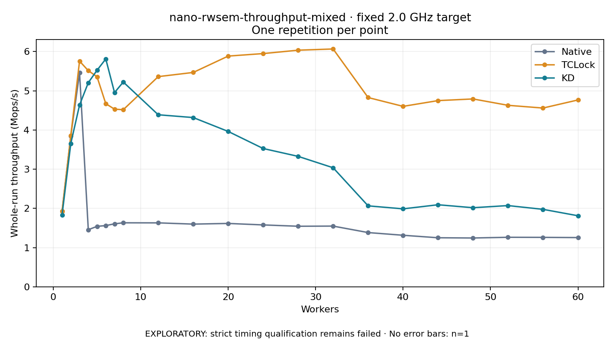

# nano-rwsem-throughput-mixed · fixed 2.0 GHz target

One timed round per point. **EXPLORATORY: strict timing qualification remains failed.** Failed/unrun points have no rate; one round supplies no repeat-variability estimate.

| Workers | Native Mops/s | TCLock Mops/s | KD Mops/s | KD / Native | KD / TCLock | KD execution |
|---:|---:|---:|---:|---:|---:|:---|
| 1 | 1.926 | 1.928 | 1.830 | 0.950× | 0.949× | NO_JIT |
| 2 | 3.852 | 3.858 | 3.657 | 0.949× | 0.948× | NO_JIT |
| 3 | 5.460 | 5.758 | 4.637 | 0.849× | 0.805× | NO_JIT |
| 4 | 1.456 | 5.515 | 5.207 | 3.577× | 0.944× | NO_JIT |
| 5 | 1.542 | 5.359 | 5.524 | 3.583× | 1.031× | NO_JIT |
| 6 | 1.561 | 4.672 | 5.813 | 3.724× | 1.244× | NO_JIT |
| 7 | 1.606 | 4.532 | 4.955 | 3.084× | 1.093× | NO_JIT |
| 8 | 1.632 | 4.518 | 5.224 | 3.201× | 1.156× | NO_JIT |
| 12 | 1.630 | 5.362 | 4.389 | 2.692× | 0.818× | NO_JIT |
| 16 | 1.599 | 5.469 | 4.318 | 2.701× | 0.790× | NO_JIT |
| 20 | 1.616 | 5.886 | 3.963 | 2.453× | 0.673× | NO_JIT |
| 24 | 1.578 | 5.950 | 3.528 | 2.235× | 0.593× | NO_JIT |
| 28 | 1.544 | 6.037 | 3.327 | 2.155× | 0.551× | NO_JIT |
| 32 | 1.548 | 6.067 | 3.037 | 1.961× | 0.501× | NO_JIT |
| 36 | 1.383 | 4.829 | 2.065 | 1.493× | 0.428× | RETURNED_JIT |
| 40 | 1.314 | 4.604 | 1.988 | 1.513× | 0.432× | RETURNED_JIT |
| 44 | 1.251 | 4.750 | 2.093 | 1.673× | 0.441× | RETURNED_JIT |
| 48 | 1.245 | 4.793 | 2.017 | 1.621× | 0.421× | RETURNED_JIT |
| 52 | 1.263 | 4.630 | 2.072 | 1.641× | 0.447× | RETURNED_JIT |
| 56 | 1.261 | 4.560 | 1.976 | 1.567× | 0.433× | RETURNED_JIT |
| 60 | 1.255 | 4.767 | 1.812 | 1.444× | 0.380× | RETURNED_JIT |

[Full-precision table](table.csv)

Frozen source: `a9aeb280a68242818aa469d8277e0c5a22fffee1`. [Archive hashes, frozen-validator replay and exact lifecycle checks](audit.json). Measured points: **63**; failed: **0**; unrun: **0**. Failed/unrun points have no throughput value. The full raw archive remains the primary receipt; compact JSON copies stay under the raw audit path.

Whole-run throughput is completed operations divided by the recorded wall interval; peak rates use the frozen full-cohort progress-window validator. Reciprocal throughput is an aggregate service interval, not operation latency. Returned completion share counts eligible writer operations (snapshot reads for the extracted snapshot cases). NO_JIT points are local execution evidence. One observation cannot establish statistical superiority.

Frequency readbacks are bound before/after this workload. Fixed frequency does not repair the separately failed strict host task-membership gate. Exact output checks and drain validate the retained execution; offline replay does not rerun kernel bodies or syscalls.

Frozen score-ineligible observations, if any, retain their separately labeled raw rate in the CSV and are excluded from the ordinary chart and ratios. Valid NO_JIT observations remain plotted.
