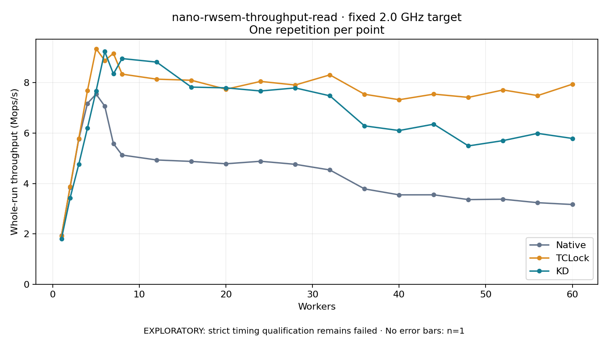

# nano-rwsem-throughput-read · fixed 2.0 GHz target

One timed round per point. **EXPLORATORY: strict timing qualification remains failed.** Failed/unrun points have no rate; one round supplies no repeat-variability estimate.

| Workers | Native Mops/s | TCLock Mops/s | KD Mops/s | KD / Native | KD / TCLock | KD execution |
|---:|---:|---:|---:|---:|---:|:---|
| 1 | 1.928 | 1.927 | 1.805 | 0.936× | 0.937× | NO_JIT |
| 2 | 3.842 | 3.875 | 3.426 | 0.892× | 0.884× | NO_JIT |
| 3 | 5.760 | 5.786 | 4.758 | 0.826× | 0.822× | NO_JIT |
| 4 | 7.177 | 7.681 | 6.200 | 0.864× | 0.807× | NO_JIT |
| 5 | 7.548 | 9.351 | 7.674 | 1.017× | 0.821× | NO_JIT |
| 6 | 7.071 | 8.883 | 9.236 | 1.306× | 1.040× | NO_JIT |
| 7 | 5.583 | 9.163 | 8.350 | 1.495× | 0.911× | NO_JIT |
| 8 | 5.129 | 8.342 | 8.959 | 1.747× | 1.074× | NO_JIT |
| 12 | 4.933 | 8.141 | 8.818 | 1.788× | 1.083× | NO_JIT |
| 16 | 4.876 | 8.098 | 7.826 | 1.605× | 0.966× | NO_JIT |
| 20 | 4.782 | 7.741 | 7.796 | 1.630× | 1.007× | NO_JIT |
| 24 | 4.882 | 8.052 | 7.672 | 1.571× | 0.953× | NO_JIT |
| 28 | 4.761 | 7.909 | 7.794 | 1.637× | 0.985× | NO_JIT |
| 32 | 4.536 | 8.312 | 7.480 | 1.649× | 0.900× | NO_JIT |
| 36 | 3.786 | 7.542 | 6.288 | 1.661× | 0.834× | NO_JIT |
| 40 | 3.548 | 7.325 | 6.102 | 1.720× | 0.833× | NO_JIT |
| 44 | 3.550 | 7.548 | 6.355 | 1.790× | 0.842× | NO_JIT |
| 48 | 3.360 | 7.418 | 5.491 | 1.634× | 0.740× | NO_JIT |
| 52 | 3.376 | 7.713 | 5.702 | 1.689× | 0.739× | NO_JIT |
| 56 | 3.237 | 7.490 | 5.990 | 1.850× | 0.800× | NO_JIT |
| 60 | 3.165 | 7.941 | 5.788 | 1.829× | 0.729× | NO_JIT |

[Full-precision table](table.csv)

Frozen source: `a9aeb280a68242818aa469d8277e0c5a22fffee1`. [Archive hashes, frozen-validator replay and exact lifecycle checks](audit.json). Measured points: **63**; failed: **0**; unrun: **0**. Failed/unrun points have no throughput value. The full raw archive remains the primary receipt; compact JSON copies stay under the raw audit path.

Whole-run throughput is completed operations divided by the recorded wall interval; peak rates use the frozen full-cohort progress-window validator. Reciprocal throughput is an aggregate service interval, not operation latency. Returned completion share counts eligible writer operations (snapshot reads for the extracted snapshot cases). NO_JIT points are local execution evidence. One observation cannot establish statistical superiority.

Frequency readbacks are bound before/after this workload. Fixed frequency does not repair the separately failed strict host task-membership gate. Exact output checks and drain validate the retained execution; offline replay does not rerun kernel bodies or syscalls.

Frozen score-ineligible observations, if any, retain their separately labeled raw rate in the CSV and are excluded from the ordinary chart and ratios. Valid NO_JIT observations remain plotted.
