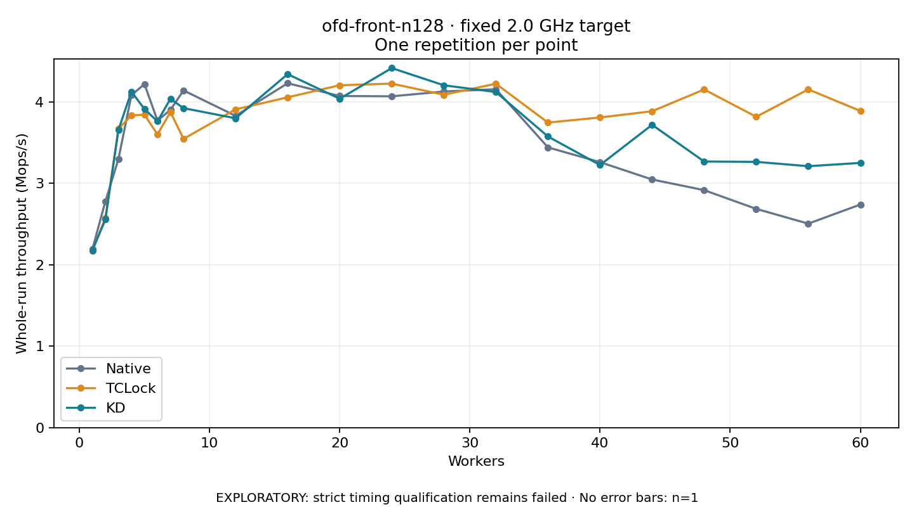

# ofd-front-n128 · fixed 2.0 GHz target

One timed round per point. **EXPLORATORY: strict timing qualification remains failed.** Failed/unrun points have no rate; one round supplies no repeat-variability estimate.

| Workers | Native Mops/s | TCLock Mops/s | KD Mops/s | KD / Native | KD / TCLock | KD execution |
|---:|---:|---:|---:|---:|---:|:---|
| 1 | 2.190 | 2.172 | 2.178 | 0.995× | 1.003× | NO_JIT |
| 2 | 2.778 | 2.576 | 2.554 | 0.919× | 0.992× | NO_JIT |
| 3 | 3.295 | 3.668 | 3.655 | 1.109× | 0.996× | NO_JIT |
| 4 | 4.082 | 3.834 | 4.125 | 1.011× | 1.076× | NO_JIT |
| 5 | 4.217 | 3.842 | 3.911 | 0.928× | 1.018× | NO_JIT |
| 6 | 3.770 | 3.600 | 3.760 | 0.997× | 1.044× | NO_JIT |
| 7 | 3.901 | 3.874 | 4.037 | 1.035× | 1.042× | NO_JIT |
| 8 | 4.139 | 3.545 | 3.922 | 0.947× | 1.106× | NO_JIT |
| 12 | 3.828 | 3.907 | 3.798 | 0.992× | 0.972× | RETURNED_JIT |
| 16 | 4.228 | 4.055 | 4.340 | 1.026× | 1.070× | RETURNED_JIT |
| 20 | 4.071 | 4.203 | 4.038 | 0.992× | 0.961× | RETURNED_JIT |
| 24 | 4.067 | 4.223 | 4.414 | 1.085× | 1.045× | RETURNED_JIT |
| 28 | 4.126 | 4.086 | 4.203 | 1.018× | 1.028× | RETURNED_JIT |
| 32 | 4.155 | 4.222 | 4.120 | 0.992× | 0.976× | RETURNED_JIT |
| 36 | 3.440 | 3.745 | 3.574 | 1.039× | 0.954× | RETURNED_JIT |
| 40 | 3.259 | 3.808 | 3.224 | 0.989× | 0.847× | RETURNED_JIT |
| 44 | 3.046 | 3.884 | 3.717 | 1.220× | 0.957× | RETURNED_JIT |
| 48 | 2.915 | 4.151 | 3.267 | 1.121× | 0.787× | RETURNED_JIT |
| 52 | 2.686 | 3.816 | 3.263 | 1.215× | 0.855× | RETURNED_JIT |
| 56 | 2.504 | 4.152 | 3.209 | 1.282× | 0.773× | RETURNED_JIT |
| 60 | 2.739 | 3.888 | 3.249 | 1.186× | 0.836× | RETURNED_JIT |

[Full-precision table](table.csv)

Frozen source: `a9aeb280a68242818aa469d8277e0c5a22fffee1`. [Archive hashes, frozen-validator replay and exact lifecycle checks](audit.json). Measured points: **63**; failed: **0**; unrun: **0**. Failed/unrun points have no throughput value. The full raw archive remains the primary receipt; compact JSON copies stay under the raw audit path.

Whole-run throughput is completed operations divided by the recorded wall interval; peak rates use the frozen full-cohort progress-window validator. Reciprocal throughput is an aggregate service interval, not operation latency. Returned completion share counts eligible writer operations (snapshot reads for the extracted snapshot cases). NO_JIT points are local execution evidence. One observation cannot establish statistical superiority.

Frequency readbacks are bound before/after this workload. Fixed frequency does not repair the separately failed strict host task-membership gate. Exact output checks and drain validate the retained execution; offline replay does not rerun kernel bodies or syscalls.

Frozen score-ineligible observations, if any, retain their separately labeled raw rate in the CSV and are excluded from the ordinary chart and ratios. Valid NO_JIT observations remain plotted.
