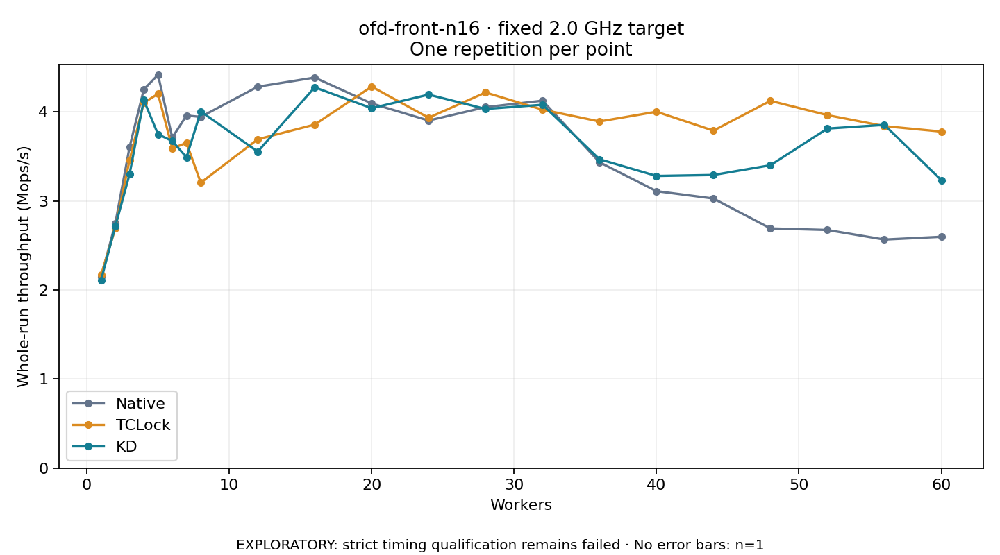

# ofd-front-n16 · fixed 2.0 GHz target

One timed round per point. **EXPLORATORY: strict timing qualification remains failed.** Failed/unrun points have no rate; one round supplies no repeat-variability estimate.

| Workers | Native Mops/s | TCLock Mops/s | KD Mops/s | KD / Native | KD / TCLock | KD execution |
|---:|---:|---:|---:|---:|---:|:---|
| 1 | 2.144 | 2.168 | 2.110 | 0.984× | 0.974× | NO_JIT |
| 2 | 2.746 | 2.692 | 2.715 | 0.989× | 1.008× | NO_JIT |
| 3 | 3.603 | 3.457 | 3.299 | 0.916× | 0.954× | NO_JIT |
| 4 | 4.251 | 4.102 | 4.132 | 0.972× | 1.007× | NO_JIT |
| 5 | 4.416 | 4.202 | 3.748 | 0.849× | 0.892× | NO_JIT |
| 6 | 3.711 | 3.591 | 3.672 | 0.989× | 1.023× | NO_JIT |
| 7 | 3.959 | 3.652 | 3.490 | 0.882× | 0.956× | NO_JIT |
| 8 | 3.943 | 3.205 | 4.005 | 1.016× | 1.250× | NO_JIT |
| 12 | 4.282 | 3.692 | 3.554 | 0.830× | 0.963× | RETURNED_JIT |
| 16 | 4.385 | 3.857 | 4.275 | 0.975× | 1.108× | RETURNED_JIT |
| 20 | 4.095 | 4.284 | 4.041 | 0.987× | 0.943× | RETURNED_JIT |
| 24 | 3.903 | 3.934 | 4.194 | 1.075× | 1.066× | RETURNED_JIT |
| 28 | 4.053 | 4.217 | 4.033 | 0.995× | 0.956× | RETURNED_JIT |
| 32 | 4.126 | 4.025 | 4.080 | 0.989× | 1.014× | RETURNED_JIT |
| 36 | 3.434 | 3.892 | 3.468 | 1.010× | 0.891× | RETURNED_JIT |
| 40 | 3.110 | 4.002 | 3.280 | 1.055× | 0.820× | RETURNED_JIT |
| 44 | 3.027 | 3.789 | 3.292 | 1.087× | 0.869× | RETURNED_JIT |
| 48 | 2.692 | 4.124 | 3.401 | 1.263× | 0.825× | RETURNED_JIT |
| 52 | 2.674 | 3.963 | 3.812 | 1.426× | 0.962× | RETURNED_JIT |
| 56 | 2.566 | 3.840 | 3.854 | 1.502× | 1.004× | RETURNED_JIT |
| 60 | 2.597 | 3.779 | 3.234 | 1.245× | 0.856× | RETURNED_JIT |

[Full-precision table](table.csv)

Frozen source: `a9aeb280a68242818aa469d8277e0c5a22fffee1`. [Archive hashes, frozen-validator replay and exact lifecycle checks](audit.json). Measured points: **63**; failed: **0**; unrun: **0**. Failed/unrun points have no throughput value. The full raw archive remains the primary receipt; compact JSON copies stay under the raw audit path.

Whole-run throughput is completed operations divided by the recorded wall interval; peak rates use the frozen full-cohort progress-window validator. Reciprocal throughput is an aggregate service interval, not operation latency. Returned completion share counts eligible writer operations (snapshot reads for the extracted snapshot cases). NO_JIT points are local execution evidence. One observation cannot establish statistical superiority.

Frequency readbacks are bound before/after this workload. Fixed frequency does not repair the separately failed strict host task-membership gate. Exact output checks and drain validate the retained execution; offline replay does not rerun kernel bodies or syscalls.

Frozen score-ineligible observations, if any, retain their separately labeled raw rate in the CSV and are excluded from the ordinary chart and ratios. Valid NO_JIT observations remain plotted.
