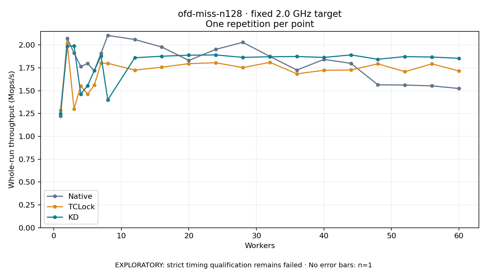

# ofd-miss-n128 · fixed 2.0 GHz target

One timed round per point. **EXPLORATORY: strict timing qualification remains failed.** Failed/unrun points have no rate; one round supplies no repeat-variability estimate.

| Workers | Native Mops/s | TCLock Mops/s | KD Mops/s | KD / Native | KD / TCLock | KD execution |
|---:|---:|---:|---:|---:|---:|:---|
| 1 | 1.222 | 1.285 | 1.246 | 1.020× | 0.970× | NO_JIT |
| 2 | 2.072 | 2.014 | 1.987 | 0.959× | 0.987× | NO_JIT |
| 3 | 1.912 | 1.300 | 1.989 | 1.040× | 1.531× | NO_JIT |
| 4 | 1.764 | 1.552 | 1.461 | 0.828× | 0.941× | NO_JIT |
| 5 | 1.797 | 1.462 | 1.554 | 0.865× | 1.063× | NO_JIT |
| 6 | 1.718 | 1.561 | 1.719 | 1.000× | 1.101× | NO_JIT |
| 7 | 1.910 | 1.802 | 1.879 | 0.984× | 1.043× | NO_JIT |
| 8 | 2.104 | 1.799 | 1.399 | 0.665× | 0.778× | RETURNED_JIT |
| 12 | 2.059 | 1.725 | 1.860 | 0.903× | 1.079× | RETURNED_JIT |
| 16 | 1.977 | 1.757 | 1.877 | 0.949× | 1.068× | RETURNED_JIT |
| 20 | 1.830 | 1.795 | 1.888 | 1.031× | 1.052× | RETURNED_JIT |
| 24 | 1.952 | 1.805 | 1.890 | 0.968× | 1.047× | RETURNED_JIT |
| 28 | 2.029 | 1.752 | 1.864 | 0.919× | 1.064× | RETURNED_JIT |
| 32 | 1.874 | 1.810 | 1.871 | 0.998× | 1.034× | RETURNED_JIT |
| 36 | 1.725 | 1.684 | 1.874 | 1.086× | 1.113× | RETURNED_JIT |
| 40 | 1.842 | 1.723 | 1.863 | 1.012× | 1.081× | RETURNED_JIT |
| 44 | 1.799 | 1.726 | 1.891 | 1.051× | 1.095× | RETURNED_JIT |
| 48 | 1.564 | 1.793 | 1.843 | 1.179× | 1.028× | RETURNED_JIT |
| 52 | 1.561 | 1.708 | 1.873 | 1.199× | 1.097× | RETURNED_JIT |
| 56 | 1.552 | 1.793 | 1.867 | 1.203× | 1.041× | RETURNED_JIT |
| 60 | 1.523 | 1.714 | 1.854 | 1.217× | 1.081× | RETURNED_JIT |

[Full-precision table](table.csv)

Frozen source: `a9aeb280a68242818aa469d8277e0c5a22fffee1`. [Archive hashes, frozen-validator replay and exact lifecycle checks](audit.json). Measured points: **63**; failed: **0**; unrun: **0**. Failed/unrun points have no throughput value. The full raw archive remains the primary receipt; compact JSON copies stay under the raw audit path.

Whole-run throughput is completed operations divided by the recorded wall interval; peak rates use the frozen full-cohort progress-window validator. Reciprocal throughput is an aggregate service interval, not operation latency. Returned completion share counts eligible writer operations (snapshot reads for the extracted snapshot cases). NO_JIT points are local execution evidence. One observation cannot establish statistical superiority.

Frequency readbacks are bound before/after this workload. Fixed frequency does not repair the separately failed strict host task-membership gate. Exact output checks and drain validate the retained execution; offline replay does not rerun kernel bodies or syscalls.

Frozen score-ineligible observations, if any, retain their separately labeled raw rate in the CSV and are excluded from the ordinary chart and ratios. Valid NO_JIT observations remain plotted.
