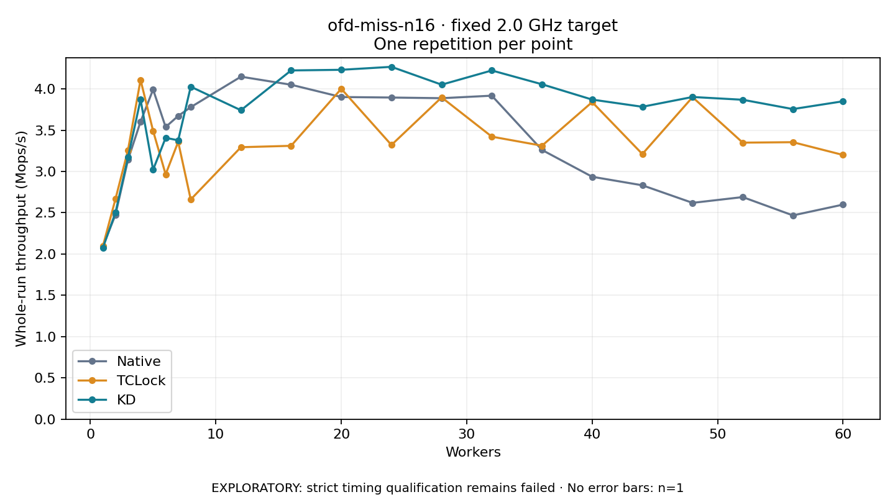

# ofd-miss-n16 · fixed 2.0 GHz target

One timed round per point. **EXPLORATORY: strict timing qualification remains failed.** Failed/unrun points have no rate; one round supplies no repeat-variability estimate.

| Workers | Native Mops/s | TCLock Mops/s | KD Mops/s | KD / Native | KD / TCLock | KD execution |
|---:|---:|---:|---:|---:|---:|:---|
| 1 | 2.093 | 2.096 | 2.077 | 0.992× | 0.991× | NO_JIT |
| 2 | 2.476 | 2.666 | 2.502 | 1.011× | 0.939× | NO_JIT |
| 3 | 3.142 | 3.259 | 3.170 | 1.009× | 0.973× | NO_JIT |
| 4 | 3.603 | 4.109 | 3.872 | 1.075× | 0.942× | NO_JIT |
| 5 | 3.992 | 3.492 | 3.021 | 0.757× | 0.865× | NO_JIT |
| 6 | 3.538 | 2.965 | 3.408 | 0.963× | 1.149× | NO_JIT |
| 7 | 3.673 | 3.359 | 3.377 | 0.920× | 1.006× | NO_JIT |
| 8 | 3.779 | 2.661 | 4.027 | 1.066× | 1.513× | NO_JIT |
| 12 | 4.148 | 3.294 | 3.741 | 0.902× | 1.136× | RETURNED_JIT |
| 16 | 4.050 | 3.311 | 4.224 | 1.043× | 1.276× | RETURNED_JIT |
| 20 | 3.901 | 4.001 | 4.231 | 1.085× | 1.057× | RETURNED_JIT |
| 24 | 3.895 | 3.321 | 4.267 | 1.095× | 1.285× | RETURNED_JIT |
| 28 | 3.887 | 3.897 | 4.051 | 1.042× | 1.040× | RETURNED_JIT |
| 32 | 3.918 | 3.422 | 4.223 | 1.078× | 1.234× | RETURNED_JIT |
| 36 | 3.261 | 3.312 | 4.056 | 1.244× | 1.225× | RETURNED_JIT |
| 40 | 2.936 | 3.840 | 3.870 | 1.318× | 1.008× | RETURNED_JIT |
| 44 | 2.833 | 3.211 | 3.783 | 1.336× | 1.178× | RETURNED_JIT |
| 48 | 2.620 | 3.900 | 3.902 | 1.489× | 1.001× | RETURNED_JIT |
| 52 | 2.690 | 3.349 | 3.868 | 1.438× | 1.155× | RETURNED_JIT |
| 56 | 2.468 | 3.355 | 3.755 | 1.522× | 1.119× | RETURNED_JIT |
| 60 | 2.599 | 3.200 | 3.850 | 1.482× | 1.203× | RETURNED_JIT |

[Full-precision table](table.csv)

Frozen source: `a9aeb280a68242818aa469d8277e0c5a22fffee1`. [Archive hashes, frozen-validator replay and exact lifecycle checks](audit.json). Measured points: **63**; failed: **0**; unrun: **0**. Failed/unrun points have no throughput value. The full raw archive remains the primary receipt; compact JSON copies stay under the raw audit path.

Whole-run throughput is completed operations divided by the recorded wall interval; peak rates use the frozen full-cohort progress-window validator. Reciprocal throughput is an aggregate service interval, not operation latency. Returned completion share counts eligible writer operations (snapshot reads for the extracted snapshot cases). NO_JIT points are local execution evidence. One observation cannot establish statistical superiority.

Frequency readbacks are bound before/after this workload. Fixed frequency does not repair the separately failed strict host task-membership gate. Exact output checks and drain validate the retained execution; offline replay does not rerun kernel bodies or syscalls.

Frozen score-ineligible observations, if any, retain their separately labeled raw rate in the CSV and are excluded from the ordinary chart and ratios. Valid NO_JIT observations remain plotted.
