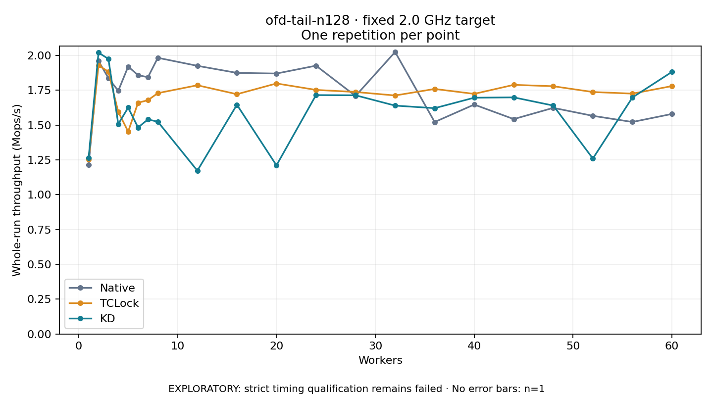

# ofd-tail-n128 · fixed 2.0 GHz target

One timed round per point. **EXPLORATORY: strict timing qualification remains failed.** Failed/unrun points have no rate; one round supplies no repeat-variability estimate.

| Workers | Native Mops/s | TCLock Mops/s | KD Mops/s | KD / Native | KD / TCLock | KD execution |
|---:|---:|---:|---:|---:|---:|:---|
| 1 | 1.214 | 1.252 | 1.263 | 1.041× | 1.009× | NO_JIT |
| 2 | 1.960 | 1.927 | 2.019 | 1.030× | 1.048× | NO_JIT |
| 3 | 1.837 | 1.883 | 1.975 | 1.075× | 1.049× | NO_JIT |
| 4 | 1.745 | 1.594 | 1.507 | 0.863× | 0.945× | NO_JIT |
| 5 | 1.919 | 1.453 | 1.625 | 0.847× | 1.118× | NO_JIT |
| 6 | 1.858 | 1.660 | 1.482 | 0.798× | 0.893× | NO_JIT |
| 7 | 1.843 | 1.678 | 1.540 | 0.836× | 0.918× | NO_JIT |
| 8 | 1.982 | 1.729 | 1.524 | 0.769× | 0.882× | NO_JIT |
| 12 | 1.925 | 1.785 | 1.172 | 0.609× | 0.657× | RETURNED_JIT |
| 16 | 1.874 | 1.721 | 1.645 | 0.878× | 0.956× | RETURNED_JIT |
| 20 | 1.869 | 1.798 | 1.210 | 0.647× | 0.673× | RETURNED_JIT |
| 24 | 1.926 | 1.752 | 1.715 | 0.890× | 0.979× | RETURNED_JIT |
| 28 | 1.708 | 1.737 | 1.713 | 1.003× | 0.986× | RETURNED_JIT |
| 32 | 2.024 | 1.712 | 1.639 | 0.810× | 0.957× | RETURNED_JIT |
| 36 | 1.521 | 1.759 | 1.621 | 1.065× | 0.922× | RETURNED_JIT |
| 40 | 1.647 | 1.723 | 1.696 | 1.030× | 0.984× | RETURNED_JIT |
| 44 | 1.542 | 1.788 | 1.698 | 1.101× | 0.950× | RETURNED_JIT |
| 48 | 1.623 | 1.778 | 1.639 | 1.010× | 0.922× | RETURNED_JIT |
| 52 | 1.566 | 1.737 | 1.259 | 0.804× | 0.725× | RETURNED_JIT |
| 56 | 1.522 | 1.725 | 1.697 | 1.116× | 0.984× | RETURNED_JIT |
| 60 | 1.579 | 1.779 | 1.881 | 1.191× | 1.057× | RETURNED_JIT |

[Full-precision table](table.csv)

Frozen source: `a9aeb280a68242818aa469d8277e0c5a22fffee1`. [Archive hashes, frozen-validator replay and exact lifecycle checks](audit.json). Measured points: **63**; failed: **0**; unrun: **0**. Failed/unrun points have no throughput value. The full raw archive remains the primary receipt; compact JSON copies stay under the raw audit path.

Whole-run throughput is completed operations divided by the recorded wall interval; peak rates use the frozen full-cohort progress-window validator. Reciprocal throughput is an aggregate service interval, not operation latency. Returned completion share counts eligible writer operations (snapshot reads for the extracted snapshot cases). NO_JIT points are local execution evidence. One observation cannot establish statistical superiority.

Frequency readbacks are bound before/after this workload. Fixed frequency does not repair the separately failed strict host task-membership gate. Exact output checks and drain validate the retained execution; offline replay does not rerun kernel bodies or syscalls.

Frozen score-ineligible observations, if any, retain their separately labeled raw rate in the CSV and are excluded from the ordinary chart and ratios. Valid NO_JIT observations remain plotted.
