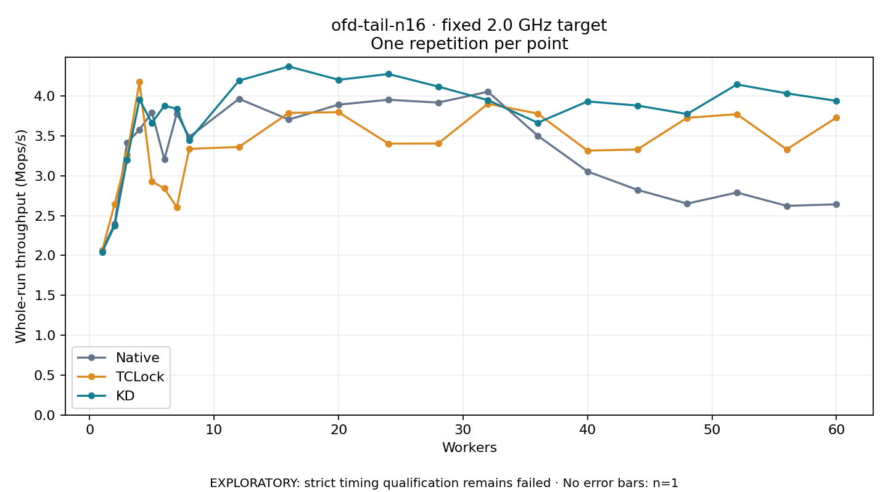

# ofd-tail-n16 · fixed 2.0 GHz target

One timed round per point. **EXPLORATORY: strict timing qualification remains failed.** Failed/unrun points have no rate; one round supplies no repeat-variability estimate.

| Workers | Native Mops/s | TCLock Mops/s | KD Mops/s | KD / Native | KD / TCLock | KD execution |
|---:|---:|---:|---:|---:|---:|:---|
| 1 | 2.063 | 2.060 | 2.044 | 0.990× | 0.992× | NO_JIT |
| 2 | 2.394 | 2.643 | 2.373 | 0.991× | 0.898× | NO_JIT |
| 3 | 3.419 | 3.258 | 3.198 | 0.935× | 0.982× | NO_JIT |
| 4 | 3.577 | 4.178 | 3.956 | 1.106× | 0.947× | NO_JIT |
| 5 | 3.795 | 2.929 | 3.664 | 0.965× | 1.251× | NO_JIT |
| 6 | 3.205 | 2.841 | 3.878 | 1.210× | 1.365× | NO_JIT |
| 7 | 3.782 | 2.604 | 3.841 | 1.016× | 1.475× | NO_JIT |
| 8 | 3.487 | 3.338 | 3.448 | 0.989× | 1.033× | RETURNED_JIT |
| 12 | 3.966 | 3.361 | 4.195 | 1.058× | 1.248× | RETURNED_JIT |
| 16 | 3.705 | 3.790 | 4.371 | 1.180× | 1.154× | RETURNED_JIT |
| 20 | 3.893 | 3.798 | 4.204 | 1.080× | 1.107× | RETURNED_JIT |
| 24 | 3.954 | 3.404 | 4.277 | 1.082× | 1.256× | RETURNED_JIT |
| 28 | 3.919 | 3.405 | 4.119 | 1.051× | 1.210× | RETURNED_JIT |
| 32 | 4.054 | 3.904 | 3.949 | 0.974× | 1.012× | RETURNED_JIT |
| 36 | 3.502 | 3.780 | 3.666 | 1.047× | 0.970× | RETURNED_JIT |
| 40 | 3.055 | 3.316 | 3.933 | 1.287× | 1.186× | RETURNED_JIT |
| 44 | 2.824 | 3.330 | 3.882 | 1.374× | 1.166× | RETURNED_JIT |
| 48 | 2.651 | 3.728 | 3.775 | 1.424× | 1.013× | RETURNED_JIT |
| 52 | 2.790 | 3.773 | 4.146 | 1.486× | 1.099× | RETURNED_JIT |
| 56 | 2.623 | 3.332 | 4.034 | 1.538× | 1.211× | RETURNED_JIT |
| 60 | 2.643 | 3.730 | 3.940 | 1.491× | 1.056× | RETURNED_JIT |

[Full-precision table](table.csv)

Frozen source: `a9aeb280a68242818aa469d8277e0c5a22fffee1`. [Archive hashes, frozen-validator replay and exact lifecycle checks](audit.json). Measured points: **63**; failed: **0**; unrun: **0**. Failed/unrun points have no throughput value. The full raw archive remains the primary receipt; compact JSON copies stay under the raw audit path.

Whole-run throughput is completed operations divided by the recorded wall interval; peak rates use the frozen full-cohort progress-window validator. Reciprocal throughput is an aggregate service interval, not operation latency. Returned completion share counts eligible writer operations (snapshot reads for the extracted snapshot cases). NO_JIT points are local execution evidence. One observation cannot establish statistical superiority.

Frequency readbacks are bound before/after this workload. Fixed frequency does not repair the separately failed strict host task-membership gate. Exact output checks and drain validate the retained execution; offline replay does not rerun kernel bodies or syscalls.

Frozen score-ineligible observations, if any, retain their separately labeled raw rate in the CSV and are excluded from the ordinary chart and ratios. Valid NO_JIT observations remain plotted.
