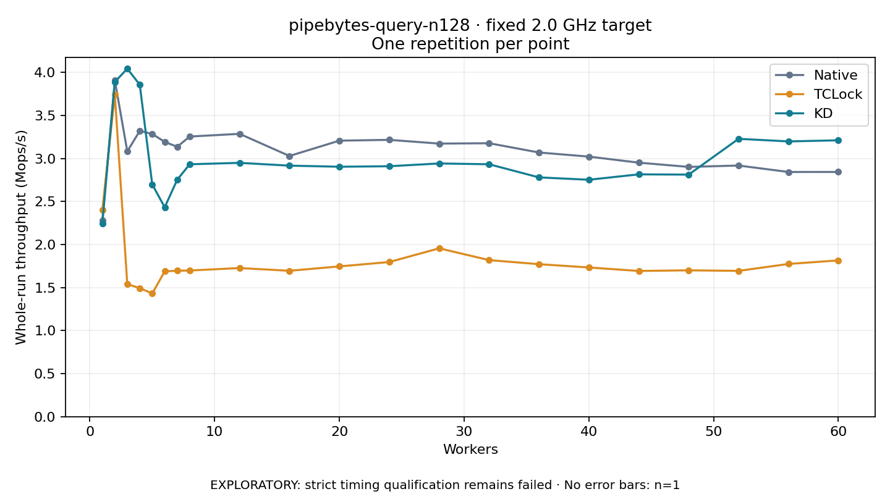

# pipebytes-query-n128 · fixed 2.0 GHz target

One timed round per point. **EXPLORATORY: strict timing qualification remains failed.** Failed/unrun points have no rate; one round supplies no repeat-variability estimate.

| Workers | Native Mops/s | TCLock Mops/s | KD Mops/s | KD / Native | KD / TCLock | KD execution |
|---:|---:|---:|---:|---:|---:|:---|
| 1 | 2.284 | 2.403 | 2.247 | 0.984× | 0.935× | NO_JIT |
| 2 | 3.909 | 3.743 | 3.890 | 0.995× | 1.039× | NO_JIT |
| 3 | 3.083 | 1.540 | 4.044 | 1.312× | 2.626× | NO_JIT |
| 4 | 3.321 | 1.494 | 3.859 | 1.162× | 2.582× | RETURNED_JIT |
| 5 | 3.286 | 1.431 | 2.699 | 0.821× | 1.886× | RETURNED_JIT |
| 6 | 3.194 | 1.689 | 2.434 | 0.762× | 1.441× | RETURNED_JIT |
| 7 | 3.137 | 1.696 | 2.753 | 0.878× | 1.623× | RETURNED_JIT |
| 8 | 3.256 | 1.699 | 2.933 | 0.901× | 1.727× | RETURNED_JIT |
| 12 | 3.287 | 1.727 | 2.950 | 0.897× | 1.708× | RETURNED_JIT |
| 16 | 3.030 | 1.696 | 2.917 | 0.963× | 1.721× | RETURNED_JIT |
| 20 | 3.208 | 1.746 | 2.905 | 0.906× | 1.663× | RETURNED_JIT |
| 24 | 3.217 | 1.797 | 2.911 | 0.905× | 1.620× | RETURNED_JIT |
| 28 | 3.174 | 1.957 | 2.943 | 0.927× | 1.504× | RETURNED_JIT |
| 32 | 3.178 | 1.820 | 2.934 | 0.923× | 1.612× | RETURNED_JIT |
| 36 | 3.070 | 1.772 | 2.781 | 0.906× | 1.569× | RETURNED_JIT |
| 40 | 3.022 | 1.734 | 2.753 | 0.911× | 1.588× | RETURNED_JIT |
| 44 | 2.952 | 1.694 | 2.816 | 0.954× | 1.663× | RETURNED_JIT |
| 48 | 2.903 | 1.701 | 2.813 | 0.969× | 1.654× | RETURNED_JIT |
| 52 | 2.919 | 1.694 | 3.229 | 1.106× | 1.906× | RETURNED_JIT |
| 56 | 2.844 | 1.775 | 3.199 | 1.125× | 1.803× | RETURNED_JIT |
| 60 | 2.844 | 1.816 | 3.212 | 1.129× | 1.768× | RETURNED_JIT |

[Full-precision table](table.csv)

Frozen source: `a9aeb280a68242818aa469d8277e0c5a22fffee1`. [Archive hashes, frozen-validator replay and exact lifecycle checks](audit.json). Measured points: **63**; failed: **0**; unrun: **0**. Failed/unrun points have no throughput value. The full raw archive remains the primary receipt; compact JSON copies stay under the raw audit path.

Whole-run throughput is completed operations divided by the recorded wall interval; peak rates use the frozen full-cohort progress-window validator. Reciprocal throughput is an aggregate service interval, not operation latency. Returned completion share counts eligible writer operations (snapshot reads for the extracted snapshot cases). NO_JIT points are local execution evidence. One observation cannot establish statistical superiority.

Frequency readbacks are bound before/after this workload. Fixed frequency does not repair the separately failed strict host task-membership gate. Exact output checks and drain validate the retained execution; offline replay does not rerun kernel bodies or syscalls.

Frozen score-ineligible observations, if any, retain their separately labeled raw rate in the CSV and are excluded from the ordinary chart and ratios. Valid NO_JIT observations remain plotted.
