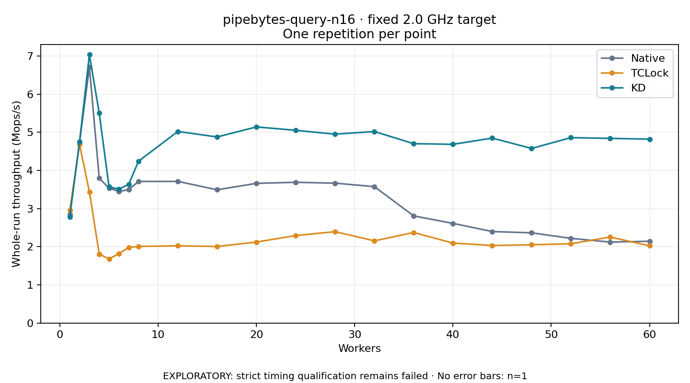

# pipebytes-query-n16 · fixed 2.0 GHz target

One timed round per point. **EXPLORATORY: strict timing qualification remains failed.** Failed/unrun points have no rate; one round supplies no repeat-variability estimate.

| Workers | Native Mops/s | TCLock Mops/s | KD Mops/s | KD / Native | KD / TCLock | KD execution |
|---:|---:|---:|---:|---:|---:|:---|
| 1 | 2.850 | 2.952 | 2.779 | 0.975× | 0.942× | NO_JIT |
| 2 | 4.734 | 4.678 | 4.752 | 1.004× | 1.016× | NO_JIT |
| 3 | 6.706 | 3.440 | 7.031 | 1.048× | 2.044× | NO_JIT |
| 4 | 3.796 | 1.809 | 5.501 | 1.449× | 3.041× | RETURNED_JIT |
| 5 | 3.533 | 1.678 | 3.569 | 1.010× | 2.127× | RETURNED_JIT |
| 6 | 3.449 | 1.820 | 3.509 | 1.017× | 1.928× | RETURNED_JIT |
| 7 | 3.494 | 1.980 | 3.636 | 1.041× | 1.836× | RETURNED_JIT |
| 8 | 3.711 | 2.007 | 4.241 | 1.143× | 2.113× | RETURNED_JIT |
| 12 | 3.712 | 2.024 | 5.021 | 1.353× | 2.481× | RETURNED_JIT |
| 16 | 3.492 | 2.007 | 4.877 | 1.397× | 2.430× | RETURNED_JIT |
| 20 | 3.661 | 2.122 | 5.139 | 1.404× | 2.422× | RETURNED_JIT |
| 24 | 3.688 | 2.293 | 5.051 | 1.369× | 2.203× | RETURNED_JIT |
| 28 | 3.665 | 2.394 | 4.950 | 1.350× | 2.067× | RETURNED_JIT |
| 32 | 3.575 | 2.154 | 5.019 | 1.404× | 2.330× | RETURNED_JIT |
| 36 | 2.808 | 2.373 | 4.700 | 1.674× | 1.981× | RETURNED_JIT |
| 40 | 2.612 | 2.096 | 4.683 | 1.793× | 2.235× | RETURNED_JIT |
| 44 | 2.397 | 2.033 | 4.846 | 2.022× | 2.384× | RETURNED_JIT |
| 48 | 2.364 | 2.051 | 4.575 | 1.935× | 2.231× | RETURNED_JIT |
| 52 | 2.219 | 2.077 | 4.858 | 2.189× | 2.339× | RETURNED_JIT |
| 56 | 2.122 | 2.254 | 4.839 | 2.281× | 2.147× | RETURNED_JIT |
| 60 | 2.143 | 2.024 | 4.819 | 2.248× | 2.381× | RETURNED_JIT |

[Full-precision table](table.csv)

Frozen source: `a9aeb280a68242818aa469d8277e0c5a22fffee1`. [Archive hashes, frozen-validator replay and exact lifecycle checks](audit.json). Measured points: **63**; failed: **0**; unrun: **0**. Failed/unrun points have no throughput value. The full raw archive remains the primary receipt; compact JSON copies stay under the raw audit path.

Whole-run throughput is completed operations divided by the recorded wall interval; peak rates use the frozen full-cohort progress-window validator. Reciprocal throughput is an aggregate service interval, not operation latency. Returned completion share counts eligible writer operations (snapshot reads for the extracted snapshot cases). NO_JIT points are local execution evidence. One observation cannot establish statistical superiority.

Frequency readbacks are bound before/after this workload. Fixed frequency does not repair the separately failed strict host task-membership gate. Exact output checks and drain validate the retained execution; offline replay does not rerun kernel bodies or syscalls.

Frozen score-ineligible observations, if any, retain their separately labeled raw rate in the CSV and are excluded from the ordinary chart and ratios. Valid NO_JIT observations remain plotted.
