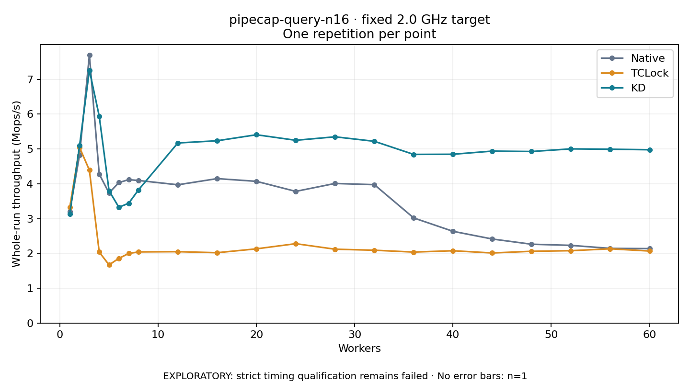

# pipecap-query-n16 · fixed 2.0 GHz target

One timed round per point. **EXPLORATORY: strict timing qualification remains failed.** Failed/unrun points have no rate; one round supplies no repeat-variability estimate.

| Workers | Native Mops/s | TCLock Mops/s | KD Mops/s | KD / Native | KD / TCLock | KD execution |
|---:|---:|---:|---:|---:|---:|:---|
| 1 | 3.196 | 3.319 | 3.124 | 0.977× | 0.941× | NO_JIT |
| 2 | 4.828 | 5.041 | 5.094 | 1.055× | 1.010× | NO_JIT |
| 3 | 7.695 | 4.389 | 7.261 | 0.944× | 1.654× | NO_JIT |
| 4 | 4.277 | 2.038 | 5.941 | 1.389× | 2.915× | RETURNED_JIT |
| 5 | 3.733 | 1.670 | 3.797 | 1.017× | 2.273× | RETURNED_JIT |
| 6 | 4.033 | 1.857 | 3.324 | 0.824× | 1.790× | RETURNED_JIT |
| 7 | 4.117 | 1.998 | 3.440 | 0.836× | 1.722× | RETURNED_JIT |
| 8 | 4.094 | 2.042 | 3.824 | 0.934× | 1.872× | RETURNED_JIT |
| 12 | 3.969 | 2.049 | 5.170 | 1.303× | 2.523× | RETURNED_JIT |
| 16 | 4.147 | 2.020 | 5.233 | 1.262× | 2.591× | RETURNED_JIT |
| 20 | 4.069 | 2.130 | 5.406 | 1.329× | 2.538× | RETURNED_JIT |
| 24 | 3.780 | 2.278 | 5.247 | 1.388× | 2.303× | RETURNED_JIT |
| 28 | 4.008 | 2.120 | 5.347 | 1.334× | 2.522× | RETURNED_JIT |
| 32 | 3.972 | 2.091 | 5.218 | 1.314× | 2.496× | RETURNED_JIT |
| 36 | 3.018 | 2.038 | 4.842 | 1.604× | 2.376× | RETURNED_JIT |
| 40 | 2.634 | 2.076 | 4.846 | 1.840× | 2.334× | RETURNED_JIT |
| 44 | 2.413 | 2.012 | 4.937 | 2.046× | 2.454× | RETURNED_JIT |
| 48 | 2.263 | 2.060 | 4.925 | 2.177× | 2.391× | RETURNED_JIT |
| 52 | 2.230 | 2.077 | 5.001 | 2.242× | 2.407× | RETURNED_JIT |
| 56 | 2.144 | 2.131 | 4.990 | 2.328× | 2.341× | RETURNED_JIT |
| 60 | 2.137 | 2.067 | 4.976 | 2.328× | 2.407× | RETURNED_JIT |

[Full-precision table](table.csv)

Frozen source: `a9aeb280a68242818aa469d8277e0c5a22fffee1`. [Archive hashes, frozen-validator replay and exact lifecycle checks](audit.json). Measured points: **63**; failed: **0**; unrun: **0**. Failed/unrun points have no throughput value. The full raw archive remains the primary receipt; compact JSON copies stay under the raw audit path.

Whole-run throughput is completed operations divided by the recorded wall interval; peak rates use the frozen full-cohort progress-window validator. Reciprocal throughput is an aggregate service interval, not operation latency. Returned completion share counts eligible writer operations (snapshot reads for the extracted snapshot cases). NO_JIT points are local execution evidence. One observation cannot establish statistical superiority.

Frequency readbacks are bound before/after this workload. Fixed frequency does not repair the separately failed strict host task-membership gate. Exact output checks and drain validate the retained execution; offline replay does not rerun kernel bodies or syscalls.

Frozen score-ineligible observations, if any, retain their separately labeled raw rate in the CSV and are excluded from the ordinary chart and ratios. Valid NO_JIT observations remain plotted.
