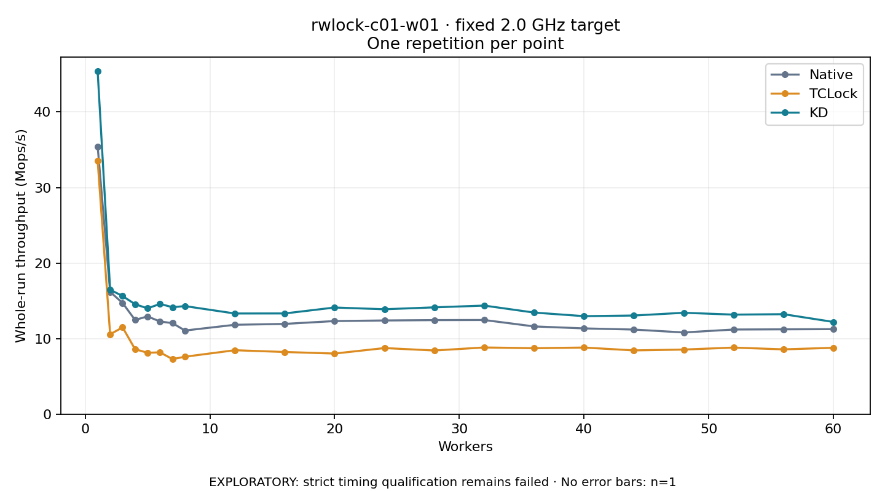

# rwlock-c01-w01 · fixed 2.0 GHz target

One timed round per point. **EXPLORATORY: strict timing qualification remains failed.** Failed/unrun points have no rate; one round supplies no repeat-variability estimate.

| Workers | Native Mops/s | TCLock Mops/s | KD Mops/s | KD / Native | KD / TCLock | KD execution |
|---:|---:|---:|---:|---:|---:|:---|
| 1 | 35.443 | 33.545 | 45.367 | 1.280× | 1.352× | NO_JIT |
| 2 | 16.190 | 10.573 | 16.473 | 1.017× | 1.558× | NO_JIT |
| 3 | 14.713 | 11.488 | 15.630 | 1.062× | 1.361× | NO_JIT |
| 4 | 12.470 | 8.596 | 14.553 | 1.167× | 1.693× | NO_JIT |
| 5 | 12.939 | 8.124 | 14.005 | 1.082× | 1.724× | NO_JIT |
| 6 | 12.262 | 8.179 | 14.592 | 1.190× | 1.784× | NO_JIT |
| 7 | 12.048 | 7.283 | 14.155 | 1.175× | 1.943× | NO_JIT |
| 8 | 11.068 | 7.600 | 14.303 | 1.292× | 1.882× | NO_JIT |
| 12 | 11.828 | 8.461 | 13.324 | 1.127× | 1.575× | NO_JIT |
| 16 | 11.946 | 8.227 | 13.330 | 1.116× | 1.620× | RETURNED_JIT |
| 20 | 12.322 | 8.020 | 14.116 | 1.146× | 1.760× | RETURNED_JIT |
| 24 | 12.400 | 8.747 | 13.885 | 1.120× | 1.587× | RETURNED_JIT |
| 28 | 12.446 | 8.424 | 14.138 | 1.136× | 1.678× | RETURNED_JIT |
| 32 | 12.461 | 8.826 | 14.370 | 1.153× | 1.628× | RETURNED_JIT |
| 36 | 11.611 | 8.730 | 13.445 | 1.158× | 1.540× | RETURNED_JIT |
| 40 | 11.350 | 8.815 | 12.971 | 1.143× | 1.472× | RETURNED_JIT |
| 44 | 11.195 | 8.437 | 13.056 | 1.166× | 1.547× | RETURNED_JIT |
| 48 | 10.813 | 8.550 | 13.419 | 1.241× | 1.569× | RETURNED_JIT |
| 52 | 11.202 | 8.810 | 13.174 | 1.176× | 1.495× | RETURNED_JIT |
| 56 | 11.225 | 8.574 | 13.233 | 1.179× | 1.543× | RETURNED_JIT |
| 60 | 11.253 | 8.782 | 12.204 | 1.085× | 1.390× | RETURNED_JIT |

[Full-precision table](table.csv)

Frozen source: `a9aeb280a68242818aa469d8277e0c5a22fffee1`. [Archive hashes, frozen-validator replay and exact lifecycle checks](audit.json). Measured points: **63**; failed: **0**; unrun: **0**. Failed/unrun points have no throughput value. The full raw archive remains the primary receipt; compact JSON copies stay under the raw audit path.

Whole-run throughput is completed operations divided by the recorded wall interval; peak rates use the frozen full-cohort progress-window validator. Reciprocal throughput is an aggregate service interval, not operation latency. Returned completion share counts eligible writer operations (snapshot reads for the extracted snapshot cases). NO_JIT points are local execution evidence. One observation cannot establish statistical superiority.

Frequency readbacks are bound before/after this workload. Fixed frequency does not repair the separately failed strict host task-membership gate. Exact output checks and drain validate the retained execution; offline replay does not rerun kernel bodies or syscalls.

Frozen score-ineligible observations, if any, retain their separately labeled raw rate in the CSV and are excluded from the ordinary chart and ratios. Valid NO_JIT observations remain plotted.
