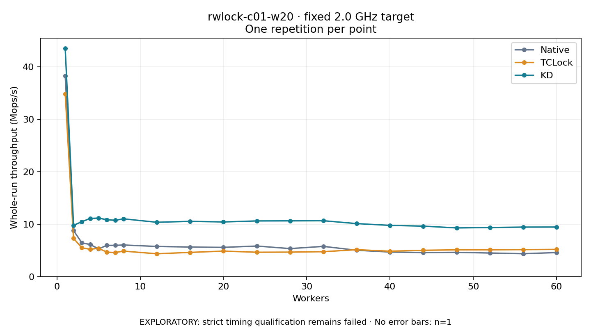

# rwlock-c01-w20 · fixed 2.0 GHz target

One timed round per point. **EXPLORATORY: strict timing qualification remains failed.** Failed/unrun points have no rate; one round supplies no repeat-variability estimate.

| Workers | Native Mops/s | TCLock Mops/s | KD Mops/s | KD / Native | KD / TCLock | KD execution |
|---:|---:|---:|---:|---:|---:|:---|
| 1 | 38.337 | 34.907 | 43.552 | 1.136× | 1.248× | NO_JIT |
| 2 | 8.801 | 7.309 | 9.793 | 1.113× | 1.340× | NO_JIT |
| 3 | 6.457 | 5.499 | 10.487 | 1.624× | 1.907× | NO_JIT |
| 4 | 6.131 | 5.228 | 11.111 | 1.812× | 2.125× | NO_JIT |
| 5 | 5.296 | 5.409 | 11.169 | 2.109× | 2.065× | NO_JIT |
| 6 | 5.971 | 4.676 | 10.866 | 1.820× | 2.324× | NO_JIT |
| 7 | 5.968 | 4.600 | 10.752 | 1.802× | 2.337× | NO_JIT |
| 8 | 6.042 | 4.871 | 11.032 | 1.826× | 2.265× | NO_JIT |
| 12 | 5.762 | 4.367 | 10.376 | 1.801× | 2.376× | RETURNED_JIT |
| 16 | 5.649 | 4.630 | 10.553 | 1.868× | 2.279× | RETURNED_JIT |
| 20 | 5.588 | 4.872 | 10.436 | 1.868× | 2.142× | RETURNED_JIT |
| 24 | 5.841 | 4.659 | 10.631 | 1.820× | 2.282× | RETURNED_JIT |
| 28 | 5.354 | 4.681 | 10.648 | 1.989× | 2.275× | RETURNED_JIT |
| 32 | 5.774 | 4.761 | 10.670 | 1.848× | 2.241× | RETURNED_JIT |
| 36 | 5.037 | 5.145 | 10.123 | 2.010× | 1.967× | RETURNED_JIT |
| 40 | 4.692 | 4.854 | 9.783 | 2.085× | 2.015× | RETURNED_JIT |
| 44 | 4.602 | 5.031 | 9.638 | 2.094× | 1.916× | RETURNED_JIT |
| 48 | 4.639 | 5.115 | 9.299 | 2.004× | 1.818× | NO_JIT |
| 52 | 4.509 | 5.117 | 9.373 | 2.079× | 1.832× | NO_JIT |
| 56 | 4.380 | 5.157 | 9.455 | 2.159× | 1.834× | NO_JIT |
| 60 | 4.596 | 5.201 | 9.465 | 2.059× | 1.820× | NO_JIT |

[Full-precision table](table.csv)

Frozen source: `a9aeb280a68242818aa469d8277e0c5a22fffee1`. [Archive hashes, frozen-validator replay and exact lifecycle checks](audit.json). Measured points: **63**; failed: **0**; unrun: **0**. Failed/unrun points have no throughput value. The full raw archive remains the primary receipt; compact JSON copies stay under the raw audit path.

Whole-run throughput is completed operations divided by the recorded wall interval; peak rates use the frozen full-cohort progress-window validator. Reciprocal throughput is an aggregate service interval, not operation latency. Returned completion share counts eligible writer operations (snapshot reads for the extracted snapshot cases). NO_JIT points are local execution evidence. One observation cannot establish statistical superiority.

Frequency readbacks are bound before/after this workload. Fixed frequency does not repair the separately failed strict host task-membership gate. Exact output checks and drain validate the retained execution; offline replay does not rerun kernel bodies or syscalls.

Frozen score-ineligible observations, if any, retain their separately labeled raw rate in the CSV and are excluded from the ordinary chart and ratios. Valid NO_JIT observations remain plotted.
