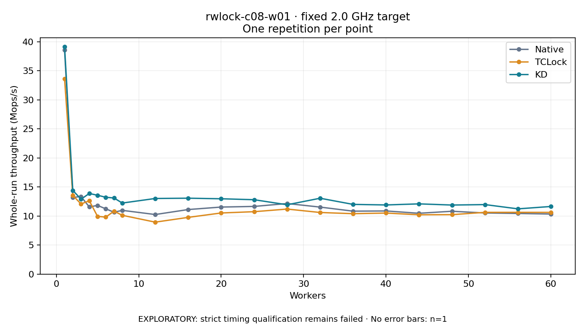

# rwlock-c08-w01 · fixed 2.0 GHz target

One timed round per point. **EXPLORATORY: strict timing qualification remains failed.** Failed/unrun points have no rate; one round supplies no repeat-variability estimate.

| Workers | Native Mops/s | TCLock Mops/s | KD Mops/s | KD / Native | KD / TCLock | KD execution |
|---:|---:|---:|---:|---:|---:|:---|
| 1 | 38.551 | 33.631 | 39.156 | 1.016× | 1.164× | NO_JIT |
| 2 | 13.201 | 13.548 | 14.412 | 1.092× | 1.064× | NO_JIT |
| 3 | 13.345 | 12.069 | 12.893 | 0.966× | 1.068× | NO_JIT |
| 4 | 11.560 | 12.626 | 13.875 | 1.200× | 1.099× | NO_JIT |
| 5 | 11.827 | 9.939 | 13.570 | 1.147× | 1.365× | NO_JIT |
| 6 | 11.234 | 9.811 | 13.227 | 1.177× | 1.348× | NO_JIT |
| 7 | 10.652 | 10.834 | 13.100 | 1.230× | 1.209× | NO_JIT |
| 8 | 10.973 | 10.121 | 12.230 | 1.115× | 1.208× | NO_JIT |
| 12 | 10.254 | 8.945 | 13.015 | 1.269× | 1.455× | NO_JIT |
| 16 | 11.112 | 9.765 | 13.064 | 1.176× | 1.338× | NO_JIT |
| 20 | 11.540 | 10.521 | 12.966 | 1.124× | 1.232× | RETURNED_JIT |
| 24 | 11.649 | 10.744 | 12.802 | 1.099× | 1.192× | RETURNED_JIT |
| 28 | 12.148 | 11.195 | 11.935 | 0.982× | 1.066× | RETURNED_JIT |
| 32 | 11.534 | 10.606 | 13.058 | 1.132× | 1.231× | RETURNED_JIT |
| 36 | 10.834 | 10.400 | 11.998 | 1.107× | 1.154× | RETURNED_JIT |
| 40 | 10.869 | 10.507 | 11.903 | 1.095× | 1.133× | RETURNED_JIT |
| 44 | 10.471 | 10.212 | 12.089 | 1.155× | 1.184× | RETURNED_JIT |
| 48 | 10.818 | 10.232 | 11.886 | 1.099× | 1.162× | RETURNED_JIT |
| 52 | 10.520 | 10.631 | 11.965 | 1.137× | 1.126× | RETURNED_JIT |
| 56 | 10.438 | 10.634 | 11.231 | 1.076× | 1.056× | RETURNED_JIT |
| 60 | 10.339 | 10.624 | 11.641 | 1.126× | 1.096× | RETURNED_JIT |

[Full-precision table](table.csv)

Frozen source: `a9aeb280a68242818aa469d8277e0c5a22fffee1`. [Archive hashes, frozen-validator replay and exact lifecycle checks](audit.json). Measured points: **63**; failed: **0**; unrun: **0**. Failed/unrun points have no throughput value. The full raw archive remains the primary receipt; compact JSON copies stay under the raw audit path.

Whole-run throughput is completed operations divided by the recorded wall interval; peak rates use the frozen full-cohort progress-window validator. Reciprocal throughput is an aggregate service interval, not operation latency. Returned completion share counts eligible writer operations (snapshot reads for the extracted snapshot cases). NO_JIT points are local execution evidence. One observation cannot establish statistical superiority.

Frequency readbacks are bound before/after this workload. Fixed frequency does not repair the separately failed strict host task-membership gate. Exact output checks and drain validate the retained execution; offline replay does not rerun kernel bodies or syscalls.

Frozen score-ineligible observations, if any, retain their separately labeled raw rate in the CSV and are excluded from the ordinary chart and ratios. Valid NO_JIT observations remain plotted.
