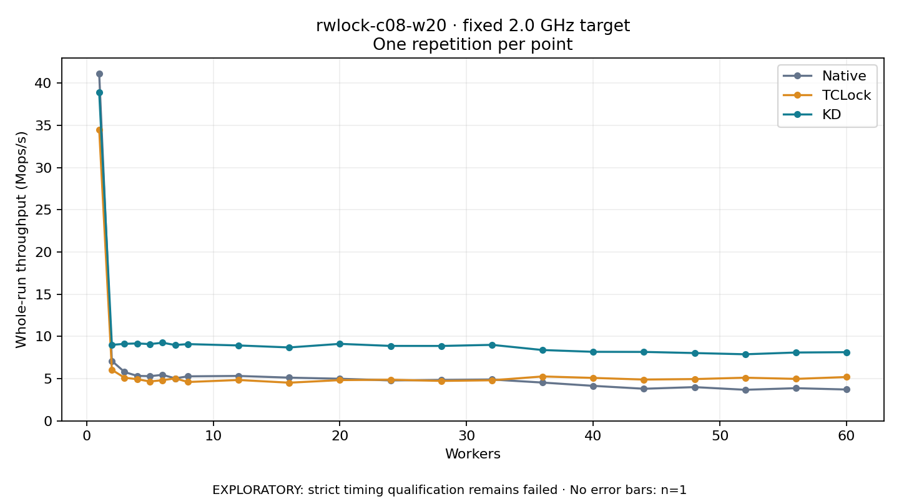

# rwlock-c08-w20 · fixed 2.0 GHz target

One timed round per point. **EXPLORATORY: strict timing qualification remains failed.** Failed/unrun points have no rate; one round supplies no repeat-variability estimate.

| Workers | Native Mops/s | TCLock Mops/s | KD Mops/s | KD / Native | KD / TCLock | KD execution |
|---:|---:|---:|---:|---:|---:|:---|
| 1 | 41.112 | 34.506 | 38.926 | 0.947× | 1.128× | NO_JIT |
| 2 | 7.108 | 6.052 | 9.006 | 1.267× | 1.488× | NO_JIT |
| 3 | 5.785 | 5.113 | 9.126 | 1.577× | 1.785× | NO_JIT |
| 4 | 5.331 | 4.939 | 9.174 | 1.721× | 1.857× | NO_JIT |
| 5 | 5.295 | 4.667 | 9.097 | 1.718× | 1.949× | NO_JIT |
| 6 | 5.450 | 4.818 | 9.256 | 1.698× | 1.921× | NO_JIT |
| 7 | 5.038 | 5.037 | 8.987 | 1.784× | 1.784× | NO_JIT |
| 8 | 5.276 | 4.604 | 9.095 | 1.724× | 1.975× | NO_JIT |
| 12 | 5.322 | 4.842 | 8.935 | 1.679× | 1.845× | RETURNED_JIT |
| 16 | 5.122 | 4.524 | 8.699 | 1.698× | 1.923× | RETURNED_JIT |
| 20 | 4.992 | 4.828 | 9.124 | 1.828× | 1.890× | RETURNED_JIT |
| 24 | 4.789 | 4.874 | 8.881 | 1.854× | 1.822× | RETURNED_JIT |
| 28 | 4.845 | 4.734 | 8.876 | 1.832× | 1.875× | RETURNED_JIT |
| 32 | 4.899 | 4.809 | 9.005 | 1.838× | 1.873× | RETURNED_JIT |
| 36 | 4.538 | 5.262 | 8.392 | 1.849× | 1.595× | RETURNED_JIT |
| 40 | 4.148 | 5.090 | 8.182 | 1.972× | 1.607× | RETURNED_JIT |
| 44 | 3.806 | 4.893 | 8.169 | 2.146× | 1.669× | RETURNED_JIT |
| 48 | 3.999 | 4.953 | 8.035 | 2.009× | 1.622× | RETURNED_JIT |
| 52 | 3.684 | 5.115 | 7.890 | 2.142× | 1.543× | RETURNED_JIT |
| 56 | 3.874 | 4.975 | 8.098 | 2.090× | 1.628× | RETURNED_JIT |
| 60 | 3.716 | 5.195 | 8.138 | 2.190× | 1.566× | RETURNED_JIT |

[Full-precision table](table.csv)

Frozen source: `a9aeb280a68242818aa469d8277e0c5a22fffee1`. [Archive hashes, frozen-validator replay and exact lifecycle checks](audit.json). Measured points: **63**; failed: **0**; unrun: **0**. Failed/unrun points have no throughput value. The full raw archive remains the primary receipt; compact JSON copies stay under the raw audit path.

Whole-run throughput is completed operations divided by the recorded wall interval; peak rates use the frozen full-cohort progress-window validator. Reciprocal throughput is an aggregate service interval, not operation latency. Returned completion share counts eligible writer operations (snapshot reads for the extracted snapshot cases). NO_JIT points are local execution evidence. One observation cannot establish statistical superiority.

Frequency readbacks are bound before/after this workload. Fixed frequency does not repair the separately failed strict host task-membership gate. Exact output checks and drain validate the retained execution; offline replay does not rerun kernel bodies or syscalls.

Frozen score-ineligible observations, if any, retain their separately labeled raw rate in the CSV and are excluded from the ordinary chart and ratios. Valid NO_JIT observations remain plotted.
