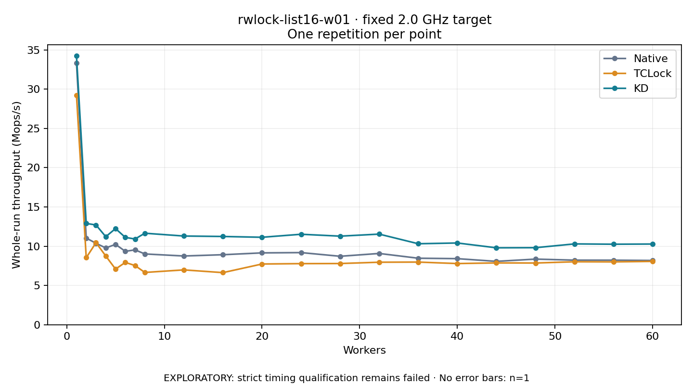

# rwlock-list16-w01 · fixed 2.0 GHz target

One timed round per point. **EXPLORATORY: strict timing qualification remains failed.** Failed/unrun points have no rate; one round supplies no repeat-variability estimate.

| Workers | Native Mops/s | TCLock Mops/s | KD Mops/s | KD / Native | KD / TCLock | KD execution |
|---:|---:|---:|---:|---:|---:|:---|
| 1 | 33.318 | 29.230 | 34.265 | 1.028× | 1.172× | NO_JIT |
| 2 | 11.036 | 8.534 | 12.900 | 1.169× | 1.512× | NO_JIT |
| 3 | 10.368 | 10.446 | 12.699 | 1.225× | 1.216× | NO_JIT |
| 4 | 9.777 | 8.750 | 11.209 | 1.146× | 1.281× | NO_JIT |
| 5 | 10.229 | 7.087 | 12.240 | 1.197× | 1.727× | NO_JIT |
| 6 | 9.348 | 7.936 | 11.119 | 1.189× | 1.401× | NO_JIT |
| 7 | 9.531 | 7.533 | 10.915 | 1.145× | 1.449× | NO_JIT |
| 8 | 9.012 | 6.656 | 11.651 | 1.293× | 1.750× | NO_JIT |
| 12 | 8.750 | 6.982 | 11.292 | 1.291× | 1.617× | NO_JIT |
| 16 | 8.914 | 6.634 | 11.236 | 1.260× | 1.694× | NO_JIT |
| 20 | 9.147 | 7.732 | 11.135 | 1.217× | 1.440× | RETURNED_JIT |
| 24 | 9.184 | 7.780 | 11.518 | 1.254× | 1.480× | RETURNED_JIT |
| 28 | 8.715 | 7.792 | 11.279 | 1.294× | 1.447× | RETURNED_JIT |
| 32 | 9.074 | 7.958 | 11.537 | 1.271× | 1.450× | RETURNED_JIT |
| 36 | 8.467 | 7.977 | 10.311 | 1.218× | 1.293× | RETURNED_JIT |
| 40 | 8.413 | 7.788 | 10.408 | 1.237× | 1.336× | RETURNED_JIT |
| 44 | 8.068 | 7.871 | 9.794 | 1.214× | 1.244× | RETURNED_JIT |
| 48 | 8.355 | 7.857 | 9.809 | 1.174× | 1.248× | RETURNED_JIT |
| 52 | 8.223 | 8.017 | 10.290 | 1.251× | 1.283× | RETURNED_JIT |
| 56 | 8.218 | 8.003 | 10.252 | 1.248× | 1.281× | RETURNED_JIT |
| 60 | 8.181 | 8.063 | 10.274 | 1.256× | 1.274× | RETURNED_JIT |

[Full-precision table](table.csv)

Frozen source: `a9aeb280a68242818aa469d8277e0c5a22fffee1`. [Archive hashes, frozen-validator replay and exact lifecycle checks](audit.json). Measured points: **63**; failed: **0**; unrun: **0**. Failed/unrun points have no throughput value. The full raw archive remains the primary receipt; compact JSON copies stay under the raw audit path.

Whole-run throughput is completed operations divided by the recorded wall interval; peak rates use the frozen full-cohort progress-window validator. Reciprocal throughput is an aggregate service interval, not operation latency. Returned completion share counts eligible writer operations (snapshot reads for the extracted snapshot cases). NO_JIT points are local execution evidence. One observation cannot establish statistical superiority.

Frequency readbacks are bound before/after this workload. Fixed frequency does not repair the separately failed strict host task-membership gate. Exact output checks and drain validate the retained execution; offline replay does not rerun kernel bodies or syscalls.

Frozen score-ineligible observations, if any, retain their separately labeled raw rate in the CSV and are excluded from the ordinary chart and ratios. Valid NO_JIT observations remain plotted.
