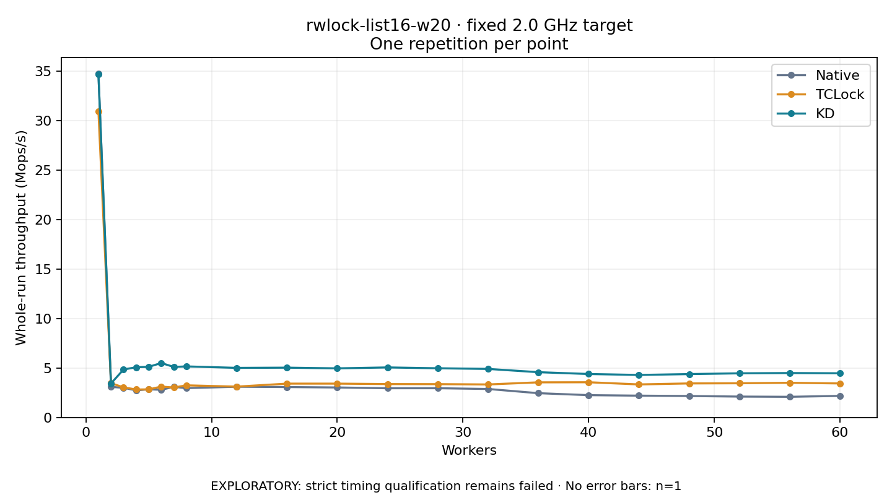

# rwlock-list16-w20 · fixed 2.0 GHz target

One timed round per point. **EXPLORATORY: strict timing qualification remains failed.** Failed/unrun points have no rate; one round supplies no repeat-variability estimate.

| Workers | Native Mops/s | TCLock Mops/s | KD Mops/s | KD / Native | KD / TCLock | KD execution |
|---:|---:|---:|---:|---:|---:|:---|
| 1 | 34.722 | 30.924 | 34.659 | 0.998× | 1.121× | NO_JIT |
| 2 | 3.098 | 3.461 | 3.442 | 1.111× | 0.995× | NO_JIT |
| 3 | 2.996 | 3.045 | 4.848 | 1.618× | 1.592× | NO_JIT |
| 4 | 2.744 | 2.829 | 5.077 | 1.851× | 1.795× | NO_JIT |
| 5 | 2.849 | 2.840 | 5.117 | 1.797× | 1.802× | NO_JIT |
| 6 | 2.798 | 3.123 | 5.503 | 1.967× | 1.762× | NO_JIT |
| 7 | 3.099 | 3.028 | 5.105 | 1.648× | 1.686× | NO_JIT |
| 8 | 2.966 | 3.250 | 5.160 | 1.740× | 1.588× | NO_JIT |
| 12 | 3.107 | 3.118 | 5.013 | 1.613× | 1.608× | RETURNED_JIT |
| 16 | 3.075 | 3.421 | 5.035 | 1.637× | 1.472× | RETURNED_JIT |
| 20 | 3.033 | 3.421 | 4.964 | 1.637× | 1.451× | RETURNED_JIT |
| 24 | 2.955 | 3.377 | 5.057 | 1.712× | 1.497× | RETURNED_JIT |
| 28 | 2.957 | 3.369 | 4.973 | 1.681× | 1.476× | RETURNED_JIT |
| 32 | 2.881 | 3.338 | 4.907 | 1.703× | 1.470× | RETURNED_JIT |
| 36 | 2.456 | 3.551 | 4.577 | 1.863× | 1.289× | RETURNED_JIT |
| 40 | 2.258 | 3.561 | 4.394 | 1.946× | 1.234× | RETURNED_JIT |
| 44 | 2.207 | 3.341 | 4.297 | 1.947× | 1.286× | RETURNED_JIT |
| 48 | 2.170 | 3.441 | 4.386 | 2.021× | 1.274× | RETURNED_JIT |
| 52 | 2.112 | 3.458 | 4.462 | 2.112× | 1.291× | RETURNED_JIT |
| 56 | 2.090 | 3.507 | 4.491 | 2.149× | 1.281× | RETURNED_JIT |
| 60 | 2.182 | 3.440 | 4.465 | 2.046× | 1.298× | RETURNED_JIT |

[Full-precision table](table.csv)

Frozen source: `a9aeb280a68242818aa469d8277e0c5a22fffee1`. [Archive hashes, frozen-validator replay and exact lifecycle checks](audit.json). Measured points: **63**; failed: **0**; unrun: **0**. Failed/unrun points have no throughput value. The full raw archive remains the primary receipt; compact JSON copies stay under the raw audit path.

Whole-run throughput is completed operations divided by the recorded wall interval; peak rates use the frozen full-cohort progress-window validator. Reciprocal throughput is an aggregate service interval, not operation latency. Returned completion share counts eligible writer operations (snapshot reads for the extracted snapshot cases). NO_JIT points are local execution evidence. One observation cannot establish statistical superiority.

Frequency readbacks are bound before/after this workload. Fixed frequency does not repair the separately failed strict host task-membership gate. Exact output checks and drain validate the retained execution; offline replay does not rerun kernel bodies or syscalls.

Frozen score-ineligible observations, if any, retain their separately labeled raw rate in the CSV and are excluded from the ordinary chart and ratios. Valid NO_JIT observations remain plotted.
