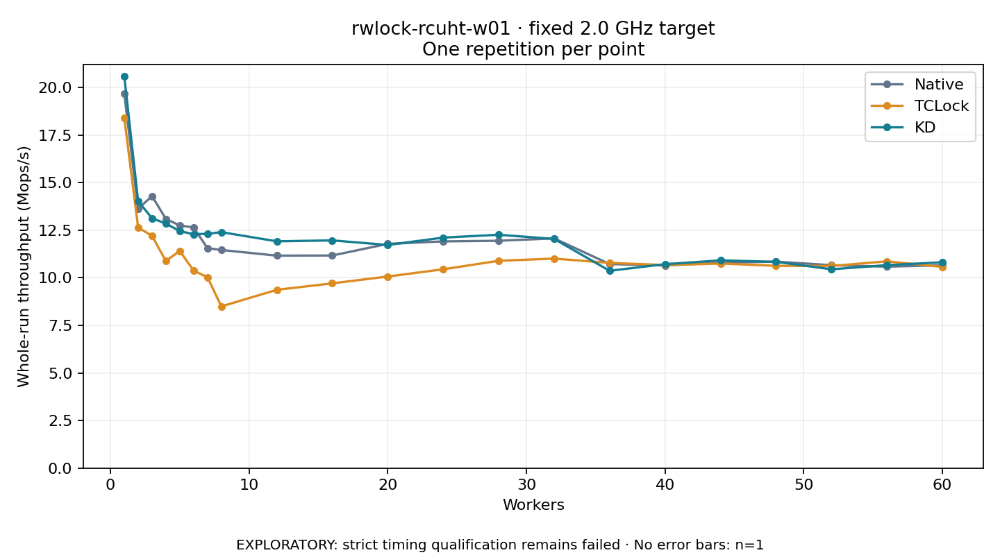

# rwlock-rcuht-w01 · fixed 2.0 GHz target

One timed round per point. **EXPLORATORY: strict timing qualification remains failed.** Failed/unrun points have no rate; one round supplies no repeat-variability estimate.

| Workers | Native Mops/s | TCLock Mops/s | KD Mops/s | KD / Native | KD / TCLock | KD execution |
|---:|---:|---:|---:|---:|---:|:---|
| 1 | 19.682 | 18.413 | 20.606 | 1.047× | 1.119× | NO_JIT |
| 2 | 13.629 | 12.645 | 14.029 | 1.029× | 1.109× | NO_JIT |
| 3 | 14.301 | 12.210 | 13.134 | 0.918× | 1.076× | NO_JIT |
| 4 | 13.095 | 10.886 | 12.852 | 0.981× | 1.181× | NO_JIT |
| 5 | 12.754 | 11.416 | 12.459 | 0.977× | 1.091× | NO_JIT |
| 6 | 12.645 | 10.380 | 12.294 | 0.972× | 1.184× | NO_JIT |
| 7 | 11.559 | 10.032 | 12.315 | 1.065× | 1.228× | NO_JIT |
| 8 | 11.465 | 8.499 | 12.402 | 1.082× | 1.459× | NO_JIT |
| 12 | 11.167 | 9.371 | 11.920 | 1.067× | 1.272× | NO_JIT |
| 16 | 11.175 | 9.711 | 11.968 | 1.071× | 1.232× | NO_JIT |
| 20 | 11.787 | 10.070 | 11.729 | 0.995× | 1.165× | RETURNED_JIT |
| 24 | 11.915 | 10.450 | 12.115 | 1.017× | 1.159× | RETURNED_JIT |
| 28 | 11.949 | 10.896 | 12.265 | 1.026× | 1.126× | RETURNED_JIT |
| 32 | 12.075 | 11.012 | 12.045 | 0.998× | 1.094× | RETURNED_JIT |
| 36 | 10.725 | 10.786 | 10.371 | 0.967× | 0.962× | RETURNED_JIT |
| 40 | 10.648 | 10.674 | 10.719 | 1.007× | 1.004× | RETURNED_JIT |
| 44 | 10.796 | 10.753 | 10.919 | 1.011× | 1.015× | RETURNED_JIT |
| 48 | 10.852 | 10.631 | 10.841 | 0.999× | 1.020× | RETURNED_JIT |
| 52 | 10.667 | 10.623 | 10.449 | 0.980× | 0.984× | RETURNED_JIT |
| 56 | 10.588 | 10.870 | 10.668 | 1.008× | 0.981× | RETURNED_JIT |
| 60 | 10.659 | 10.575 | 10.819 | 1.015× | 1.023× | RETURNED_JIT |

[Full-precision table](table.csv)

Frozen source: `a9aeb280a68242818aa469d8277e0c5a22fffee1`. [Archive hashes, frozen-validator replay and exact lifecycle checks](audit.json). Measured points: **63**; failed: **0**; unrun: **0**. Failed/unrun points have no throughput value. The full raw archive remains the primary receipt; compact JSON copies stay under the raw audit path.

Whole-run throughput is completed operations divided by the recorded wall interval; peak rates use the frozen full-cohort progress-window validator. Reciprocal throughput is an aggregate service interval, not operation latency. Returned completion share counts eligible writer operations (snapshot reads for the extracted snapshot cases). NO_JIT points are local execution evidence. One observation cannot establish statistical superiority.

Frequency readbacks are bound before/after this workload. Fixed frequency does not repair the separately failed strict host task-membership gate. Exact output checks and drain validate the retained execution; offline replay does not rerun kernel bodies or syscalls.

Frozen score-ineligible observations, if any, retain their separately labeled raw rate in the CSV and are excluded from the ordinary chart and ratios. Valid NO_JIT observations remain plotted.
