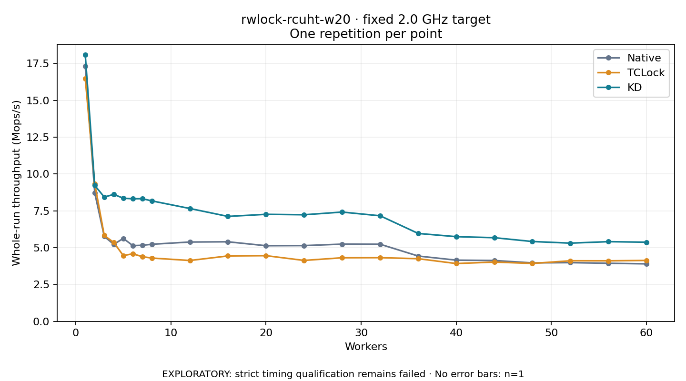

# rwlock-rcuht-w20 · fixed 2.0 GHz target

One timed round per point. **EXPLORATORY: strict timing qualification remains failed.** Failed/unrun points have no rate; one round supplies no repeat-variability estimate.

| Workers | Native Mops/s | TCLock Mops/s | KD Mops/s | KD / Native | KD / TCLock | KD execution |
|---:|---:|---:|---:|---:|---:|:---|
| 1 | 17.314 | 16.481 | 18.093 | 1.045× | 1.098× | NO_JIT |
| 2 | 8.710 | 9.331 | 9.221 | 1.059× | 0.988× | NO_JIT |
| 3 | 5.763 | 5.829 | 8.436 | 1.464× | 1.447× | NO_JIT |
| 4 | 5.226 | 5.351 | 8.617 | 1.649× | 1.611× | NO_JIT |
| 5 | 5.630 | 4.462 | 8.357 | 1.484× | 1.873× | NO_JIT |
| 6 | 5.140 | 4.585 | 8.320 | 1.619× | 1.815× | NO_JIT |
| 7 | 5.161 | 4.389 | 8.324 | 1.613× | 1.897× | NO_JIT |
| 8 | 5.232 | 4.296 | 8.175 | 1.562× | 1.903× | NO_JIT |
| 12 | 5.384 | 4.130 | 7.658 | 1.422× | 1.854× | RETURNED_JIT |
| 16 | 5.400 | 4.440 | 7.122 | 1.319× | 1.604× | RETURNED_JIT |
| 20 | 5.133 | 4.458 | 7.264 | 1.415× | 1.630× | RETURNED_JIT |
| 24 | 5.142 | 4.135 | 7.235 | 1.407× | 1.750× | RETURNED_JIT |
| 28 | 5.241 | 4.316 | 7.417 | 1.415× | 1.719× | RETURNED_JIT |
| 32 | 5.234 | 4.322 | 7.164 | 1.369× | 1.658× | RETURNED_JIT |
| 36 | 4.433 | 4.253 | 5.966 | 1.346× | 1.403× | RETURNED_JIT |
| 40 | 4.154 | 3.923 | 5.747 | 1.384× | 1.465× | RETURNED_JIT |
| 44 | 4.131 | 4.024 | 5.678 | 1.374× | 1.411× | RETURNED_JIT |
| 48 | 3.968 | 3.930 | 5.418 | 1.365× | 1.379× | RETURNED_JIT |
| 52 | 3.986 | 4.112 | 5.309 | 1.332× | 1.291× | RETURNED_JIT |
| 56 | 3.941 | 4.109 | 5.408 | 1.372× | 1.316× | RETURNED_JIT |
| 60 | 3.903 | 4.134 | 5.372 | 1.377× | 1.299× | RETURNED_JIT |

[Full-precision table](table.csv)

Frozen source: `a9aeb280a68242818aa469d8277e0c5a22fffee1`. [Archive hashes, frozen-validator replay and exact lifecycle checks](audit.json). Measured points: **63**; failed: **0**; unrun: **0**. Failed/unrun points have no throughput value. The full raw archive remains the primary receipt; compact JSON copies stay under the raw audit path.

Whole-run throughput is completed operations divided by the recorded wall interval; peak rates use the frozen full-cohort progress-window validator. Reciprocal throughput is an aggregate service interval, not operation latency. Returned completion share counts eligible writer operations (snapshot reads for the extracted snapshot cases). NO_JIT points are local execution evidence. One observation cannot establish statistical superiority.

Frequency readbacks are bound before/after this workload. Fixed frequency does not repair the separately failed strict host task-membership gate. Exact output checks and drain validate the retained execution; offline replay does not rerun kernel bodies or syscalls.

Frozen score-ineligible observations, if any, retain their separately labeled raw rate in the CSV and are excluded from the ordinary chart and ratios. Valid NO_JIT observations remain plotted.
