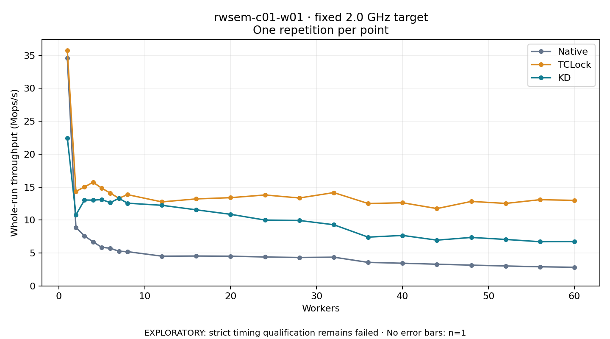

# rwsem-c01-w01 · fixed 2.0 GHz target

One timed round per point. **EXPLORATORY: strict timing qualification remains failed.** Failed/unrun points have no rate; one round supplies no repeat-variability estimate.

| Workers | Native Mops/s | TCLock Mops/s | KD Mops/s | KD / Native | KD / TCLock | KD execution |
|---:|---:|---:|---:|---:|---:|:---|
| 1 | 34.576 | 35.771 | 22.456 | 0.649× | 0.628× | NO_JIT |
| 2 | 8.887 | 14.349 | 10.776 | 1.213× | 0.751× | NO_JIT |
| 3 | 7.589 | 15.026 | 13.040 | 1.718× | 0.868× | NO_JIT |
| 4 | 6.694 | 15.737 | 13.025 | 1.946× | 0.828× | NO_JIT |
| 5 | 5.863 | 14.842 | 13.102 | 2.235× | 0.883× | NO_JIT |
| 6 | 5.722 | 14.089 | 12.643 | 2.209× | 0.897× | NO_JIT |
| 7 | 5.262 | 13.306 | 13.299 | 2.527× | 0.999× | NO_JIT |
| 8 | 5.203 | 13.860 | 12.557 | 2.413× | 0.906× | NO_JIT |
| 12 | 4.518 | 12.755 | 12.239 | 2.709× | 0.960× | NO_JIT |
| 16 | 4.541 | 13.211 | 11.552 | 2.544× | 0.874× | NO_JIT |
| 20 | 4.515 | 13.397 | 10.869 | 2.407× | 0.811× | NO_JIT |
| 24 | 4.393 | 13.806 | 9.998 | 2.276× | 0.724× | NO_JIT |
| 28 | 4.316 | 13.351 | 9.934 | 2.302× | 0.744× | NO_JIT |
| 32 | 4.365 | 14.167 | 9.288 | 2.128× | 0.656× | NO_JIT |
| 36 | 3.573 | 12.506 | 7.406 | 2.072× | 0.592× | NO_JIT |
| 40 | 3.444 | 12.626 | 7.667 | 2.226× | 0.607× | NO_JIT |
| 44 | 3.296 | 11.741 | 6.949 | 2.108× | 0.592× | NO_JIT |
| 48 | 3.156 | 12.826 | 7.361 | 2.332× | 0.574× | NO_JIT |
| 52 | 3.028 | 12.525 | 7.056 | 2.330× | 0.563× | NO_JIT |
| 56 | 2.907 | 13.092 | 6.711 | 2.308× | 0.513× | NO_JIT |
| 60 | 2.830 | 12.987 | 6.731 | 2.378× | 0.518× | NO_JIT |

[Full-precision table](table.csv)

Frozen source: `a9aeb280a68242818aa469d8277e0c5a22fffee1`. [Archive hashes, frozen-validator replay and exact lifecycle checks](audit.json). Measured points: **63**; failed: **0**; unrun: **0**. Failed/unrun points have no throughput value. The full raw archive remains the primary receipt; compact JSON copies stay under the raw audit path.

Whole-run throughput is completed operations divided by the recorded wall interval; peak rates use the frozen full-cohort progress-window validator. Reciprocal throughput is an aggregate service interval, not operation latency. Returned completion share counts eligible writer operations (snapshot reads for the extracted snapshot cases). NO_JIT points are local execution evidence. One observation cannot establish statistical superiority.

Frequency readbacks are bound before/after this workload. Fixed frequency does not repair the separately failed strict host task-membership gate. Exact output checks and drain validate the retained execution; offline replay does not rerun kernel bodies or syscalls.

Frozen score-ineligible observations, if any, retain their separately labeled raw rate in the CSV and are excluded from the ordinary chart and ratios. Valid NO_JIT observations remain plotted.
