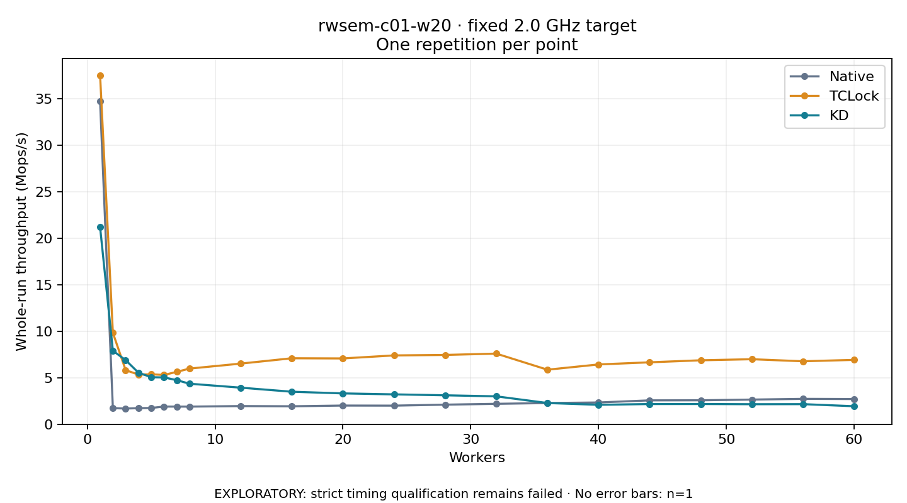

# rwsem-c01-w20 · fixed 2.0 GHz target

One timed round per point. **EXPLORATORY: strict timing qualification remains failed.** Failed/unrun points have no rate; one round supplies no repeat-variability estimate.

| Workers | Native Mops/s | TCLock Mops/s | KD Mops/s | KD / Native | KD / TCLock | KD execution |
|---:|---:|---:|---:|---:|---:|:---|
| 1 | 34.704 | 37.500 | 21.184 | 0.610× | 0.565× | NO_JIT |
| 2 | 1.735 | 9.828 | 7.900 | 4.553× | 0.804× | NO_JIT |
| 3 | 1.688 | 5.811 | 6.887 | 4.081× | 1.185× | NO_JIT |
| 4 | 1.728 | 5.337 | 5.541 | 3.206× | 1.038× | NO_JIT |
| 5 | 1.749 | 5.365 | 5.055 | 2.890× | 0.942× | NO_JIT |
| 6 | 1.900 | 5.294 | 5.031 | 2.648× | 0.950× | NO_JIT |
| 7 | 1.897 | 5.630 | 4.735 | 2.496× | 0.841× | NO_JIT |
| 8 | 1.895 | 5.979 | 4.355 | 2.298× | 0.728× | NO_JIT |
| 12 | 1.953 | 6.514 | 3.931 | 2.013× | 0.603× | NO_JIT |
| 16 | 1.930 | 7.089 | 3.494 | 1.810× | 0.493× | NO_JIT |
| 20 | 2.009 | 7.069 | 3.314 | 1.650× | 0.469× | NO_JIT |
| 24 | 1.999 | 7.394 | 3.210 | 1.606× | 0.434× | NO_JIT |
| 28 | 2.105 | 7.446 | 3.110 | 1.477× | 0.418× | NO_JIT |
| 32 | 2.194 | 7.588 | 2.998 | 1.367× | 0.395× | RETURNED_JIT |
| 36 | 2.277 | 5.860 | 2.281 | 1.001× | 0.389× | RETURNED_JIT |
| 40 | 2.338 | 6.424 | 2.088 | 0.893× | 0.325× | RETURNED_JIT |
| 44 | 2.566 | 6.654 | 2.172 | 0.847× | 0.326× | RETURNED_JIT |
| 48 | 2.573 | 6.871 | 2.175 | 0.845× | 0.317× | RETURNED_JIT |
| 52 | 2.650 | 6.986 | 2.153 | 0.812× | 0.308× | RETURNED_JIT |
| 56 | 2.728 | 6.764 | 2.160 | 0.792× | 0.319× | RETURNED_JIT |
| 60 | 2.709 | 6.917 | 1.935 | 0.714× | 0.280× | RETURNED_JIT |

[Full-precision table](table.csv)

Frozen source: `a9aeb280a68242818aa469d8277e0c5a22fffee1`. [Archive hashes, frozen-validator replay and exact lifecycle checks](audit.json). Measured points: **63**; failed: **0**; unrun: **0**. Failed/unrun points have no throughput value. The full raw archive remains the primary receipt; compact JSON copies stay under the raw audit path.

Whole-run throughput is completed operations divided by the recorded wall interval; peak rates use the frozen full-cohort progress-window validator. Reciprocal throughput is an aggregate service interval, not operation latency. Returned completion share counts eligible writer operations (snapshot reads for the extracted snapshot cases). NO_JIT points are local execution evidence. One observation cannot establish statistical superiority.

Frequency readbacks are bound before/after this workload. Fixed frequency does not repair the separately failed strict host task-membership gate. Exact output checks and drain validate the retained execution; offline replay does not rerun kernel bodies or syscalls.

Frozen score-ineligible observations, if any, retain their separately labeled raw rate in the CSV and are excluded from the ordinary chart and ratios. Valid NO_JIT observations remain plotted.
