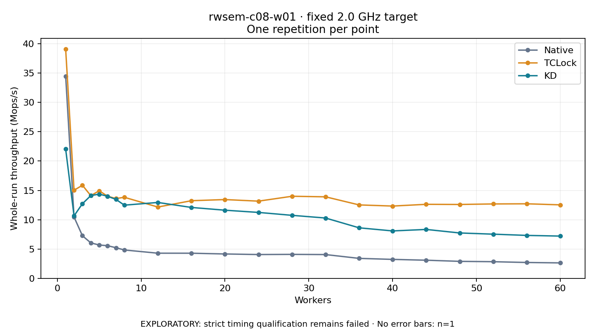

# rwsem-c08-w01 · fixed 2.0 GHz target

One timed round per point. **EXPLORATORY: strict timing qualification remains failed.** Failed/unrun points have no rate; one round supplies no repeat-variability estimate.

| Workers | Native Mops/s | TCLock Mops/s | KD Mops/s | KD / Native | KD / TCLock | KD execution |
|---:|---:|---:|---:|---:|---:|:---|
| 1 | 34.472 | 39.100 | 22.042 | 0.639× | 0.564× | NO_JIT |
| 2 | 10.453 | 15.025 | 10.656 | 1.019× | 0.709× | NO_JIT |
| 3 | 7.265 | 15.872 | 12.725 | 1.752× | 0.802× | NO_JIT |
| 4 | 6.046 | 14.103 | 14.108 | 2.334× | 1.000× | NO_JIT |
| 5 | 5.687 | 14.931 | 14.364 | 2.526× | 0.962× | NO_JIT |
| 6 | 5.566 | 13.999 | 13.992 | 2.514× | 0.999× | NO_JIT |
| 7 | 5.222 | 13.606 | 13.459 | 2.577× | 0.989× | NO_JIT |
| 8 | 4.836 | 13.821 | 12.480 | 2.580× | 0.903× | NO_JIT |
| 12 | 4.287 | 12.159 | 12.940 | 3.018× | 1.064× | NO_JIT |
| 16 | 4.284 | 13.240 | 12.089 | 2.822× | 0.913× | NO_JIT |
| 20 | 4.155 | 13.433 | 11.620 | 2.796× | 0.865× | NO_JIT |
| 24 | 4.058 | 13.165 | 11.241 | 2.770× | 0.854× | NO_JIT |
| 28 | 4.089 | 13.997 | 10.744 | 2.628× | 0.768× | NO_JIT |
| 32 | 4.053 | 13.901 | 10.285 | 2.538× | 0.740× | NO_JIT |
| 36 | 3.404 | 12.521 | 8.615 | 2.530× | 0.688× | NO_JIT |
| 40 | 3.231 | 12.327 | 8.085 | 2.502× | 0.656× | NO_JIT |
| 44 | 3.091 | 12.623 | 8.339 | 2.698× | 0.661× | NO_JIT |
| 48 | 2.896 | 12.598 | 7.737 | 2.671× | 0.614× | NO_JIT |
| 52 | 2.837 | 12.686 | 7.533 | 2.656× | 0.594× | NO_JIT |
| 56 | 2.704 | 12.712 | 7.321 | 2.708× | 0.576× | NO_JIT |
| 60 | 2.634 | 12.531 | 7.205 | 2.736× | 0.575× | NO_JIT |

[Full-precision table](table.csv)

Frozen source: `a9aeb280a68242818aa469d8277e0c5a22fffee1`. [Archive hashes, frozen-validator replay and exact lifecycle checks](audit.json). Measured points: **63**; failed: **0**; unrun: **0**. Failed/unrun points have no throughput value. The full raw archive remains the primary receipt; compact JSON copies stay under the raw audit path.

Whole-run throughput is completed operations divided by the recorded wall interval; peak rates use the frozen full-cohort progress-window validator. Reciprocal throughput is an aggregate service interval, not operation latency. Returned completion share counts eligible writer operations (snapshot reads for the extracted snapshot cases). NO_JIT points are local execution evidence. One observation cannot establish statistical superiority.

Frequency readbacks are bound before/after this workload. Fixed frequency does not repair the separately failed strict host task-membership gate. Exact output checks and drain validate the retained execution; offline replay does not rerun kernel bodies or syscalls.

Frozen score-ineligible observations, if any, retain their separately labeled raw rate in the CSV and are excluded from the ordinary chart and ratios. Valid NO_JIT observations remain plotted.
