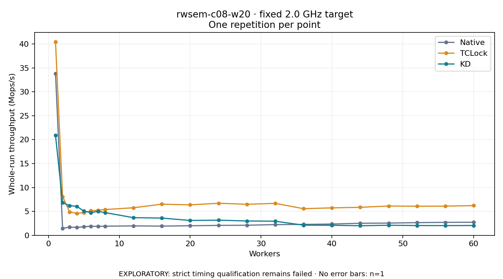

# rwsem-c08-w20 · fixed 2.0 GHz target

One timed round per point. **EXPLORATORY: strict timing qualification remains failed.** Failed/unrun points have no rate; one round supplies no repeat-variability estimate.

| Workers | Native Mops/s | TCLock Mops/s | KD Mops/s | KD / Native | KD / TCLock | KD execution |
|---:|---:|---:|---:|---:|---:|:---|
| 1 | 33.792 | 40.464 | 20.920 | 0.619× | 0.517× | NO_JIT |
| 2 | 1.472 | 8.097 | 6.829 | 4.639× | 0.843× | NO_JIT |
| 3 | 1.701 | 4.872 | 6.198 | 3.645× | 1.272× | NO_JIT |
| 4 | 1.671 | 4.597 | 6.069 | 3.633× | 1.320× | RETURNED_JIT |
| 5 | 1.783 | 4.749 | 5.061 | 2.838× | 1.066× | RETURNED_JIT |
| 6 | 1.907 | 5.130 | 4.750 | 2.491× | 0.926× | RETURNED_JIT |
| 7 | 1.859 | 5.256 | 5.010 | 2.696× | 0.953× | RETURNED_JIT |
| 8 | 1.913 | 5.389 | 4.749 | 2.483× | 0.881× | RETURNED_JIT |
| 12 | 1.972 | 5.764 | 3.690 | 1.871× | 0.640× | RETURNED_JIT |
| 16 | 1.925 | 6.509 | 3.608 | 1.874× | 0.554× | RETURNED_JIT |
| 20 | 2.005 | 6.376 | 3.112 | 1.552× | 0.488× | RETURNED_JIT |
| 24 | 2.073 | 6.701 | 3.168 | 1.528× | 0.473× | RETURNED_JIT |
| 28 | 2.111 | 6.493 | 2.997 | 1.420× | 0.461× | RETURNED_JIT |
| 32 | 2.239 | 6.679 | 2.947 | 1.316× | 0.441× | RETURNED_JIT |
| 36 | 2.282 | 5.565 | 2.123 | 0.931× | 0.382× | RETURNED_JIT |
| 40 | 2.359 | 5.740 | 2.098 | 0.889× | 0.365× | RETURNED_JIT |
| 44 | 2.516 | 5.855 | 2.006 | 0.797× | 0.343× | RETURNED_JIT |
| 48 | 2.559 | 6.130 | 2.100 | 0.821× | 0.343× | RETURNED_JIT |
| 52 | 2.650 | 6.075 | 2.050 | 0.774× | 0.337× | RETURNED_JIT |
| 56 | 2.714 | 6.102 | 2.033 | 0.749× | 0.333× | RETURNED_JIT |
| 60 | 2.727 | 6.216 | 2.059 | 0.755× | 0.331× | RETURNED_JIT |

[Full-precision table](table.csv)

Frozen source: `a9aeb280a68242818aa469d8277e0c5a22fffee1`. [Archive hashes, frozen-validator replay and exact lifecycle checks](audit.json). Measured points: **63**; failed: **0**; unrun: **0**. Failed/unrun points have no throughput value. The full raw archive remains the primary receipt; compact JSON copies stay under the raw audit path.

Whole-run throughput is completed operations divided by the recorded wall interval; peak rates use the frozen full-cohort progress-window validator. Reciprocal throughput is an aggregate service interval, not operation latency. Returned completion share counts eligible writer operations (snapshot reads for the extracted snapshot cases). NO_JIT points are local execution evidence. One observation cannot establish statistical superiority.

Frequency readbacks are bound before/after this workload. Fixed frequency does not repair the separately failed strict host task-membership gate. Exact output checks and drain validate the retained execution; offline replay does not rerun kernel bodies or syscalls.

Frozen score-ineligible observations, if any, retain their separately labeled raw rate in the CSV and are excluded from the ordinary chart and ratios. Valid NO_JIT observations remain plotted.
