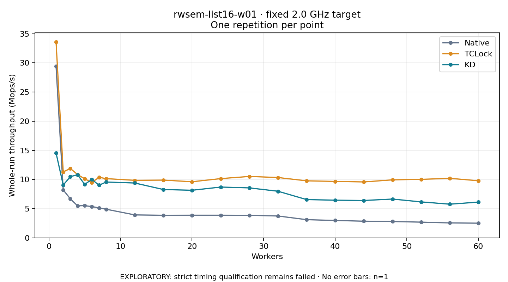

# rwsem-list16-w01 · fixed 2.0 GHz target

One timed round per point. **EXPLORATORY: strict timing qualification remains failed.** Failed/unrun points have no rate; one round supplies no repeat-variability estimate.

| Workers | Native Mops/s | TCLock Mops/s | KD Mops/s | KD / Native | KD / TCLock | KD execution |
|---:|---:|---:|---:|---:|---:|:---|
| 1 | 29.437 | 33.601 | 14.553 | 0.494× | 0.433× | NO_JIT |
| 2 | 8.218 | 11.303 | 9.054 | 1.102× | 0.801× | NO_JIT |
| 3 | 6.682 | 11.893 | 10.489 | 1.570× | 0.882× | NO_JIT |
| 4 | 5.499 | 10.857 | 10.825 | 1.968× | 0.997× | NO_JIT |
| 5 | 5.518 | 10.121 | 9.163 | 1.661× | 0.905× | NO_JIT |
| 6 | 5.357 | 9.488 | 10.027 | 1.872× | 1.057× | NO_JIT |
| 7 | 5.143 | 10.374 | 9.022 | 1.754× | 0.870× | NO_JIT |
| 8 | 4.908 | 10.155 | 9.570 | 1.950× | 0.942× | NO_JIT |
| 12 | 3.933 | 9.860 | 9.399 | 2.390× | 0.953× | NO_JIT |
| 16 | 3.871 | 9.900 | 8.285 | 2.141× | 0.837× | NO_JIT |
| 20 | 3.882 | 9.618 | 8.159 | 2.101× | 0.848× | NO_JIT |
| 24 | 3.881 | 10.155 | 8.707 | 2.243× | 0.857× | NO_JIT |
| 28 | 3.865 | 10.526 | 8.564 | 2.216× | 0.814× | NO_JIT |
| 32 | 3.749 | 10.343 | 7.992 | 2.132× | 0.773× | NO_JIT |
| 36 | 3.118 | 9.777 | 6.562 | 2.105× | 0.671× | NO_JIT |
| 40 | 2.979 | 9.675 | 6.455 | 2.167× | 0.667× | NO_JIT |
| 44 | 2.857 | 9.585 | 6.406 | 2.243× | 0.668× | NO_JIT |
| 48 | 2.798 | 9.943 | 6.652 | 2.377× | 0.669× | NO_JIT |
| 52 | 2.696 | 10.027 | 6.163 | 2.286× | 0.615× | NO_JIT |
| 56 | 2.560 | 10.208 | 5.773 | 2.255× | 0.566× | NO_JIT |
| 60 | 2.516 | 9.787 | 6.127 | 2.435× | 0.626× | NO_JIT |

[Full-precision table](table.csv)

Frozen source: `a9aeb280a68242818aa469d8277e0c5a22fffee1`. [Archive hashes, frozen-validator replay and exact lifecycle checks](audit.json). Measured points: **63**; failed: **0**; unrun: **0**. Failed/unrun points have no throughput value. The full raw archive remains the primary receipt; compact JSON copies stay under the raw audit path.

Whole-run throughput is completed operations divided by the recorded wall interval; peak rates use the frozen full-cohort progress-window validator. Reciprocal throughput is an aggregate service interval, not operation latency. Returned completion share counts eligible writer operations (snapshot reads for the extracted snapshot cases). NO_JIT points are local execution evidence. One observation cannot establish statistical superiority.

Frequency readbacks are bound before/after this workload. Fixed frequency does not repair the separately failed strict host task-membership gate. Exact output checks and drain validate the retained execution; offline replay does not rerun kernel bodies or syscalls.

Frozen score-ineligible observations, if any, retain their separately labeled raw rate in the CSV and are excluded from the ordinary chart and ratios. Valid NO_JIT observations remain plotted.
