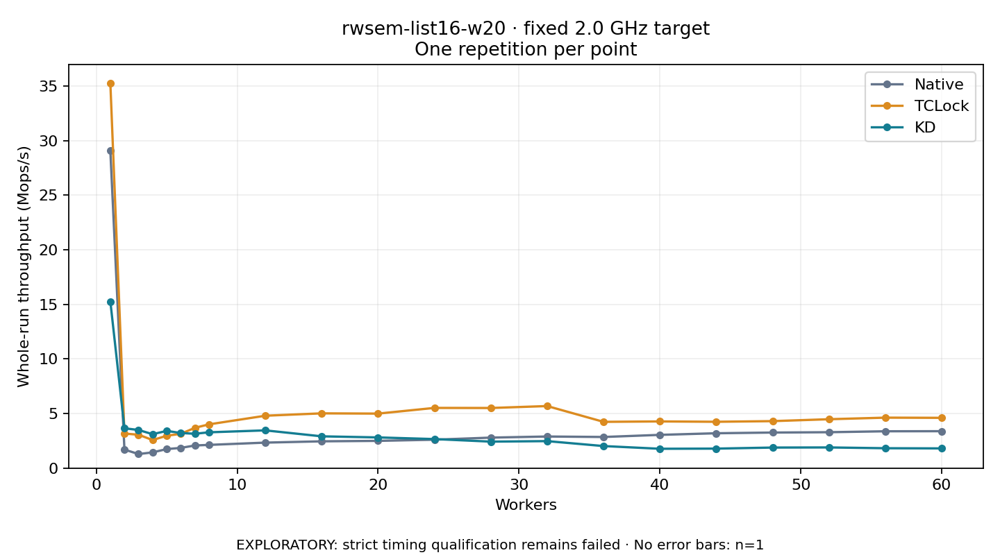

# rwsem-list16-w20 · fixed 2.0 GHz target

One timed round per point. **EXPLORATORY: strict timing qualification remains failed.** Failed/unrun points have no rate; one round supplies no repeat-variability estimate.

| Workers | Native Mops/s | TCLock Mops/s | KD Mops/s | KD / Native | KD / TCLock | KD execution |
|---:|---:|---:|---:|---:|---:|:---|
| 1 | 29.062 | 35.265 | 15.263 | 0.525× | 0.433× | NO_JIT |
| 2 | 1.697 | 3.167 | 3.648 | 2.149× | 1.152× | NO_JIT |
| 3 | 1.287 | 3.057 | 3.492 | 2.713× | 1.143× | NO_JIT |
| 4 | 1.442 | 2.572 | 3.107 | 2.155× | 1.208× | RETURNED_JIT |
| 5 | 1.743 | 2.966 | 3.409 | 1.956× | 1.150× | RETURNED_JIT |
| 6 | 1.852 | 3.142 | 3.215 | 1.736× | 1.023× | RETURNED_JIT |
| 7 | 2.073 | 3.691 | 3.146 | 1.518× | 0.852× | RETURNED_JIT |
| 8 | 2.127 | 4.008 | 3.280 | 1.542× | 0.818× | RETURNED_JIT |
| 12 | 2.335 | 4.798 | 3.456 | 1.480× | 0.720× | RETURNED_JIT |
| 16 | 2.454 | 5.016 | 2.911 | 1.186× | 0.580× | RETURNED_JIT |
| 20 | 2.495 | 4.992 | 2.811 | 1.127× | 0.563× | RETURNED_JIT |
| 24 | 2.603 | 5.514 | 2.660 | 1.022× | 0.482× | RETURNED_JIT |
| 28 | 2.794 | 5.506 | 2.426 | 0.868× | 0.441× | RETURNED_JIT |
| 32 | 2.894 | 5.683 | 2.472 | 0.854× | 0.435× | RETURNED_JIT |
| 36 | 2.851 | 4.238 | 2.020 | 0.708× | 0.477× | RETURNED_JIT |
| 40 | 3.045 | 4.276 | 1.772 | 0.582× | 0.414× | RETURNED_JIT |
| 44 | 3.193 | 4.244 | 1.786 | 0.559× | 0.421× | RETURNED_JIT |
| 48 | 3.258 | 4.303 | 1.883 | 0.578× | 0.438× | RETURNED_JIT |
| 52 | 3.288 | 4.478 | 1.894 | 0.576× | 0.423× | RETURNED_JIT |
| 56 | 3.374 | 4.622 | 1.821 | 0.540× | 0.394× | RETURNED_JIT |
| 60 | 3.381 | 4.605 | 1.806 | 0.534× | 0.392× | RETURNED_JIT |

[Full-precision table](table.csv)

Frozen source: `a9aeb280a68242818aa469d8277e0c5a22fffee1`. [Archive hashes, frozen-validator replay and exact lifecycle checks](audit.json). Measured points: **63**; failed: **0**; unrun: **0**. Failed/unrun points have no throughput value. The full raw archive remains the primary receipt; compact JSON copies stay under the raw audit path.

Whole-run throughput is completed operations divided by the recorded wall interval; peak rates use the frozen full-cohort progress-window validator. Reciprocal throughput is an aggregate service interval, not operation latency. Returned completion share counts eligible writer operations (snapshot reads for the extracted snapshot cases). NO_JIT points are local execution evidence. One observation cannot establish statistical superiority.

Frequency readbacks are bound before/after this workload. Fixed frequency does not repair the separately failed strict host task-membership gate. Exact output checks and drain validate the retained execution; offline replay does not rerun kernel bodies or syscalls.

Frozen score-ineligible observations, if any, retain their separately labeled raw rate in the CSV and are excluded from the ordinary chart and ratios. Valid NO_JIT observations remain plotted.
