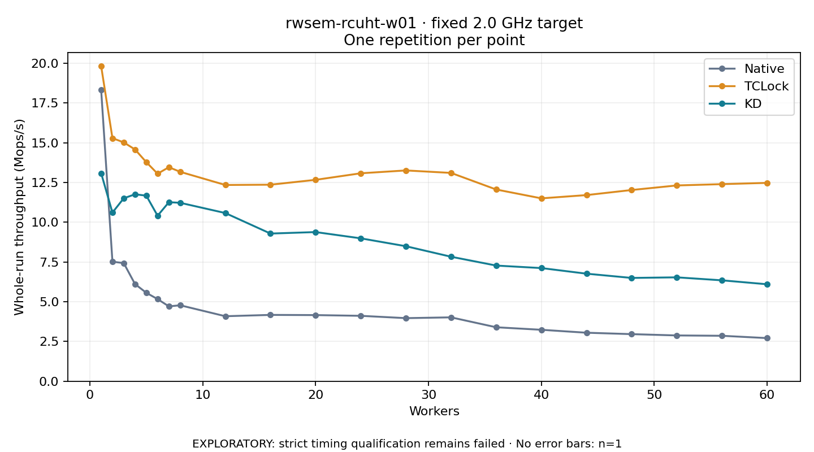

# rwsem-rcuht-w01 · fixed 2.0 GHz target

One timed round per point. **EXPLORATORY: strict timing qualification remains failed.** Failed/unrun points have no rate; one round supplies no repeat-variability estimate.

| Workers | Native Mops/s | TCLock Mops/s | KD Mops/s | KD / Native | KD / TCLock | KD execution |
|---:|---:|---:|---:|---:|---:|:---|
| 1 | 18.321 | 19.825 | 13.090 | 0.714× | 0.660× | NO_JIT |
| 2 | 7.522 | 15.295 | 10.611 | 1.411× | 0.694× | NO_JIT |
| 3 | 7.433 | 15.029 | 11.511 | 1.549× | 0.766× | NO_JIT |
| 4 | 6.114 | 14.584 | 11.762 | 1.924× | 0.807× | NO_JIT |
| 5 | 5.565 | 13.784 | 11.677 | 2.098× | 0.847× | NO_JIT |
| 6 | 5.168 | 13.057 | 10.413 | 2.015× | 0.798× | NO_JIT |
| 7 | 4.710 | 13.468 | 11.265 | 2.392× | 0.836× | NO_JIT |
| 8 | 4.780 | 13.176 | 11.228 | 2.349× | 0.852× | NO_JIT |
| 12 | 4.091 | 12.349 | 10.583 | 2.587× | 0.857× | NO_JIT |
| 16 | 4.174 | 12.366 | 9.292 | 2.226× | 0.751× | NO_JIT |
| 20 | 4.162 | 12.673 | 9.386 | 2.255× | 0.741× | NO_JIT |
| 24 | 4.116 | 13.085 | 8.991 | 2.184× | 0.687× | NO_JIT |
| 28 | 3.970 | 13.264 | 8.495 | 2.140× | 0.640× | NO_JIT |
| 32 | 4.019 | 13.108 | 7.834 | 1.949× | 0.598× | NO_JIT |
| 36 | 3.396 | 12.063 | 7.278 | 2.143× | 0.603× | NO_JIT |
| 40 | 3.237 | 11.507 | 7.120 | 2.199× | 0.619× | NO_JIT |
| 44 | 3.052 | 11.712 | 6.767 | 2.217× | 0.578× | NO_JIT |
| 48 | 2.964 | 12.033 | 6.500 | 2.193× | 0.540× | NO_JIT |
| 52 | 2.881 | 12.319 | 6.537 | 2.269× | 0.531× | NO_JIT |
| 56 | 2.860 | 12.401 | 6.349 | 2.220× | 0.512× | NO_JIT |
| 60 | 2.715 | 12.481 | 6.102 | 2.248× | 0.489× | NO_JIT |

[Full-precision table](table.csv)

Frozen source: `a9aeb280a68242818aa469d8277e0c5a22fffee1`. [Archive hashes, frozen-validator replay and exact lifecycle checks](audit.json). Measured points: **63**; failed: **0**; unrun: **0**. Failed/unrun points have no throughput value. The full raw archive remains the primary receipt; compact JSON copies stay under the raw audit path.

Whole-run throughput is completed operations divided by the recorded wall interval; peak rates use the frozen full-cohort progress-window validator. Reciprocal throughput is an aggregate service interval, not operation latency. Returned completion share counts eligible writer operations (snapshot reads for the extracted snapshot cases). NO_JIT points are local execution evidence. One observation cannot establish statistical superiority.

Frequency readbacks are bound before/after this workload. Fixed frequency does not repair the separately failed strict host task-membership gate. Exact output checks and drain validate the retained execution; offline replay does not rerun kernel bodies or syscalls.

Frozen score-ineligible observations, if any, retain their separately labeled raw rate in the CSV and are excluded from the ordinary chart and ratios. Valid NO_JIT observations remain plotted.
