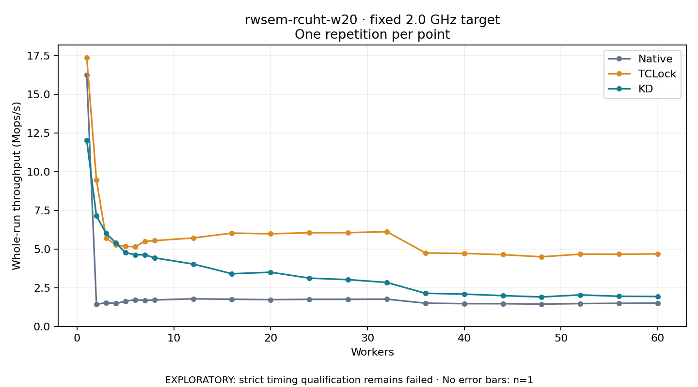

# rwsem-rcuht-w20 · fixed 2.0 GHz target

One timed round per point. **EXPLORATORY: strict timing qualification remains failed.** Failed/unrun points have no rate; one round supplies no repeat-variability estimate.

| Workers | Native Mops/s | TCLock Mops/s | KD Mops/s | KD / Native | KD / TCLock | KD execution |
|---:|---:|---:|---:|---:|---:|:---|
| 1 | 16.246 | 17.390 | 12.029 | 0.740× | 0.692× | NO_JIT |
| 2 | 1.422 | 9.472 | 7.147 | 5.025× | 0.755× | NO_JIT |
| 3 | 1.539 | 5.704 | 6.016 | 3.909× | 1.055× | NO_JIT |
| 4 | 1.479 | 5.283 | 5.408 | 3.656× | 1.024× | NO_JIT |
| 5 | 1.628 | 5.175 | 4.770 | 2.929× | 0.922× | NO_JIT |
| 6 | 1.724 | 5.146 | 4.628 | 2.685× | 0.899× | NO_JIT |
| 7 | 1.686 | 5.501 | 4.629 | 2.747× | 0.842× | NO_JIT |
| 8 | 1.712 | 5.544 | 4.431 | 2.589× | 0.799× | NO_JIT |
| 12 | 1.784 | 5.715 | 4.033 | 2.261× | 0.706× | NO_JIT |
| 16 | 1.757 | 6.030 | 3.404 | 1.938× | 0.564× | NO_JIT |
| 20 | 1.727 | 5.988 | 3.502 | 2.027× | 0.585× | NO_JIT |
| 24 | 1.749 | 6.054 | 3.120 | 1.784× | 0.515× | RETURNED_JIT |
| 28 | 1.753 | 6.058 | 3.023 | 1.725× | 0.499× | RETURNED_JIT |
| 32 | 1.760 | 6.123 | 2.842 | 1.615× | 0.464× | RETURNED_JIT |
| 36 | 1.503 | 4.748 | 2.141 | 1.424× | 0.451× | RETURNED_JIT |
| 40 | 1.471 | 4.718 | 2.088 | 1.420× | 0.442× | RETURNED_JIT |
| 44 | 1.468 | 4.636 | 1.987 | 1.354× | 0.429× | RETURNED_JIT |
| 48 | 1.441 | 4.500 | 1.904 | 1.321× | 0.423× | RETURNED_JIT |
| 52 | 1.476 | 4.670 | 2.038 | 1.380× | 0.436× | RETURNED_JIT |
| 56 | 1.494 | 4.669 | 1.946 | 1.303× | 0.417× | RETURNED_JIT |
| 60 | 1.504 | 4.686 | 1.935 | 1.287× | 0.413× | RETURNED_JIT |

[Full-precision table](table.csv)

Frozen source: `a9aeb280a68242818aa469d8277e0c5a22fffee1`. [Archive hashes, frozen-validator replay and exact lifecycle checks](audit.json). Measured points: **63**; failed: **0**; unrun: **0**. Failed/unrun points have no throughput value. The full raw archive remains the primary receipt; compact JSON copies stay under the raw audit path.

Whole-run throughput is completed operations divided by the recorded wall interval; peak rates use the frozen full-cohort progress-window validator. Reciprocal throughput is an aggregate service interval, not operation latency. Returned completion share counts eligible writer operations (snapshot reads for the extracted snapshot cases). NO_JIT points are local execution evidence. One observation cannot establish statistical superiority.

Frequency readbacks are bound before/after this workload. Fixed frequency does not repair the separately failed strict host task-membership gate. Exact output checks and drain validate the retained execution; offline replay does not rerun kernel bodies or syscalls.

Frozen score-ineligible observations, if any, retain their separately labeled raw rate in the CSV and are excluded from the ordinary chart and ratios. Valid NO_JIT observations remain plotted.
