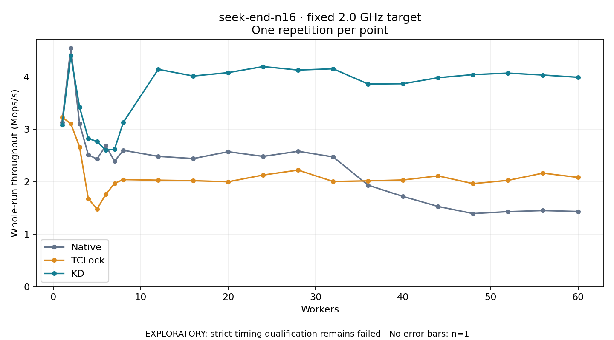

# seek-end-n16 · fixed 2.0 GHz target

One timed round per point. **EXPLORATORY: strict timing qualification remains failed.** Failed/unrun points have no rate; one round supplies no repeat-variability estimate.

| Workers | Native Mops/s | TCLock Mops/s | KD Mops/s | KD / Native | KD / TCLock | KD execution |
|---:|---:|---:|---:|---:|---:|:---|
| 1 | 3.138 | 3.231 | 3.084 | 0.983× | 0.954× | NO_JIT |
| 2 | 4.555 | 3.110 | 4.410 | 0.968× | 1.418× | NO_JIT |
| 3 | 3.110 | 2.667 | 3.426 | 1.101× | 1.284× | RETURNED_JIT |
| 4 | 2.515 | 1.679 | 2.824 | 1.123× | 1.682× | RETURNED_JIT |
| 5 | 2.435 | 1.482 | 2.772 | 1.138× | 1.871× | RETURNED_JIT |
| 6 | 2.689 | 1.761 | 2.603 | 0.968× | 1.478× | RETURNED_JIT |
| 7 | 2.393 | 1.971 | 2.621 | 1.095× | 1.330× | RETURNED_JIT |
| 8 | 2.602 | 2.043 | 3.132 | 1.204× | 1.533× | RETURNED_JIT |
| 12 | 2.486 | 2.032 | 4.146 | 1.668× | 2.041× | RETURNED_JIT |
| 16 | 2.444 | 2.022 | 4.018 | 1.644× | 1.988× | RETURNED_JIT |
| 20 | 2.574 | 2.001 | 4.083 | 1.586× | 2.040× | RETURNED_JIT |
| 24 | 2.486 | 2.130 | 4.198 | 1.689× | 1.971× | RETURNED_JIT |
| 28 | 2.583 | 2.224 | 4.132 | 1.600× | 1.858× | RETURNED_JIT |
| 32 | 2.476 | 2.007 | 4.156 | 1.679× | 2.071× | RETURNED_JIT |
| 36 | 1.936 | 2.019 | 3.866 | 1.996× | 1.915× | RETURNED_JIT |
| 40 | 1.721 | 2.035 | 3.871 | 2.249× | 1.902× | RETURNED_JIT |
| 44 | 1.531 | 2.113 | 3.986 | 2.603× | 1.886× | RETURNED_JIT |
| 48 | 1.395 | 1.966 | 4.045 | 2.899× | 2.058× | RETURNED_JIT |
| 52 | 1.432 | 2.028 | 4.074 | 2.845× | 2.008× | RETURNED_JIT |
| 56 | 1.453 | 2.166 | 4.037 | 2.779× | 1.863× | RETURNED_JIT |
| 60 | 1.435 | 2.085 | 3.994 | 2.783× | 1.916× | RETURNED_JIT |

[Full-precision table](table.csv)

Frozen source: `a9aeb280a68242818aa469d8277e0c5a22fffee1`. [Archive hashes, frozen-validator replay and exact lifecycle checks](audit.json). Measured points: **63**; failed: **0**; unrun: **0**. Failed/unrun points have no throughput value. The full raw archive remains the primary receipt; compact JSON copies stay under the raw audit path.

Whole-run throughput is completed operations divided by the recorded wall interval; peak rates use the frozen full-cohort progress-window validator. Reciprocal throughput is an aggregate service interval, not operation latency. Returned completion share counts eligible writer operations (snapshot reads for the extracted snapshot cases). NO_JIT points are local execution evidence. One observation cannot establish statistical superiority.

Frequency readbacks are bound before/after this workload. Fixed frequency does not repair the separately failed strict host task-membership gate. Exact output checks and drain validate the retained execution; offline replay does not rerun kernel bodies or syscalls.

Frozen score-ineligible observations, if any, retain their separately labeled raw rate in the CSV and are excluded from the ordinary chart and ratios. Valid NO_JIT observations remain plotted.
