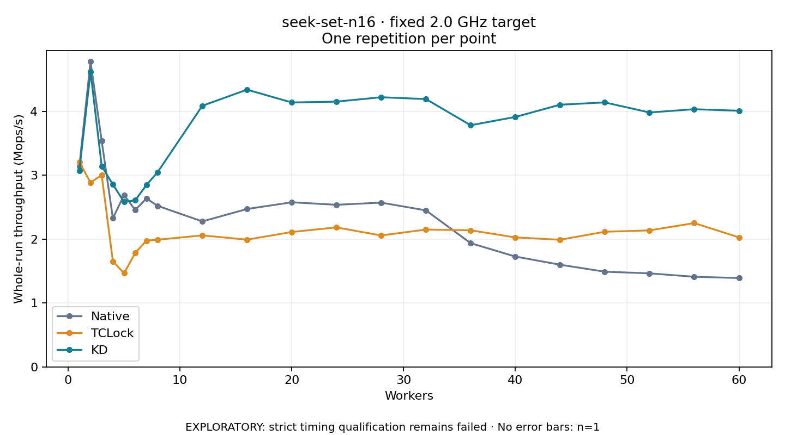

# seek-set-n16 · fixed 2.0 GHz target

One timed round per point. **EXPLORATORY: strict timing qualification remains failed.** Failed/unrun points have no rate; one round supplies no repeat-variability estimate.

| Workers | Native Mops/s | TCLock Mops/s | KD Mops/s | KD / Native | KD / TCLock | KD execution |
|---:|---:|---:|---:|---:|---:|:---|
| 1 | 3.138 | 3.205 | 3.072 | 0.979× | 0.958× | NO_JIT |
| 2 | 4.781 | 2.886 | 4.618 | 0.966× | 1.600× | NO_JIT |
| 3 | 3.535 | 3.000 | 3.142 | 0.889× | 1.047× | RETURNED_JIT |
| 4 | 2.326 | 1.653 | 2.855 | 1.227× | 1.727× | RETURNED_JIT |
| 5 | 2.689 | 1.466 | 2.582 | 0.960× | 1.762× | RETURNED_JIT |
| 6 | 2.455 | 1.784 | 2.607 | 1.062× | 1.461× | RETURNED_JIT |
| 7 | 2.636 | 1.976 | 2.847 | 1.080× | 1.440× | RETURNED_JIT |
| 8 | 2.521 | 1.991 | 3.046 | 1.208× | 1.530× | RETURNED_JIT |
| 12 | 2.277 | 2.058 | 4.086 | 1.795× | 1.985× | RETURNED_JIT |
| 16 | 2.471 | 1.991 | 4.339 | 1.756× | 2.179× | RETURNED_JIT |
| 20 | 2.576 | 2.111 | 4.138 | 1.606× | 1.960× | RETURNED_JIT |
| 24 | 2.537 | 2.183 | 4.151 | 1.636× | 1.901× | RETURNED_JIT |
| 28 | 2.571 | 2.057 | 4.220 | 1.641× | 2.052× | RETURNED_JIT |
| 32 | 2.449 | 2.149 | 4.191 | 1.711× | 1.950× | RETURNED_JIT |
| 36 | 1.937 | 2.138 | 3.782 | 1.953× | 1.769× | RETURNED_JIT |
| 40 | 1.727 | 2.027 | 3.911 | 2.265× | 1.930× | RETURNED_JIT |
| 44 | 1.599 | 1.990 | 4.103 | 2.565× | 2.062× | RETURNED_JIT |
| 48 | 1.490 | 2.115 | 4.139 | 2.778× | 1.957× | RETURNED_JIT |
| 52 | 1.464 | 2.136 | 3.982 | 2.720× | 1.864× | RETURNED_JIT |
| 56 | 1.411 | 2.251 | 4.033 | 2.859× | 1.792× | RETURNED_JIT |
| 60 | 1.391 | 2.027 | 4.009 | 2.882× | 1.978× | RETURNED_JIT |

[Full-precision table](table.csv)

Frozen source: `a9aeb280a68242818aa469d8277e0c5a22fffee1`. [Archive hashes, frozen-validator replay and exact lifecycle checks](audit.json). Measured points: **63**; failed: **0**; unrun: **0**. Failed/unrun points have no throughput value. The full raw archive remains the primary receipt; compact JSON copies stay under the raw audit path.

Whole-run throughput is completed operations divided by the recorded wall interval; peak rates use the frozen full-cohort progress-window validator. Reciprocal throughput is an aggregate service interval, not operation latency. Returned completion share counts eligible writer operations (snapshot reads for the extracted snapshot cases). NO_JIT points are local execution evidence. One observation cannot establish statistical superiority.

Frequency readbacks are bound before/after this workload. Fixed frequency does not repair the separately failed strict host task-membership gate. Exact output checks and drain validate the retained execution; offline replay does not rerun kernel bodies or syscalls.

Frozen score-ineligible observations, if any, retain their separately labeled raw rate in the CSV and are excluded from the ordinary chart and ratios. Valid NO_JIT observations remain plotted.
