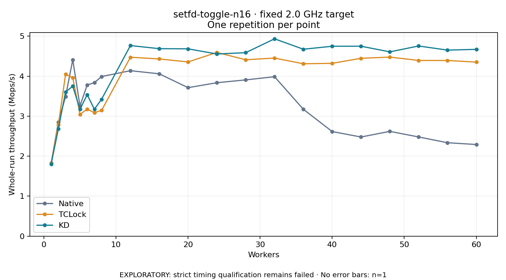

# setfd-toggle-n16 · fixed 2.0 GHz target

One timed round per point. **EXPLORATORY: strict timing qualification remains failed.** Failed/unrun points have no rate; one round supplies no repeat-variability estimate.

| Workers | Native Mops/s | TCLock Mops/s | KD Mops/s | KD / Native | KD / TCLock | KD execution |
|---:|---:|---:|---:|---:|---:|:---|
| 1 | 1.827 | 1.818 | 1.800 | 0.985× | 0.990× | NO_JIT |
| 2 | 2.849 | 2.783 | 2.683 | 0.942× | 0.964× | NO_JIT |
| 3 | 3.491 | 4.045 | 3.605 | 1.033× | 0.891× | NO_JIT |
| 4 | 4.410 | 3.960 | 3.749 | 0.850× | 0.947× | NO_JIT |
| 5 | 3.255 | 3.047 | 3.172 | 0.974× | 1.041× | NO_JIT |
| 6 | 3.780 | 3.175 | 3.537 | 0.936× | 1.114× | NO_JIT |
| 7 | 3.837 | 3.088 | 3.173 | 0.827× | 1.028× | NO_JIT |
| 8 | 3.990 | 3.143 | 3.423 | 0.858× | 1.089× | NO_JIT |
| 12 | 4.136 | 4.473 | 4.765 | 1.152× | 1.065× | RETURNED_JIT |
| 16 | 4.059 | 4.430 | 4.687 | 1.155× | 1.058× | RETURNED_JIT |
| 20 | 3.712 | 4.355 | 4.683 | 1.261× | 1.075× | RETURNED_JIT |
| 24 | 3.836 | 4.592 | 4.554 | 1.187× | 0.992× | RETURNED_JIT |
| 28 | 3.907 | 4.410 | 4.587 | 1.174× | 1.040× | RETURNED_JIT |
| 32 | 3.986 | 4.452 | 4.933 | 1.238× | 1.108× | RETURNED_JIT |
| 36 | 3.172 | 4.310 | 4.673 | 1.473× | 1.084× | RETURNED_JIT |
| 40 | 2.615 | 4.320 | 4.747 | 1.815× | 1.099× | RETURNED_JIT |
| 44 | 2.479 | 4.446 | 4.748 | 1.916× | 1.068× | RETURNED_JIT |
| 48 | 2.620 | 4.477 | 4.607 | 1.759× | 1.029× | RETURNED_JIT |
| 52 | 2.480 | 4.393 | 4.754 | 1.917× | 1.082× | RETURNED_JIT |
| 56 | 2.336 | 4.392 | 4.651 | 1.991× | 1.059× | RETURNED_JIT |
| 60 | 2.291 | 4.351 | 4.670 | 2.038× | 1.073× | RETURNED_JIT |

[Full-precision table](table.csv)

Frozen source: `a9aeb280a68242818aa469d8277e0c5a22fffee1`. [Archive hashes, frozen-validator replay and exact lifecycle checks](audit.json). Measured points: **63**; failed: **0**; unrun: **0**. Failed/unrun points have no throughput value. The full raw archive remains the primary receipt; compact JSON copies stay under the raw audit path.

Whole-run throughput is completed operations divided by the recorded wall interval; peak rates use the frozen full-cohort progress-window validator. Reciprocal throughput is an aggregate service interval, not operation latency. Returned completion share counts eligible writer operations (snapshot reads for the extracted snapshot cases). NO_JIT points are local execution evidence. One observation cannot establish statistical superiority.

Frequency readbacks are bound before/after this workload. Fixed frequency does not repair the separately failed strict host task-membership gate. Exact output checks and drain validate the retained execution; offline replay does not rerun kernel bodies or syscalls.

Frozen score-ineligible observations, if any, retain their separately labeled raw rate in the CSV and are excluded from the ordinary chart and ratios. Valid NO_JIT observations remain plotted.
