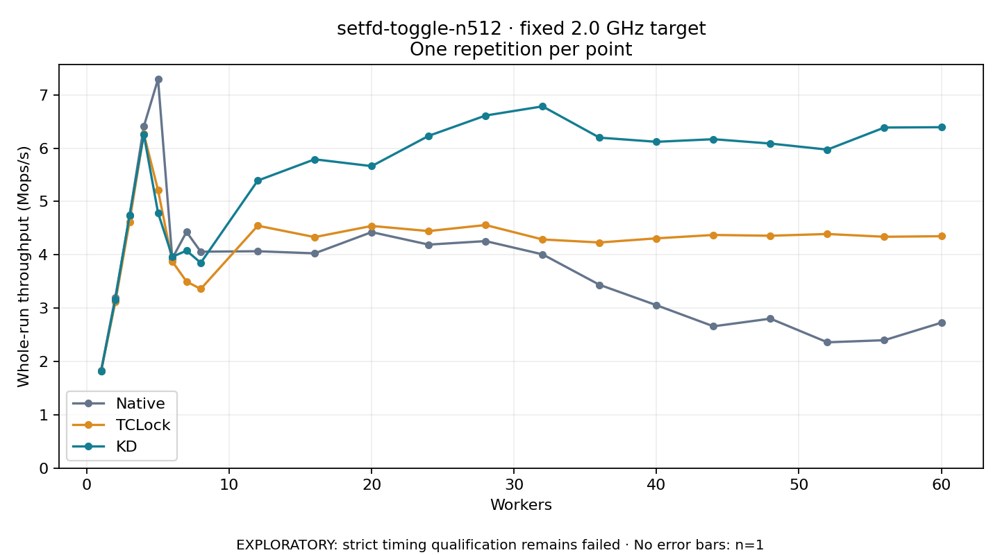

# setfd-toggle-n512 · fixed 2.0 GHz target

One timed round per point. **EXPLORATORY: strict timing qualification remains failed.** Failed/unrun points have no rate; one round supplies no repeat-variability estimate.

| Workers | Native Mops/s | TCLock Mops/s | KD Mops/s | KD / Native | KD / TCLock | KD execution |
|---:|---:|---:|---:|---:|---:|:---|
| 1 | 1.829 | 1.818 | 1.814 | 0.991× | 0.998× | NO_JIT |
| 2 | 3.204 | 3.114 | 3.165 | 0.988× | 1.016× | NO_JIT |
| 3 | 4.729 | 4.622 | 4.743 | 1.003× | 1.026× | NO_JIT |
| 4 | 6.406 | 6.271 | 6.259 | 0.977× | 0.998× | NO_JIT |
| 5 | 7.296 | 5.213 | 4.789 | 0.656× | 0.919× | NO_JIT |
| 6 | 3.932 | 3.876 | 3.964 | 1.008× | 1.023× | NO_JIT |
| 7 | 4.430 | 3.499 | 4.079 | 0.921× | 1.166× | NO_JIT |
| 8 | 4.059 | 3.361 | 3.851 | 0.949× | 1.146× | RETURNED_JIT |
| 12 | 4.068 | 4.547 | 5.393 | 1.326× | 1.186× | RETURNED_JIT |
| 16 | 4.028 | 4.333 | 5.792 | 1.438× | 1.337× | RETURNED_JIT |
| 20 | 4.426 | 4.542 | 5.664 | 1.280× | 1.247× | RETURNED_JIT |
| 24 | 4.192 | 4.446 | 6.232 | 1.487× | 1.402× | RETURNED_JIT |
| 28 | 4.258 | 4.559 | 6.613 | 1.553× | 1.450× | RETURNED_JIT |
| 32 | 4.009 | 4.289 | 6.785 | 1.692× | 1.582× | RETURNED_JIT |
| 36 | 3.438 | 4.232 | 6.198 | 1.803× | 1.465× | RETURNED_JIT |
| 40 | 3.055 | 4.310 | 6.120 | 2.003× | 1.420× | RETURNED_JIT |
| 44 | 2.660 | 4.373 | 6.169 | 2.320× | 1.411× | RETURNED_JIT |
| 48 | 2.803 | 4.358 | 6.088 | 2.172× | 1.397× | RETURNED_JIT |
| 52 | 2.360 | 4.391 | 5.974 | 2.532× | 1.361× | RETURNED_JIT |
| 56 | 2.399 | 4.339 | 6.388 | 2.662× | 1.472× | RETURNED_JIT |
| 60 | 2.727 | 4.349 | 6.394 | 2.345× | 1.470× | RETURNED_JIT |

[Full-precision table](table.csv)

Frozen source: `a9aeb280a68242818aa469d8277e0c5a22fffee1`. [Archive hashes, frozen-validator replay and exact lifecycle checks](audit.json). Measured points: **63**; failed: **0**; unrun: **0**. Failed/unrun points have no throughput value. The full raw archive remains the primary receipt; compact JSON copies stay under the raw audit path.

Whole-run throughput is completed operations divided by the recorded wall interval; peak rates use the frozen full-cohort progress-window validator. Reciprocal throughput is an aggregate service interval, not operation latency. Returned completion share counts eligible writer operations (snapshot reads for the extracted snapshot cases). NO_JIT points are local execution evidence. One observation cannot establish statistical superiority.

Frequency readbacks are bound before/after this workload. Fixed frequency does not repair the separately failed strict host task-membership gate. Exact output checks and drain validate the retained execution; offline replay does not rerun kernel bodies or syscalls.

Frozen score-ineligible observations, if any, retain their separately labeled raw rate in the CSV and are excluded from the ordinary chart and ratios. Valid NO_JIT observations remain plotted.
