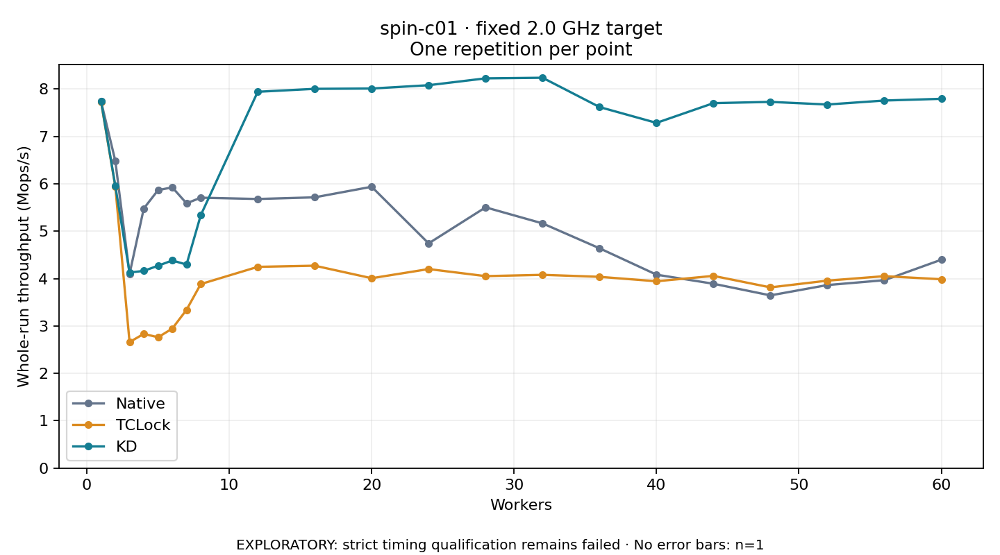

# spin-c01 · fixed 2.0 GHz target

One timed round per point. **EXPLORATORY: strict timing qualification remains failed.** Failed/unrun points have no rate; one round supplies no repeat-variability estimate.

| Workers | Native Mops/s | TCLock Mops/s | KD Mops/s | KD / Native | KD / TCLock | KD execution |
|---:|---:|---:|---:|---:|---:|:---|
| 1 | 7.739 | 7.728 | 7.745 | 1.001× | 1.002× | NO_JIT |
| 2 | 6.486 | 5.944 | 5.956 | 0.918× | 1.002× | NO_JIT |
| 3 | 4.099 | 2.660 | 4.129 | 1.007× | 1.552× | NO_JIT |
| 4 | 5.481 | 2.834 | 4.163 | 0.760× | 1.469× | NO_JIT |
| 5 | 5.868 | 2.761 | 4.272 | 0.728× | 1.547× | NO_JIT |
| 6 | 5.927 | 2.946 | 4.383 | 0.740× | 1.488× | NO_JIT |
| 7 | 5.589 | 3.341 | 4.297 | 0.769× | 1.286× | NO_JIT |
| 8 | 5.709 | 3.885 | 5.339 | 0.935× | 1.374× | RETURNED_JIT |
| 12 | 5.681 | 4.249 | 7.944 | 1.398× | 1.870× | RETURNED_JIT |
| 16 | 5.716 | 4.273 | 8.007 | 1.401× | 1.874× | RETURNED_JIT |
| 20 | 5.939 | 4.009 | 8.013 | 1.349× | 1.999× | RETURNED_JIT |
| 24 | 4.744 | 4.202 | 8.083 | 1.704× | 1.924× | RETURNED_JIT |
| 28 | 5.505 | 4.053 | 8.228 | 1.495× | 2.030× | RETURNED_JIT |
| 32 | 5.166 | 4.081 | 8.241 | 1.595× | 2.020× | RETURNED_JIT |
| 36 | 4.640 | 4.038 | 7.622 | 1.642× | 1.888× | RETURNED_JIT |
| 40 | 4.084 | 3.944 | 7.288 | 1.785× | 1.848× | RETURNED_JIT |
| 44 | 3.892 | 4.058 | 7.705 | 1.980× | 1.899× | RETURNED_JIT |
| 48 | 3.646 | 3.815 | 7.731 | 2.120× | 2.026× | RETURNED_JIT |
| 52 | 3.864 | 3.958 | 7.676 | 1.986× | 1.940× | RETURNED_JIT |
| 56 | 3.966 | 4.052 | 7.760 | 1.956× | 1.915× | RETURNED_JIT |
| 60 | 4.399 | 3.987 | 7.796 | 1.772× | 1.955× | RETURNED_JIT |

[Full-precision table](table.csv)

Frozen source: `a9aeb280a68242818aa469d8277e0c5a22fffee1`. [Archive hashes, frozen-validator replay and exact lifecycle checks](audit.json). Measured points: **63**; failed: **0**; unrun: **0**. Failed/unrun points have no throughput value. The full raw archive remains the primary receipt; compact JSON copies stay under the raw audit path.

Whole-run throughput is completed operations divided by the recorded wall interval; peak rates use the frozen full-cohort progress-window validator. Reciprocal throughput is an aggregate service interval, not operation latency. Returned completion share counts eligible writer operations (snapshot reads for the extracted snapshot cases). NO_JIT points are local execution evidence. One observation cannot establish statistical superiority.

Frequency readbacks are bound before/after this workload. Fixed frequency does not repair the separately failed strict host task-membership gate. Exact output checks and drain validate the retained execution; offline replay does not rerun kernel bodies or syscalls.

Frozen score-ineligible observations, if any, retain their separately labeled raw rate in the CSV and are excluded from the ordinary chart and ratios. Valid NO_JIT observations remain plotted.
