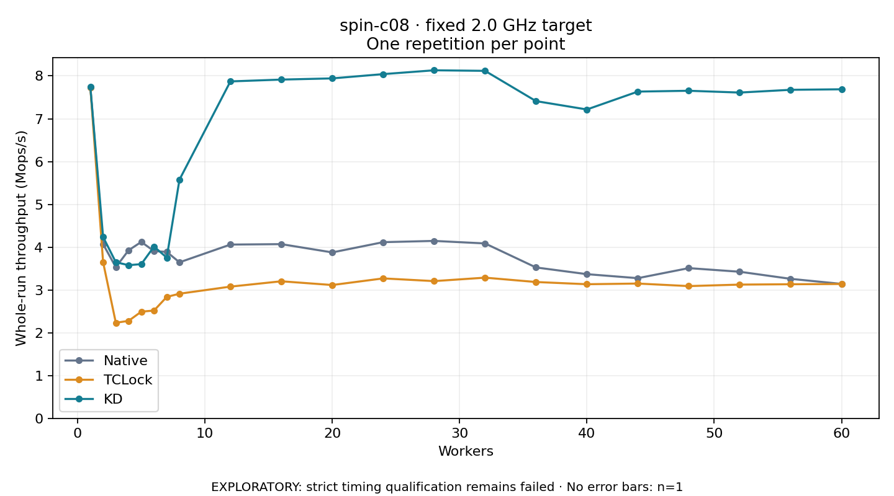

# spin-c08 · fixed 2.0 GHz target

One timed round per point. **EXPLORATORY: strict timing qualification remains failed.** Failed/unrun points have no rate; one round supplies no repeat-variability estimate.

| Workers | Native Mops/s | TCLock Mops/s | KD Mops/s | KD / Native | KD / TCLock | KD execution |
|---:|---:|---:|---:|---:|---:|:---|
| 1 | 7.738 | 7.738 | 7.744 | 1.001× | 1.001× | NO_JIT |
| 2 | 4.071 | 3.652 | 4.238 | 1.041× | 1.160× | NO_JIT |
| 3 | 3.531 | 2.233 | 3.648 | 1.033× | 1.634× | NO_JIT |
| 4 | 3.926 | 2.277 | 3.579 | 0.912× | 1.571× | NO_JIT |
| 5 | 4.122 | 2.493 | 3.603 | 0.874× | 1.445× | NO_JIT |
| 6 | 3.907 | 2.519 | 4.014 | 1.027× | 1.594× | NO_JIT |
| 7 | 3.889 | 2.837 | 3.755 | 0.965× | 1.324× | NO_JIT |
| 8 | 3.645 | 2.912 | 5.578 | 1.530× | 1.915× | RETURNED_JIT |
| 12 | 4.060 | 3.078 | 7.872 | 1.939× | 2.558× | RETURNED_JIT |
| 16 | 4.070 | 3.202 | 7.915 | 1.945× | 2.471× | RETURNED_JIT |
| 20 | 3.877 | 3.115 | 7.943 | 2.049× | 2.550× | RETURNED_JIT |
| 24 | 4.116 | 3.270 | 8.043 | 1.954× | 2.460× | RETURNED_JIT |
| 28 | 4.146 | 3.206 | 8.132 | 1.962× | 2.536× | RETURNED_JIT |
| 32 | 4.087 | 3.287 | 8.119 | 1.987× | 2.470× | RETURNED_JIT |
| 36 | 3.526 | 3.185 | 7.412 | 2.102× | 2.327× | RETURNED_JIT |
| 40 | 3.369 | 3.134 | 7.216 | 2.142× | 2.303× | RETURNED_JIT |
| 44 | 3.275 | 3.149 | 7.634 | 2.331× | 2.424× | RETURNED_JIT |
| 48 | 3.510 | 3.090 | 7.654 | 2.181× | 2.477× | RETURNED_JIT |
| 52 | 3.425 | 3.125 | 7.612 | 2.222× | 2.436× | RETURNED_JIT |
| 56 | 3.260 | 3.133 | 7.676 | 2.355× | 2.450× | RETURNED_JIT |
| 60 | 3.141 | 3.139 | 7.688 | 2.447× | 2.449× | RETURNED_JIT |

[Full-precision table](table.csv)

Frozen source: `a9aeb280a68242818aa469d8277e0c5a22fffee1`. [Archive hashes, frozen-validator replay and exact lifecycle checks](audit.json). Measured points: **63**; failed: **0**; unrun: **0**. Failed/unrun points have no throughput value. The full raw archive remains the primary receipt; compact JSON copies stay under the raw audit path.

Whole-run throughput is completed operations divided by the recorded wall interval; peak rates use the frozen full-cohort progress-window validator. Reciprocal throughput is an aggregate service interval, not operation latency. Returned completion share counts eligible writer operations (snapshot reads for the extracted snapshot cases). NO_JIT points are local execution evidence. One observation cannot establish statistical superiority.

Frequency readbacks are bound before/after this workload. Fixed frequency does not repair the separately failed strict host task-membership gate. Exact output checks and drain validate the retained execution; offline replay does not rerun kernel bodies or syscalls.

Frozen score-ineligible observations, if any, retain their separately labeled raw rate in the CSV and are excluded from the ordinary chart and ratios. Valid NO_JIT observations remain plotted.
